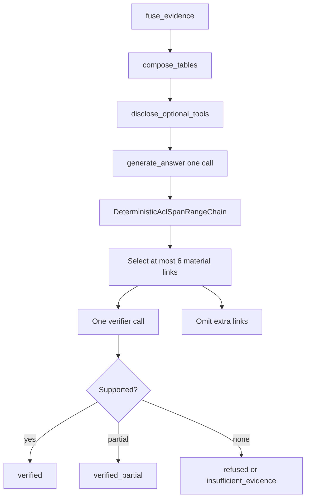

# Answer verification

Packet 3 generates **one** answer from canonical Supabase passages and
deterministic table values, then verifies citations in two layers.
Unsupported links are omitted or refused. They are never softened into
uncited claims. SSE and the public chat UI remain later packets.

Related: [COMBINED_FUSION.md](./COMBINED_FUSION.md) ·
[QUERY_ROUTING.md](./QUERY_ROUTING.md) ·
[QUERY_BUDGETS.md](./QUERY_BUDGETS.md) ·
[OPTIONAL_TOOLS.md](./OPTIONAL_TOOLS.md) ·
[phase-06 evidence](../development/phase-06-agent-intelligence-evidence.md) ·
[docs index](../README.md)

## Evidence the answer may use

- Canonical Hybrid/Combined `EvidenceUnit` / `ScoredPassage` citation text
  and locators.
- StructuredTable sandbox results with exact cell or range provenance.
- Not native graph prose, BM25 snippets, unresolved paths, or numbers the
  model calculates from prose.

Source records are delimited as `<<untrusted-source>>`. Embedded
instructions stay inside the record.

## Multi-hop citations

Each atomic link cites at least one canonical passage or table range.
The composed conclusion is labeled `inference`. Wording is no stronger
than the supported path. The conclusion need not appear verbatim in one
passage. A chain whose every link is supported remains an inference.

## Layered verify

1. Deterministic checks: current source/version/ACL, citation-span or
   table-range alignment, inference-chain completeness.
2. One separately budgeted small-model call covering at most **six**
   material atomic links. Lower-priority claims are omitted. A seventh
   link does not trigger another call.
3. Deadline or step exhaustion emits terminal `verified_partial` or
   `insufficient_evidence`. It is not fake success.

Counted usage kinds are `answer` and `verifier` via
`execute_counted_model_call`. Keyword extract, catalog LLM, and LightRAG
`answer_generate` stay 0.

Prompt versions: `answer_v1` and `verifier_v1` under
`apps/agents/src/smart_rag_agents/prompts/`. Hashes are LF-normalized
SHA-256 in `smart_rag_core.query_answer.versions`.

## Graph nodes

After `apply_correction`:

`fuse_evidence` → `compose_tables` → `disclose_optional_tools` →
`generate_answer` → `verify_answer` → END.

Compile still constructs no sockets or OpenAI clients. Mock mode works
without network.

