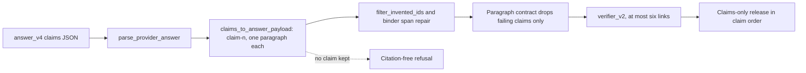
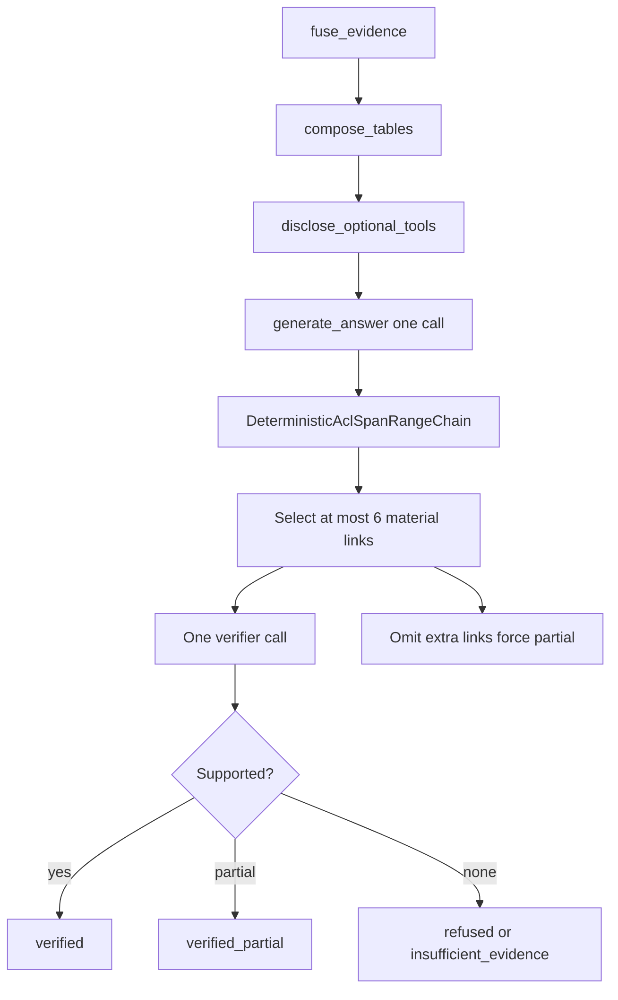
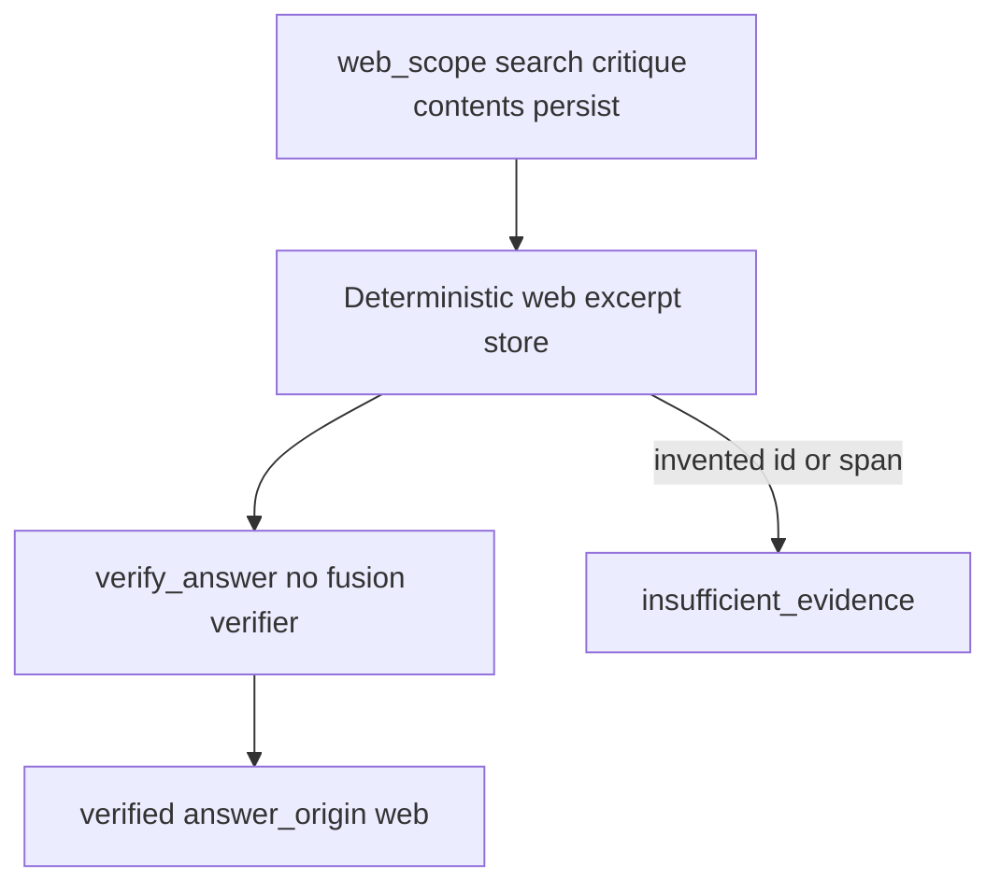

# Answer verification

Packet 3 generates **one** answer from canonical Supabase passages and
deterministic table values, then verifies citations in two layers.
Unsupported links are omitted or refused. They are never softened into
uncited claims. SSE and the public chat UI remain later packets.

Related: [COMBINED_FUSION.md](./COMBINED_FUSION.md) ·
[QUERY_ROUTING.md](./QUERY_ROUTING.md) ·
[QUERY_BUDGETS.md](./QUERY_BUDGETS.md) ·
[OPTIONAL_TOOLS.md](./OPTIONAL_TOOLS.md) ·
[phase-06 evidence](../development/phase-06-agent-intelligence-evidence.md) ·
[docs index](../README.md)

## Evidence the answer may use

- Canonical Hybrid/Combined `EvidenceUnit` / `ScoredPassage` citation text
  and locators.
- StructuredTable sandbox results with exact cell or range provenance.
- Run-scoped `app.web_sources` excerpts on the Web path only. Spans must
  be exact substrings of the persisted excerpt. Invented `web_source_id`
  values are dropped. Company `citations` stay empty on Web answers.
- Not native graph prose, BM25 snippets, unresolved paths, or numbers the
  model calculates from prose.

Source records are delimited as `<<untrusted-source>>`. Embedded
instructions stay inside the record. Company answers fit whole records
under the existing `MODEL_INPUT_MAX_CHARS` bound (32,768) with
`fit_source_records`. Later exact normalized duplicates drop. Passages
are never truncated to fill leftover bytes. Overflow after fitting is
`input_bound_exceeded` with a non-empty refusal. Dropped IDs cannot be
cited. Company answer plus verifier reserve two model calls and eight
seconds; optional profile/retrieve spends must not consume that reserve.

## Multi-hop citations

Each atomic link cites at least one canonical passage or table range.
The composed conclusion is labeled `inference`. Wording is no stronger
than the supported path. The conclusion need not appear verbatim in one
passage. A chain whose every link is supported remains an inference.

## answer_v4 claims contract

`answer_v4` (Fixes 1 and 3 in
[ADR-retrieved-answer-loss-repair.md](../adr/ADR-retrieved-answer-loss-repair.md))
asks the model for an ordered list of at most six claims. Each claim
has `text`, `kind` (`fact` or `inference_link`), and one or two
citations of `{source_id, span, source_ranges}`. The model does not
write link IDs, paragraph indices, citation ownership, or
`answer_text`. The strict schema (`answer_claims_json_schema`) is the
same for every request so the provider can reuse its processed form.
`source_id` is a plain string that application code checks.

`parse_provider_answer` in `smart_rag_core.query_answer.claims` maps
the output with `claims_to_answer_payload`:

- Claim *n* (1-based) gets link ID `claim-n`, its own paragraph, and
  `priority` equal to its paragraph index, so the release keeps claim
  order.
- A citation whose `source_id` was not sent in the request is
  dropped. Passage spans are clipped to 1,000 characters. Table
  citations keep only ranges present on the table record, else all of
  the record's ranges.
- A claim is dropped on its own, and `claim-n` is added to
  `refused_links`, when it is past the sixth, has blank or oversized
  text, or keeps no citation. A provider `refused` status keeps no
  claims. No kept claim means status `refused`.
- A conclusion survives only when every listed claim was kept.

Every paragraph holds exactly one link, so the paragraph contract,
`verifier_v2`, and the claims-only release drop a failing claim
without touching the others. Output that is not valid JSON, or a
`claims` value of the wrong type, is still `answer_schema_invalid`.
Payloads without a `claims` key parse as `AnswerPayload`; the offline
mock gateway and recorded fixtures use that shape.

## Layered verify

1. Deterministic checks: current source/version/ACL, citation-span or
   table-range alignment, inference-chain completeness.
2. One separately budgeted small-model call covering at most **six**
   material atomic links. Lower-priority claims are omitted. A seventh
   link does not trigger another call. When omitted IDs exist, answer
   status is forced `partial` and SSE surfaces `verifier_omitted_links`.
   Status must not remain `complete`.
3. Deadline or step exhaustion before an answer exists emits terminal
   `verified_partial` or `insufficient_evidence`. It is not fake success.
   When the deterministic checks already passed and only the verifier
   call times out or fails, the terminal is `verified_partial` with
   detail `verifier_skipped:<reason>`. Citations still persist. SSE emits
   limitation `verifier_skipped` and does not emit `deadline`. `deadline`
   stays reserved for runs that produced no answer.
4. `verified` requires a non-null model gateway. Unbound gateway or
   unbound Hybrid on a retrieval route is `verified_partial` or
   `insufficient_evidence`, never `verified`. Citations with
   `chunk_id is None` are dropped unless `table_id` is in allowed table
   IDs.

Counted usage kinds are `answer` and `verifier` via
`execute_counted_model_call`, plus retrieve-time `embedding`, `rerank`,
and LightRAG consume against the same reservation. Keyword extract,
catalog LLM, and LightRAG `answer_generate` stay 0.

Empty `citation_text` cannot pass deterministic `complete`. Graph locators
load canonical `raw_text` through `fetch_authorized_chunk_context`; empty
text is dropped. Company `answer_v2` passage citations require an exact
1–1000 character span contained in canonical text. Empty spans are
legacy whole-passage only when paragraph mappings are not required.

Prompt versions: `answer_v4` (current), `answer_v3`, `answer_v2`, and
`answer_v1` (historical), `verifier_v2` (current), `verifier_v1` (historical),
`web_critique_v1`, and `web_answer_v1` under
`apps/agents/src/smart_rag_agents/prompts/`. Company hashes are
LF-normalized SHA-256 in `smart_rag_core.query_answer.versions`. Before
deterministic paragraph mapping, company payloads bind omitted atomic
links from paragraphs (and omitted paragraphs from links) and replace
missing or non-substring spans with the first non-empty paragraph of
authorized `citation_text`. Blank-line collapses are not used because
they are not source substrings. Invented
span text is never persisted. Direct `deterministic_check_answer` still
fail-closes unaligned spans that skip that bind step. Live
company answers derive released `answer_text` from surviving atomic-link
claims, then a composed conclusion only when the complete chain
survived. Fusion passages are never backfilled as citations. Acronym
expansions and fact literals are fail-closed even when a mock verifier
marks a cited ID supported.

Company PDF chat chips use the typed toolbar page (`pdf_page_number` =
locator `page_index + 1`) and canonical `document_title`. Printed
`page_label` stays on locators and is not the displayed page. Persistence
resolves one leaf chunk that contains the exact span. Two matching
children, multi-page locators, or a missing span fail closed. HTTP
`evidence_excerpt` is disclosed only after live ACL and current-version
recheck. SSE `citation_preview` still carries IDs only. History listings
expose `run_id`, `citation_count`, and `source_kind` without excerpts.
One-citation `GET /runs/{run_id}/citations/{citation_id}` rechecks ACL or
HTTPS before returning a 1–1000 character excerpt.
Legacy rows with null `paragraph_index` stay in a footer. Evaluation
scores resolved leaf IDs and `pdf_page_number` versus gold
`page_number`, never `page_label`. The AI Agents fixture (viewer page 25,
printed 12) is deterministic proof. The global ≥98% citation target stays
unverified until an approved evaluation run.

## Graph nodes

After `apply_correction`:

Web: `web_scope` (search → critique → optional follow-ups → contents →
persist sources → draft) → `verify_answer` → END. Hold-until-verify:
`token_delta` is emitted only after verification.

Compile still constructs no sockets or OpenAI clients. Mock mode works
without network.

Replacing a near-quote claim with the full cited sentence was measured on
stored drafts and dropped: it did not clear the pass bar without breaking
current passes. Released claims stay the model's wording.

