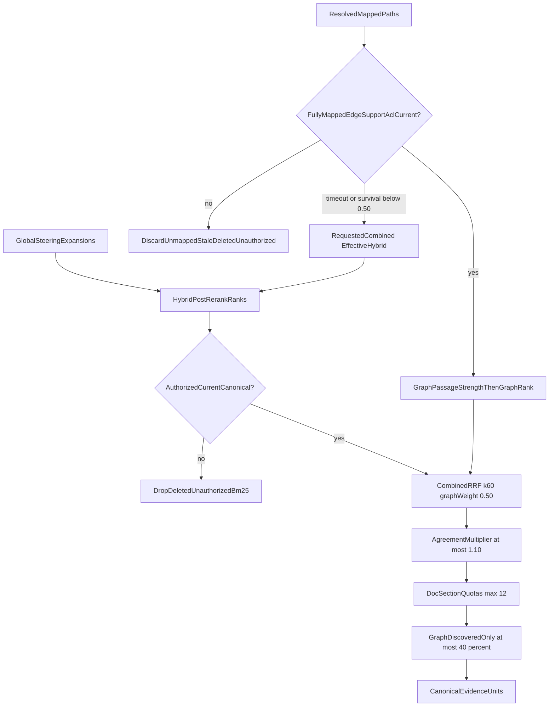

# Combined fusion

Packet 3 fuses Hybrid post-rerank ranks with **resolved** LightRAG paths.
Native graph prose, BM25 snippets, unresolved paths, and model-generated
weights never enter answer evidence. GlobalSteering expansions (at most
three) return through Hybrid and never receive a graph-evidence score.

Related: [ANSWER_VERIFICATION.md](./ANSWER_VERIFICATION.md) ·
[QUERY_ROUTING.md](./QUERY_ROUTING.md) ·
[PHASE6_HANDOFF.md](../graph/PHASE6_HANDOFF.md) ·
[PHASE5_GRAPH_EVAL.md](../evaluation/PHASE5_GRAPH_EVAL.md) ·
[phase-06 evidence](../development/phase-06-agent-intelligence-evidence.md) ·
[docs index](../README.md)

## Frozen constants

| Symbol | Value | Role |
| --- | --- | --- |
| Hop penalty | `0.25` | `path_support = min(edge) / (1 + 0.25 * (hops - 1))` |
| Edge-support multiplier cap | `1.20` | `min(1.20, 1 + 0.10 * (distinct_edges - 1))` |
| RRF `k` | `60` | Same Phase 4 Hybrid denominator |
| Graph weight | `0.50` | Constant. Never produced by a model |
| Agreement cap | `1.10` | Applied only when a passage ranks in **both** branches |
| Graph-discovered-only cap | `40%` | Share of final evidence units |
| Survival fallback | `0.50` | Combined with survival below this is effective Hybrid |
| Final evidence | `12` | Phase 4 `FINAL_EVIDENCE_MAX` |
| Per-document / section quota | `2` / `2` | Phase 4 Hybrid quotas |

Hops are at most three. Hybrid rank is post-rerank `hybrid_rank`, or the
narrow allowed RRF fallback rank when rerank was skipped.

## Scoring

```text
path_support =
  min(edge_support_confidence)
  / (1 + 0.25 * (hop_count - 1))

graph_passage_strength =
  max_over_paths(
    path_support
    * min(1.20, 1 + 0.10 * (distinct_supported_edges_in_passage - 1))
  )

combined_score(passage) =
    1.00 / (60 + hybrid_rank)
  + 0.50 / (60 + graph_rank)
```

An absent branch contributes zero. Rank canonical passages by
`graph_passage_strength` to obtain 1-based `graph_rank`. Then apply at most
the `1.10` agreement multiplier, frozen document/section quotas, and the
40% graph-discovered-only cap (lowest graph-only units drop first).

A graph-only answer is forbidden. If every remaining unit would be
graph-discovered-only, fusion fails closed rather than answering from
graph leads alone. Graph locators are not evidence until
`fetch_authorized_chunk_context` supplies non-empty canonical `raw_text`.
Empty citation text is dropped and cannot pass deterministic complete.

## Degrade

Rejected, unavailable, timed-out, cancelled, empty, or low-survival graph
keeps `requested_route=combined` (or `composite`) and sets
`effective_route=hybrid` with a typed reason (`graph_timeout`,
`graph_survival_below_threshold`, `graph_unavailable`, and the other
allow-listed codes). It never fabricates relationship evidence.

## Ablation

Development/qualification fixtures compare Hybrid-only, naive Hybrid-first
union, and resolved-path fusion. Fusion is retained only when it beats
union on path/answer success **and** citation completeness. Otherwise the
packet requires shipping union.

Packet 3 selected **resolved-path fusion** on synthetic authorized-ID
fixtures (12 Hybrid distractors plus late-ranked gold that also has
resolved graph support). Config hash
`6fadc2a7b98e47cc00c09590d8a6d196e2554fe3eb971052d058e08d0128164f`.
Live QT-EVAL-009 Combined +10pp over Hybrid on labeled
relationship/multi-hop cases remains **unverified**. Holdout labels were
not opened. First-token ≤10s and completion ≤35s p95 were not measured.

## Persistence

No new table. Fusion algorithm, config hash, ranks, scores, and
requested/effective route are stored on graph state and in
`app.citations.provenance` jsonb.


