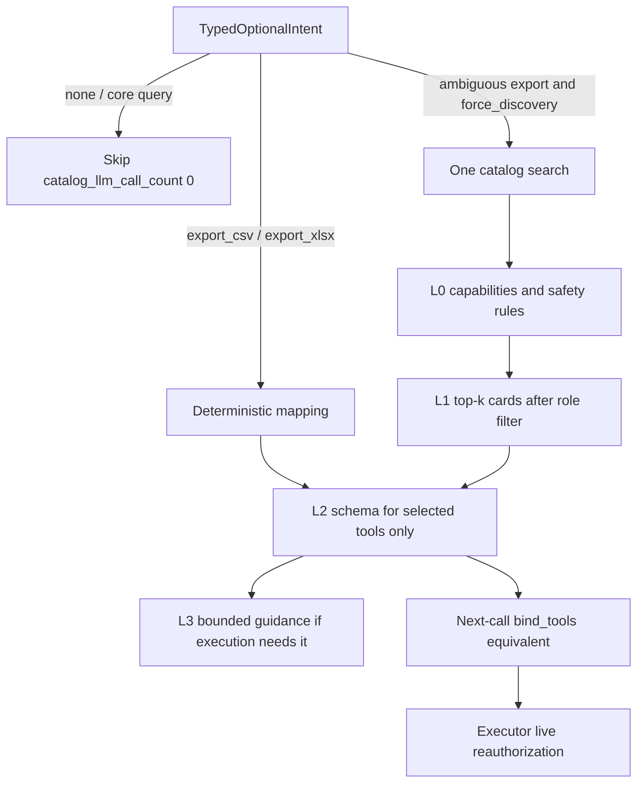
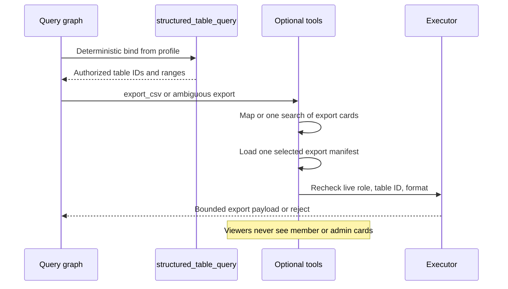

# Optional tools

Packet 4 adds a **versioned in-code allow-list** and progressive disclosure
for optional capabilities. Core Hybrid retrieve, LightRAG/graph retrieve,
`structured_table_query`, citation/source lookup, answer generation, and
verification stay **outside** catalog discovery and are bound
deterministically by packets 1–3.

Related: [ANSWER_VERIFICATION.md](./ANSWER_VERIFICATION.md) ·
[QUERY_ROUTING.md](./QUERY_ROUTING.md) ·
[QUERY_BUDGETS.md](./QUERY_BUDGETS.md) ·
[phase-06 evidence](../development/phase-06-agent-intelligence-evidence.md) ·
[docs index](../README.md)

## Runtime policy

The ≥20-tool comparison fixture measures selection accuracy, latency, and
token cost for catalog discovery versus deterministic mapping. Discovery
did **not** improve selection enough to justify the extra model round, so
v1 runtime uses **deterministic mapping**. Unjustified discovery retained
in runtime fails closed.

Catalog search remains implemented for genuinely ambiguous optional
intents (export format, administration, future connector) and for tests.
It is at most **one** round.

## Disclosure levels



- **L0:** `search_tool_catalog` / `load_tool_manifest` plus immutable
  safety rules. No catalog names.
- **L1:** Bounded top-5 of id, name, one-line purpose, risk class, and
  required role after live role/feature filtering. Hidden tools contribute
  neither names nor counts.
- **L2:** Full schema/examples/policy for at most three selected tools.
- **L3:** Bounded guidance only when execution needs it. Oversized
  guidance is rejected before prompt construction.

## Table plus export

`structured_table_query` is bound by the typed profile (packet 3). The
catalog may hold **export format** cards only. The executor rechecks table
IDs from composition, format, role, quotas, and idempotency.



## Next-call tool binding

Current LangChain docs describe dynamic selection as
`wrap_model_call` plus `request.override(tools=...)` on
`langchain.agents` middleware
(<https://docs.langchain.com/oss/python/langchain/tools#dynamic-tool-selection>).
The pinned stack is `langgraph==1.2.11` with transitive
`langchain-core==1.5.4` and **no** `langchain` agents package. The query
graph is a `StateGraph`, not `create_agent`.

The pin-compatible equivalent is
`bind_selected_tools_next_call` in
`smart_rag_agents.query.nodes.binding`: call `bind_tools(selected)` when
the chat model implements it, otherwise `Runnable.bind(tools=schemas)`.
Both return a **new** runnable for that invocation. The original model is
not mutated, so the following call does not receive unselected schemas.

## Executor

Planner output is not authority. The executor rechecks tool id/version,
live `CallerContext` / `AuthorizedRuntimeContext` role, arguments, quotas,
idempotency, side-effect class, and table IDs. A role change after
planning fails. A second side-effecting tool fails. Arbitrary MCP targets
are rejected; metadata import creates an inactive undiscoverable row and
cannot bind or execute a remote tool.

Ceilings (shared with packet 1): one discovery round, three optional
manifests, four tool executions (five Composite), one side-effecting tool.

## Telemetry

Discovery latency is recorded separately from retrieval. Counters are
tools searched/disclosed/loaded/called/rejected/useful on the **visible**
set only.

## Limits

| Limit | Value | Fail closed |
| --- | --- | --- |
| Catalog tools | ≥20 in `optional_tools_v1` (23 shipped) | Core retrieve/answer keys rejected |
| Discovery rounds | 1 | `discovery_exhausted` |
| Optional manifests | 3 | `manifest_exhausted` |
| Tool executions | 4, or 5 Composite (packet 1 remaining) | `tool_exhausted` |
| Side-effecting tools | 1 | `side_effect_exhausted` |
| L1 top-k | 5 visible cards | Hidden tools add no names/counts |
| L1 card | 256 bytes | `card_over_budget` |
| L2 manifest | 4096 bytes / 800 tokens | `manifest_over_budget` |
| L3 guidance | 2048 bytes / 400 tokens | `guidance_over_budget` |
| Model input | 8000 tokens | `model_input_over_budget` |
| Retrieval chunks in tool prompt | 12 | `chunk_over_budget` |
| Parent expansion | 4 | `parent_over_budget` |
| Conversation summary | 400 tokens | `summary_over_budget` |

## Failure modes

| Symptom | Cause | Response |
| --- | --- | --- |
| Core Hybrid query still has `catalog_llm_call_count=0` | Expected | Optional node skipped |
| Viewer export skipped with empty prompt | No export feature | Do not name member/admin tools |
| Role-change after plan | Planner role ≠ live `CallerContext` | `unauthorized` |
| Second side effect | Write/admin/remote already used | `side_effect_exhausted` |
| MCP URL or remote bind | Arbitrary server | `mcp_target_rejected` |
| Unjustified discovery in runtime | Policy is mapping | `unjustified_discovery_retained` |
| Fourth manifest | Ceiling 3 | `manifest_exhausted` |

## Security

- Planner output is not authority. The executor rechecks live role from
  `CallerContext` / `AuthorizedRuntimeContext`.
- Unauthorized catalog entries must not leak names or counts.
- Metadata import of MCP descriptors cannot authorize or bind a remote tool.
- `smart_rag_core.tools` must not import LangGraph or LangChain.

## Troubleshooting

- If `bind_tools` raises `NotImplementedError` on a chat model, the wrapper
  uses `Runnable.bind(tools=...)`. The original model stays unbound.
- If graph import hits a circular import through `gateways.model`, model
  exports on `smart_rag_core.gateways` are lazy (packet 4 hygiene).
- Discovery is implemented for tests (`force_discovery`) but is not the
  v1 runtime policy.

## Verification

```powershell
uv run python -m pytest tests/unit/test_optional_tools.py tests/unit/test_optional_tools_discovery.py tests/contract/test_langgraph_config.py tests/unit/test_package_imports.py tests/contract/test_import_boundaries.py -q
```
