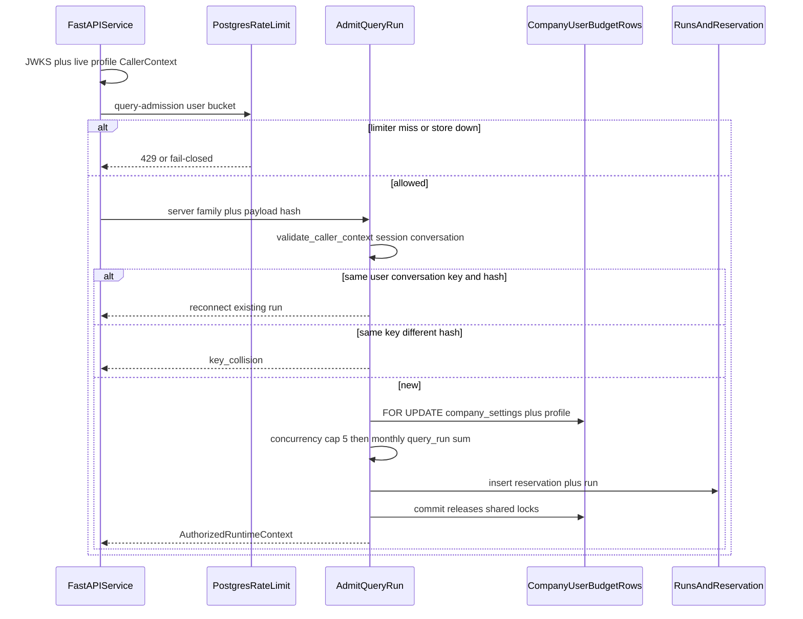
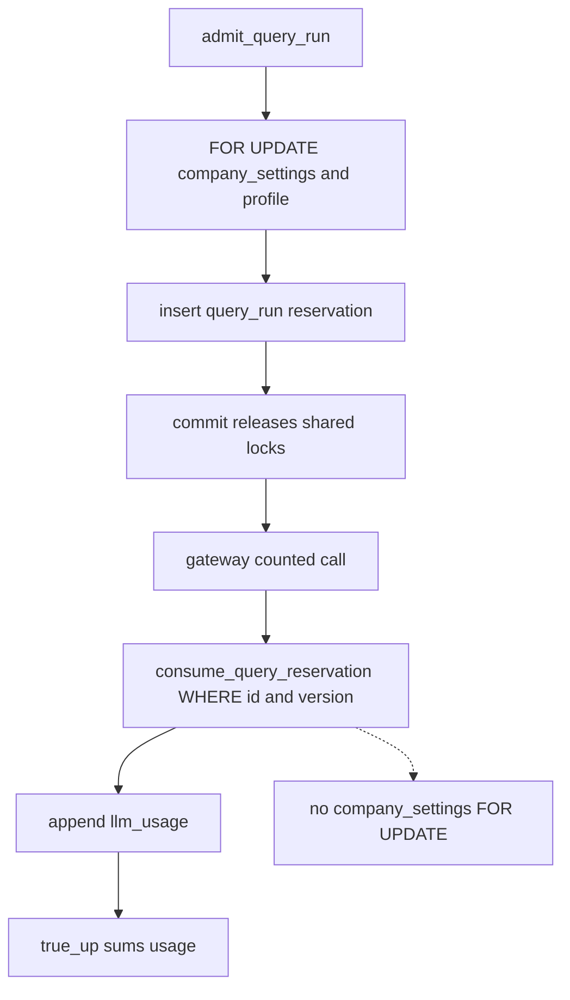

# Query run admission

Packet 1 admits one authenticated query run, reserves the server-owned route
envelope once, and hands FastAPI/core a typed `AuthorizedRuntimeContext`.
Packet 2 owns preparation, the route matrix, and one correction
([QUERY_ROUTING.md](./QUERY_ROUTING.md)). Packet 3 owns Combined fusion,
one answer, and the verifier
([COMBINED_FUSION.md](./COMBINED_FUSION.md),
[ANSWER_VERIFICATION.md](./ANSWER_VERIFICATION.md)).
SSE and the public chat router remain later packets. `/health/ready` stays
`unconfigured`.

Client JWT role, client USD, Valkey, cache, BM25, and graph output never
authorize, enlarge a budget, or bypass canonical Postgres checks.

## Admit sequence

Sending is creator-only. Owner/admin audit listing of conversations does not
create runs on another user's thread. Monthly query spend is the company-wide
sum of reserved+committed `query_run` rows versus the caller's effective cap.

## Consume versus shared locks

Heartbeat and expiry reconciliation perform the same idempotent true-up.
They are not the packet 7 idempotency/event reaper.

## LangGraph node

`enforce_admission` requires `AuthorizedRuntimeContext`. Missing or invalid
context sets `status=admission_rejected` and ends. Present context copies
ceilings into state and continues. The node does not retrieve or answer.

LangGraph Studio `query_studio` seeds a synthetic context with
`status=studio_local` from `envelope_for_family`. That seed is not
`admit_query_run`, writes no reservation, and must not be used as a
production bypass. See [LANGGRAPH_STUDIO.md](../development/LANGGRAPH_STUDIO.md).

## FastAPI slice

`admit_query_run_for_caller` applies FastAPI-owned `COST_MUTATION` limits
(Valkey when configured, else Postgres `private.consume_auth_rate_limit`,
bucket `query-admission:{user_id}`) before cost. Dual Valkey+Postgres
failure returns limiter unavailable and inserts no reservation. FastAPI does
not throttle hosted Supabase Auth.

`POST /conversations/{id}/messages` admits Auto chat as
`Phase6RouteFamily.COMPOSITE` after the `X-Client-Version` handshake.
JSON Accept returns `{run_id, stream_path, requested_search_scope}` where
`stream_path` is `/runs/{run_id}/events`. `Accept: text/event-stream`
streams immediately. See [SSE.md](../api/SSE.md). Public `GET /health/ready`
never sets `query_ready` in mock mode. A stale `rate_limit_degraded` latch
also clears `query_ready` until Valkey recovers; readiness probes and a later
successful limits `INCR` clear that latch. Named ParadeDB/Valkey/LightRAG
probes stay on authenticated `GET /ops/ready`.

The request body may include `search_scope` (`auto` default). Responses and
durable run rows echo `requested_search_scope`. Scope is hashed into the
idempotency payload unless it is `auto`, so an old Auto retry keeps the
legacy hash. Same key plus a different scope is `key_collision`. Reconnect
and `GET /runs/{run_id}` reload the stored value and never mutate it.
`app.admit_query_run_v2`, `app.load_query_run_runtime_v2`, and
`app.get_query_run_v2` wrap the previous RPCs. Old signatures stay callable.

See [FASTAPI_SECURITY.md](../api/FASTAPI_SECURITY.md).

## Related

- [QUERY_BUDGETS.md](./QUERY_BUDGETS.md)
- [QUALITY_TARGETS.md](../QUALITY_TARGETS.md)
- [LANGGRAPH_STUDIO.md](../development/LANGGRAPH_STUDIO.md)
- [AUDIT_CHAIN.md](../security/AUDIT_CHAIN.md)
- [AUTH_RATE_LIMIT_OWNERSHIP.md](../security/AUTH_RATE_LIMIT_OWNERSHIP.md)
- [FASTAPI_SECURITY.md](../api/FASTAPI_SECURITY.md)
- [SSE.md](../api/SSE.md)
- [MEMORY_DELETION.md](./MEMORY_DELETION.md)
- [phase-06-agent-intelligence-evidence.md](../development/phase-06-agent-intelligence-evidence.md)
