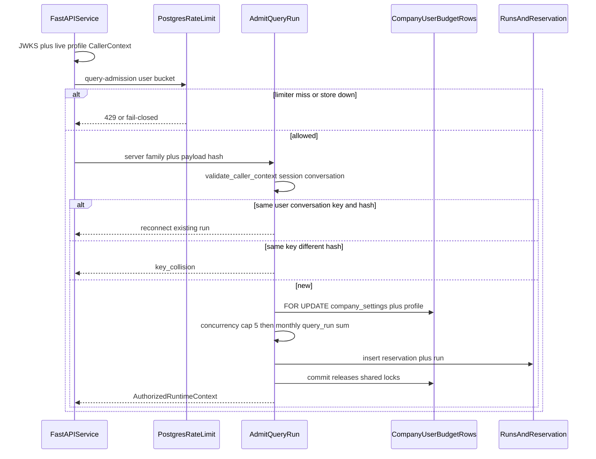

# Query run admission

Packet 1 admits one authenticated query run, reserves the server-owned route
envelope once, and hands FastAPI/core a typed `AuthorizedRuntimeContext`.
Profiling, retrieval, answering, SSE, and the public chat router are later
packets. `/health/ready` stays `unconfigured`.

Client JWT role, client USD, Valkey, cache, BM25, and graph output never
authorize, enlarge a budget, or bypass canonical Postgres checks.

## Admit sequence



Sending is creator-only. Owner/admin audit listing of conversations does not
create runs on another user's thread. Monthly query spend is the company-wide
sum of reserved+committed `query_run` rows versus the caller's effective cap.

## Consume versus shared locks

```mermaid
flowchart TD
  admit["admit_query_run"] --> lockShared["FOR UPDATE company_settings and profile"]
  lockShared --> insertRes["insert query_run reservation"]
  insertRes --> commit["commit releases shared locks"]
  commit --> call["gateway counted call"]
  call --> consume["consume_query_reservation WHERE id and version"]
  consume --> usage["append llm_usage"]
  usage --> trueUp["true_up sums usage"]
  consume -.-> noShared["no company_settings FOR UPDATE"]
```

Heartbeat and expiry reconciliation perform the same idempotent true-up.
They are not the packet 7 idempotency/event reaper.

## LangGraph node

`enforce_admission` requires `AuthorizedRuntimeContext`. Missing or invalid
context sets `status=admission_rejected` and ends. Present context copies
ceilings into state and ends. The node does not retrieve or answer.

## FastAPI slice

`admit_query_run_for_caller` applies the Postgres degraded limiter
(`private.consume_auth_rate_limit`) with bucket `query-admission:{user_id}`
before cost. Packet 1 does not throttle hosted Supabase Auth and does not
add a public streaming chat endpoint. Packet 5 owns router breadth and
provider-versus-FastAPI Auth ownership.

Rate-limit and limiter-unavailable failures insert no reservation.
Concurrency is the durable five-run SQL cap (`QT-CAP-004`), not Valkey.

## Related

- [QUERY_BUDGETS.md](./QUERY_BUDGETS.md)
- [QUALITY_TARGETS.md](../QUALITY_TARGETS.md)
- [AUDIT_CHAIN.md](../security/AUDIT_CHAIN.md)
- [AUTH_RATE_LIMIT_OWNERSHIP.md](../security/AUTH_RATE_LIMIT_OWNERSHIP.md)
- [phase-06-agent-intelligence-evidence.md](../development/phase-06-agent-intelligence-evidence.md)
