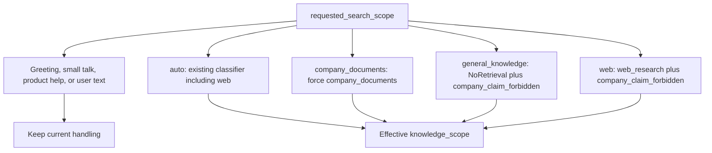
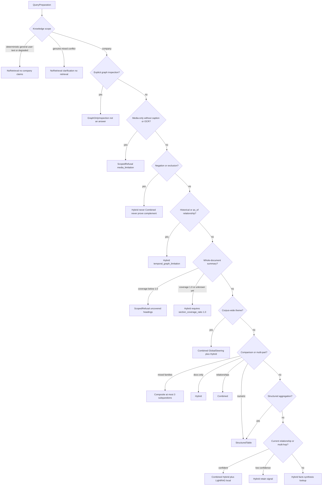
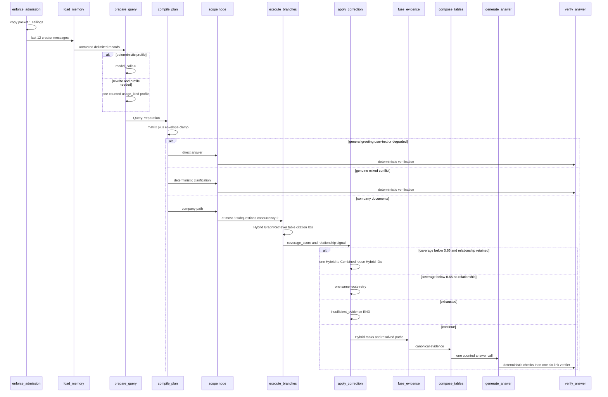

# Query routing

Packet 2 prepares one typed query, compiles the deterministic route and
limitation matrix, executes bounded retrieval branches, and applies at most
one global correction. Packet 3 fuses resolved paths, composes tables,
generates one answer, and verifies citations
([COMBINED_FUSION.md](./COMBINED_FUSION.md),
[ANSWER_VERIFICATION.md](./ANSWER_VERIFICATION.md)).
Packet 4 discloses optional tools after tables
([OPTIONAL_TOOLS.md](./OPTIONAL_TOOLS.md)).

Packet 1 `admit_query_run` reserves a **route envelope** before profiling.
The client route is not authorization. Normal Auto chat should reserve the
widest family the run might need (`composite`: 50s / 9 calls / 5 tools) so
profiling can select Hybrid/Combined without enlarging spend. Diagnostic
surfaces may reserve a specific family. The planner **never exceeds** the
remaining packet 1 ceilings. Effective route may be cheaper than the
reserved envelope. Persist `requested_route` vs `effective_route` vs
`corrected_route` on graph state.

Related: [QUERY_ADMISSION.md](./QUERY_ADMISSION.md) ·
[QUERY_BUDGETS.md](./QUERY_BUDGETS.md) ·
[COMBINED_FUSION.md](./COMBINED_FUSION.md) ·
[ANSWER_VERIFICATION.md](./ANSWER_VERIFICATION.md) ·
[PHASE6_HANDOFF.md](../graph/PHASE6_HANDOFF.md) ·
[ADR-general-chat-strict-split.md](../adr/ADR-general-chat-strict-split.md) ·
[SSE.md](../api/SSE.md) ·
[docs index](../README.md)

## Strict-split knowledge scope

Every preparation records `knowledge_scope` before the route matrix.
Company/document signals always win. Genuine company/general conflict is
`ambiguous` and never retrieves. Profile unavailable, malformed, or below the
scope-confidence threshold records a server-derived degradation reason and
uses a company-claim-forbidden general path that explicitly says company
documents were not searched. World knowledge is allowed only on
`general_knowledge` and `user_supplied_text`. Company routes never fall back to
world knowledge when evidence is missing; they refuse.

| Scope | Effective family | Model | Citations / `answer_origin` |
| --- | --- | --- | --- |
| `deterministic` | `NoRetrieval` / `general_model` | one `usage_kind=answer` | none / `general_knowledge` |
| `general_knowledge` | `NoRetrieval` / `general_model` | one `usage_kind=answer` | none / `general_knowledge` |
| `user_supplied_text` | `NoRetrieval` / `user_text_model` | one `usage_kind=answer` | none / `user_supplied_text` |
| `ambiguous` | `NoRetrieval` / `clarification` | 0 | none / `ambiguous` |
| `company_documents` | Hybrid / Combined / table / inspection as before | existing RAG | cited or refusal / `company_documents` |
| `web` | `web_research` | Bounded Exa search/contents plus crawl-proxy fallback | web citations / `web` |

### Requested search scope

`requested_search_scope` is a client **source preference** fixed at admission.
It is not authorization, not `route_family`, and not effective
`knowledge_scope`. Values: `auto`, `company_documents`, `general_knowledge`,
`web`. Omitted requests stay Auto. Exactly one source is selected; company
and web never blend. Company-insufficient evidence never falls back to web
or general. Ask labels are Auto, Company documents, General, and Web.
New chats default Auto. Web is hidden unless `/api/meta`
`web_search_enabled` is true.

Precedence after classification:

1. Pure greetings, small talk, product-help, and user-text transforms keep
   their current handling even when Company documents is selected.
2. Other substantive prompts with `company_documents` force
   `KnowledgeScope.COMPANY_DOCUMENTS` and the existing company matrix.
3. Other substantive prompts with `general_knowledge` force
   `KnowledgeScope.GENERAL_KNOWLEDGE`, one NoRetrieval branch, and
   `company_claim_forbidden=True`.
4. `auto` keeps the classifier, including degradation reasons. Explicit or
   time-sensitive public-web intent without company signals selects `web`.
   Company plus explicit web intent uses mixed-scope clarification.
5. Other substantive prompts with `web` force `KnowledgeScope.WEB` and one
   `BranchKind.WEB_RESEARCH` branch when the message has no company,
   private, or secret signals. Forced Web plus those signals clarifies.
   Disabled or unconfigured Web is typed fail-closed
   (`web_search_disabled` / `web_search_unconfigured`), not a general
   answer. A desired Web route that cannot fit the reservation is rejected;
   it never Hybrid-clamps.

The Web subgraph runs at most two rounds: one search, one critique, at
most two follow-up searches, one batched contents call, and optional
crawl-proxy fallback only for current-run Exa URLs. Caps: three
formulations, twelve candidates per round, six sources, twelve citations,
five external operations, 50s. Empty or unsafe evidence is
`web_evidence_insufficient` or `web_content_unavailable`. Ambiguous
durable operations do not retry. Company passages, memory, IDs, JWTs, and
signed URLs are never sent to Exa.

Requested Company never manufactures `company_signal=True`. Explicit Company
or General does not spend the profile model merely to decide company versus
general. Answer origin remains effective `knowledge_scope`. Company mode
never falls back to world knowledge.

Standalone greetings such as “Hi”, “Hello”, and “hi friend” are
`general_knowledge`. They use the one structured profile call plus one
general-chat model call in live mode. They do not use the canned
document-help line or the mixed-scope clarification. A profile payload that
emits `ambiguous` or `company_documents` for a standalone greeting is
ignored; only a genuine company-plus-general conflict on the same turn is
mixed. A greeting prefix on a company question, such as “Hi, what is our
refund period?”, still stays on documents and deterministic company signals
settle before the profile model.
Degraded general scope keeps `company_claim_forbidden=True` and records
`scope_degradation_reason` as `profile_unavailable`, `profile_malformed`, or
`profile_low_confidence`. That reason is server-derived and is never accepted
from model JSON. Genuine mixed scope has no degradation reason. Live
FastAPI/Studio records the actual profile model id `gpt-4o-mini` on
`usage_kind=profile`. Local `query_studio` stays unbound.

Follow-up turns stay `company_documents` when recent assistant memory
contains citation or source-id evidence, unless the user clearly switches
to a general-only or user-text-only request. Identity and capability
prompts such as “Who are you?” and “How can you help me?”, and
standalone greetings such as “Hi” and “hi friend”, are that switch: they stay
`general_knowledge` and do not ask for mixed-scope clarification. Prompt-injection text cannot force company claims onto
the general path or force a world-knowledge fallback onto the company
path.

SSE emits additive `answer_origin` `{origin}` before `token_delta`. The
Ask UI never infers origin from Hybrid/Combined/NoRetrieval pills.

## Memory

`app.load_query_memory` is SECURITY DEFINER, calls `validate_caller_context`,
is creator-only (owner/admin audit SELECT does not authorize another user's
thread), and fails on deleted conversations. It returns at most **12** recent
messages (1500 characters each) as untrusted delimited records. There is no
summary column or LangGraph store; packet 7 owns summaries. Source documents
are never joined.

## Preparation

1. Treat user text as untrusted (NUL strip, 2000-character bound).
2. Deterministic extract via `extract_deterministic` / `profile_query_sync`.
   Simple profiles use **zero** model calls.
3. When rewrite and profile need a model, **one** structured gateway call
   through `execute_counted_model_call` with `usage_kind=profile`. A separate
   rewrite call is forbidden.
4. Score intent/entity fidelity against the original. The original remains
   the fallback variant.
5. `QueryPreparation` includes original, optional rewrite, `ExpectedProfile`,
   language, UTC temporal intent, hl/ll keywords, entities/aliases, exact
   terms, dates/numbers/filters, negation, document/section/page scope, media
   intent, historical and low-confidence relationship signals, decomposition,
   confidence, `model_calls` 0|1, and fallback reason.

Manual routing is recorded only on `diagnostic` surfaces. Production manual
override is rejected.

## Route matrix

Whole-document summaries require exactly `section_coverage_ratio=1.0`. The
provisional coverage threshold remains frozen `0.65`. Phase 6 does not retune
either. V1 has no map-reduce summary.

Historical relationships never graph-retrieve. Graph-only is inspection, not
an answering fallback. `NoRetrieval` cannot make company-knowledge claims.
Negation never infers a complement from top-k. Unsupported media is a signed
scoped refusal unless adjacent caption/OCR satisfies ordinary Hybrid.

## Prepare to one correction

Independent required branches run with `BRANCH_CONCURRENCY=2`. A fourth
subquestion is rejected. Catalog-search LLMs and hidden LightRAG keyword
extraction are forbidden; empty `hl_keywords`/`ll_keywords` fail closed.
Combined degrades to Hybrid with `graph_unavailable` when the graph adapter
is missing. Hybrid/table failure never falls back to graph prose. ACL
blindness counts are disclosed only on the authorized visibility path.

## LangGraph

`enforce_admission` → `load_memory` → `prepare_query` → `compile_plan` then
validated `RetrievalPlan` selects exactly one path:

- company → `company_scope` → `apply_correction` →
  (`insufficient_evidence` END) or `fuse_evidence` → `compose_tables` →
  `disclose_optional_tools` → `generate_answer` → `verify_answer` → END;
- general/greeting/user text/degraded → `general_scope` → `verify_answer` → END;
- genuine mixed conflict → `mixed_scope` → `verify_answer` → END;
- inconsistent plan/scope → fail-closed routing rejection.

Direct paths never run retrieval, correction, fusion, table composition,
optional tools, or a verifier model.

Studio's module-level `graph` stays checkpointer-free and unbound. Local
LangGraph Studio uses two graphs
([LANGGRAPH_STUDIO.md](../development/LANGGRAPH_STUDIO.md)):

- `query_studio` seeds synthetic `status=studio_local` so you can step
  nodes without FastAPI admit. It never opens sockets or spends budget.
- `query_studio_live` is a separate factory. Execution admits a paid
  Composite/Auto run after JWKS, profile, revocation, rate, and budget
  checks. Introspection stays unbound. Disabled, missing, expired, or
  revoked JWTs reject before retrieval or model work.

Live FastAPI SSE compiles per run via
`query_graph_runtime.build_query_graph_deps` with Hybrid, counted
gateway, prompts, optional LightRAG, and a per-run `app_api` connection.
Missing Hybrid or gateway fails closed.

## Query-agent module map

Post-cleanup ownership (compatibility facades re-export the same public names):

- Graph topology and compile: `smart_rag_agents.query.graph`,
  `query/nodes/*.py` (one node body per module; `execute_branches_node` is
  an alias of `company_scope_node`).
- Routing contracts: `smart_rag_core.query_routing` (`matrix.py` facade,
  `matrix_rules.py`, `models/`).
- Admission: `query_admission/repository/` plus `envelopes.py`,
  `retrieve_budget.py`, `usage_caps.py`.
- Hybrid retrieve: `retrieval/hybrid_run/` (`HybridRetriever.retrieve`
  remains the orchestration entry).
- SSE: `smart_rag_api.services.sse` (`sse_stream.py` facade).
- Tracing: `observability/query_trace/` (`query_run_trace.py` facade).
- Agent eval: `evaluation/agent_eval/` and
  `evaluation/langsmith_agent_runner/`.
- CLI: `scripts/eval_query_agent_langsmith.py` →
  `scripts/agent_eval_cli`.
