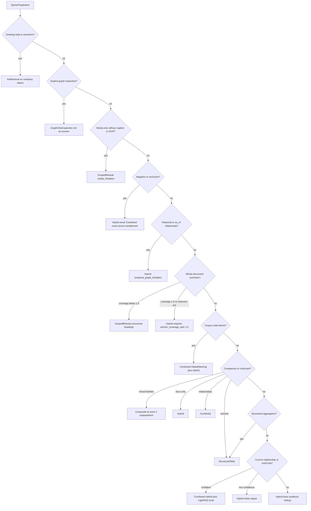
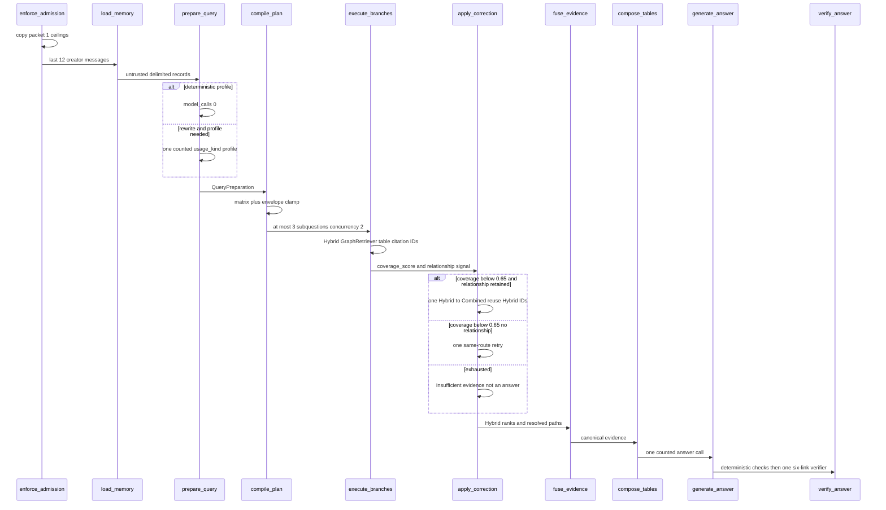

# Query routing

Packet 2 prepares one typed query, compiles the deterministic route and
limitation matrix, executes bounded retrieval branches, and applies at most
one global correction. Packet 3 fuses resolved paths, composes tables,
generates one answer, and verifies citations
([COMBINED_FUSION.md](./COMBINED_FUSION.md),
[ANSWER_VERIFICATION.md](./ANSWER_VERIFICATION.md)).
Packet 4 discloses optional tools after tables
([OPTIONAL_TOOLS.md](./OPTIONAL_TOOLS.md)).

Packet 1 `admit_query_run` reserves a **route envelope** before profiling.
The client route is not authorization. Normal Auto chat should reserve the
widest family the run might need (`composite`: 50s / 9 calls / 5 tools) so
profiling can select Hybrid/Combined without enlarging spend. Diagnostic
surfaces may reserve a specific family. The planner **never exceeds** the
remaining packet 1 ceilings. Effective route may be cheaper than the
reserved envelope. Persist `requested_route` vs `effective_route` vs
`corrected_route` on graph state.

Related: [QUERY_ADMISSION.md](./QUERY_ADMISSION.md) ·
[QUERY_BUDGETS.md](./QUERY_BUDGETS.md) ·
[COMBINED_FUSION.md](./COMBINED_FUSION.md) ·
[ANSWER_VERIFICATION.md](./ANSWER_VERIFICATION.md) ·
[PHASE6_HANDOFF.md](../graph/PHASE6_HANDOFF.md) ·
[docs index](../README.md)

## Memory

`app.load_query_memory` is SECURITY DEFINER, calls `validate_caller_context`,
is creator-only (owner/admin audit SELECT does not authorize another user's
thread), and fails on deleted conversations. It returns at most **12** recent
messages (1500 characters each) as untrusted delimited records. There is no
summary column or LangGraph store; packet 7 owns summaries. Source documents
are never joined.

## Preparation

1. Treat user text as untrusted (NUL strip, 2000-character bound).
2. Deterministic extract via `extract_deterministic` / `profile_query_sync`.
   Simple profiles use **zero** model calls.
3. When rewrite and profile need a model, **one** structured gateway call
   through `execute_counted_model_call` with `usage_kind=profile`. A separate
   rewrite call is forbidden.
4. Score intent/entity fidelity against the original. The original remains
   the fallback variant.
5. `QueryPreparation` includes original, optional rewrite, `ExpectedProfile`,
   language, UTC temporal intent, hl/ll keywords, entities/aliases, exact
   terms, dates/numbers/filters, negation, document/section/page scope, media
   intent, historical and low-confidence relationship signals, decomposition,
   confidence, `model_calls` 0|1, and fallback reason.

Manual routing is recorded only on `diagnostic` surfaces. Production manual
override is rejected.

## Route matrix

Whole-document summaries require exactly `section_coverage_ratio=1.0`. The
provisional coverage threshold remains frozen `0.65`. Phase 6 does not retune
either. V1 has no map-reduce summary.

Historical relationships never graph-retrieve. Graph-only is inspection, not
an answering fallback. `NoRetrieval` cannot make company-knowledge claims.
Negation never infers a complement from top-k. Unsupported media is a signed
scoped refusal unless adjacent caption/OCR satisfies ordinary Hybrid.

## Prepare to one correction

Independent required branches run with `BRANCH_CONCURRENCY=2`. A fourth
subquestion is rejected. Catalog-search LLMs and hidden LightRAG keyword
extraction are forbidden; empty `hl_keywords`/`ll_keywords` fail closed.
Combined degrades to Hybrid with `graph_unavailable` when the graph adapter
is missing. Hybrid/table failure never falls back to graph prose. ACL
blindness counts are disclosed only on the authorized visibility path.

## LangGraph

`enforce_admission` → `load_memory` → `prepare_query` → `compile_plan` →
`execute_branches` → `apply_correction` → `fuse_evidence` →
`compose_tables` → `disclose_optional_tools` → `generate_answer` →
`verify_answer` → END.
Health/ready stays unconfigured. SSE and the public chat UI remain later
packets.
