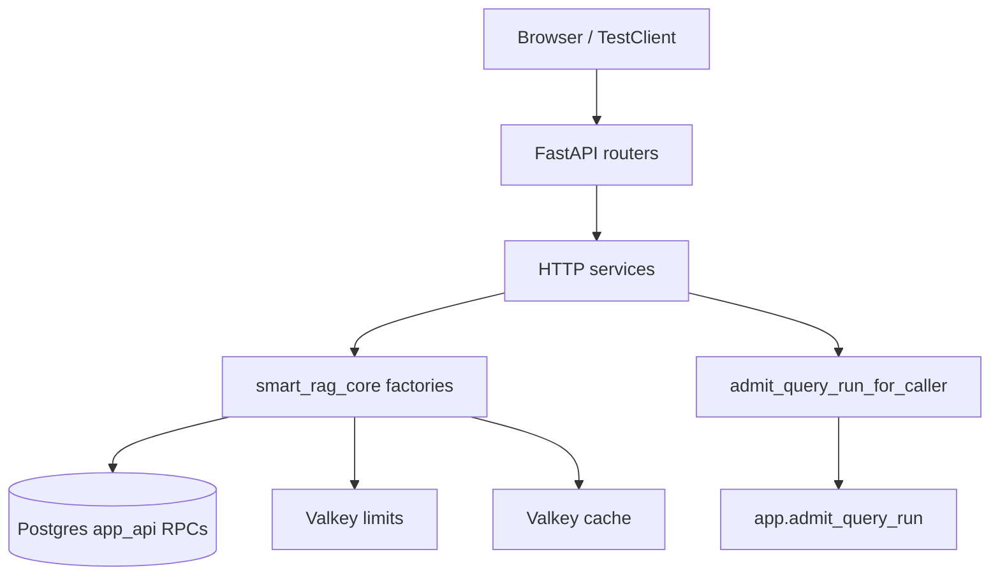

# FastAPI security (Phase 6 packet 5)

Thin FastAPI transport for authenticated RAG operations. Routers never inject
repositories. SSE event protocol, EventSource bodies, heartbeats, and resume
are packet 6. Conversation deletion and the 7/30-day reaper are packet 7
([MEMORY_DELETION.md](../agent/MEMORY_DELETION.md)). UI XSS encoding is
packet 8. CloudFront/WAF/KMS/S3 Object Lock are Phase 10.

Related: [AUTH_RATE_LIMIT_OWNERSHIP.md](../security/AUTH_RATE_LIMIT_OWNERSHIP.md) ·
[CONFIGURATION.md](../development/CONFIGURATION.md) ·
[QUERY_ADMISSION.md](../agent/QUERY_ADMISSION.md) ·
[SSE.md](./SSE.md) ·
[STREAMING_TIMEOUTS.md](../deployment/STREAMING_TIMEOUTS.md) ·
[AUDIT_CHAIN.md](../security/AUDIT_CHAIN.md) ·
[openapi.foundation.json](./openapi.foundation.json) ·
[docs index](../README.md)

## Dependency direction



Routers receive services through `Depends`. Services receive DSNs and optional
Valkey clients from `smart_rag_api.dependencies.services`. Identity is
JWKS-verified `CallerContext` (test bypass only when `APP_ENV=test`).

## Endpoint authorization matrix

| Method | Path | Caller | Authorization | Notes |
| --- | --- | --- | --- | --- |
| GET | `/health/live` | public | process up | No dependency probe |
| GET | `/health/ready` | public | probes DB/Valkey/ParadeDB/model/graph | `query_ready` only when real models, LightRAG attached, DB+Valkey ok. ParadeDB `down` degrades Hybrid to dense+term |
| GET | `/api/meta` | public | handshake fields | Packet 6 enforces `min_client_version` |
| GET | `/me` | authenticated | live profile role | Client role claims ignored |
| POST | `/admin/invitations` | owner/admin | live role + privileged Auth settings | FastAPI AUTH_ADJACENT limiter |
| POST | `/invitations/accept` | authenticated | JWT/test email, not body email | AUTH_ADJACENT |
| POST | `/admin/users/{user_id}/offboard` | owner/admin AAL2 | `apply_offboarding_security` | AUTH_ADJACENT |
| GET | `/documents` | authenticated | `list_visible_documents` ACL | LOW_RISK_READ |
| GET | `/documents/{id}` | authenticated | ACL + current version | 404 if missing/unauthorized |
| POST | `/documents/uploads` | member+ `upload_enabled` | quota reserve | COST_MUTATION; `signed_url` is null locally (Phase 10 CloudFront) |
| POST | `/documents/uploads/finalize` | member+ upload | finalize RPC | COST_MUTATION |
| POST/GET | `/conversations` | authenticated | creator insert / list RPC | COST_MUTATION on create |
| GET | `/conversations/{id}` | creator or owner/admin | non-deleted | 404 otherwise |
| DELETE | `/conversations/{id}` | creator or owner/admin | **204**; foreign/tombstoned **404** | Immediate purge; see [MEMORY_DELETION.md](../agent/MEMORY_DELETION.md) |
| POST | `/conversations/{id}/messages` | creator | handshake then idempotent Auto admit **composite** | JSON Accept → 202 `{run_id, stream_path}`; `Accept: text/event-stream` streams immediately. See [SSE.md](./SSE.md) |
| GET | `/runs/{run_id}` | creator only | IDOR → 404 | Not audit-visible to other members |
| POST | `/runs/{run_id}/cancel` | creator | pending/running | Stops live SSE, persists `cancelled` |
| GET | `/runs/{run_id}/events` | creator only | Bearer resume; no handshake | `after` / `Last-Event-ID`; tombstone → 404 |
| GET | `/runs/{run_id}/citations` | creator | IDs/provenance escaped | No snippet/passage |
| POST | `/runs/{run_id}/feedback` | creator | thumbs 1 or 5 | Comment escaped |
| GET | `/graph/entities/search` | authenticated | ACL SQL, 3s timeout | No vendor prose |
| POST | `/graph/inspect` | authenticated | existing inspect | Unchanged seed/depth caps |
| GET | `/tables` | authenticated | current-version manifests | No storage paths |
| POST | `/tables/analyze` | authenticated | `TableQueryPlan` extra=forbid | 404 missing parquet |
| GET | `/tools` | authenticated | in-code registry + live role | Unauthorized names omitted |
| POST | `/admin/tools` | owner/admin | allow-listed keys only | DB seed is not executor authority |
| POST | `/admin/tools/{key}/enable` | owner/admin | allow-list recheck | |
| POST | `/admin/tools/{key}/permissions` | owner/admin | live role still gates execute | |
| GET | `/usage/me` | authenticated | caller totals | No prompt text |
| GET | `/usage/company` | owner/admin | company totals | Members/viewers 403 |

Existing ingestion/glossary/entity-rule mutations keep owner/admin checks and
now consume FastAPI-owned rate limits after the role gate.

## CORS, headers, errors, limits

- Exact origins from `CORS_ALLOW_ORIGINS`. Defaults include local frontend
  `:3000` and Playwright `:3010`. Wildcards fail settings validation.
  Credentialed responses never send `Access-Control-Allow-Origin: *`.
- Security headers: `nosniff`, `DENY` framing, `no-store`, empty CSP default-src.
- Generic JSON errors. Untrusted content is never `text/html`.
- `REQUEST_MAX_BODY_BYTES` (default 1 MiB) rejects oversized `Content-Length`
  with HTTP 413.
- Schema `extra=forbid` on mutation bodies. Extra fields → 422
  `validation_failed`.

## Retrieval cache

`smart_rag_core.retrieval.cache_store.RetrievalCacheStore` uses the cache
Valkey instance (never limits Valkey). Keys come from
`hybrid_cache_key` (principal/ACL hash, profile, index version, visibility
generation). Values are `cache_payload` IDs/ranks only (TTL 30s). Profile
blobs use TTL 300s.

Every hit calls `recheck_retrieval_candidates` (or a test double). ACL,
delete, or current-version mismatch drops the entry, emits
`cache_recheck_failed`, and never returns stale IDs. Events:
`cache_hit`, `cache_miss`, `cache_invalidated`, `cache_recheck_failed`.

## CPU offload

`smart_rag_core.runtime.offload.OffloadExecutor` owns a bounded process pool
(CPU slices with p95 > 10 ms) and a thread pool (blocking I/O).
`sample_event_loop_lag` measures loop delay. Packet 6 proves 15s persisted
heartbeats and five held fixture streams (no OpenAI). Packet 8 owns live
Composite LLM heartbeat proof.

## Audit export (local)

`LocalHmacAuditExporter` verifies `previous_hash` chains and HMAC-signs the
head. Mutation, gap, fork, empty snapshot, passage-like payload keys, or
empty HMAC secret → `ready=false`. Full passage text is forbidden. Phase 10
must replace HMAC with a KMS key unavailable to database roles, 15-minute
anchors, and S3 Object Lock.

## Phase 10 blockers

- Named Valkey ACL users + Secrets Manager rotation (Compose uses
  `requirepass` on the private network; ADR-private-service-tls omits TLS
  locally).
- Hosted Auth throttle proof (`local_auth_throttling_proven=False`).
- CloudFront signed upload URLs, WAF, origin restriction.
- KMS chain-head anchors and Object Lock export.

## Packet 6 (implemented)

See [SSE.md](./SSE.md). Handshake (`X-Client-Version`) is enforced on
`POST /conversations/{conversation_id}/messages` before admit. Resume is
`GET /runs/{run_id}/events`. Conversation deletion is `DELETE /conversations/{id}` (204). Reaper and LangSmith deletion retry: [MEMORY_DELETION.md](../agent/MEMORY_DELETION.md).
Live Composite LLM streaming remains packet 8. CloudFront/WAF/Caddy IaC
and a staging 50s CDN stream remain Phase 10; local 90s contract files are
in [STREAMING_TIMEOUTS.md](../deployment/STREAMING_TIMEOUTS.md).

## Verification

```
uv run python scripts/ci/check_openapi.py
uv run python -m pytest tests/unit/test_fastapi_security.py tests/contract/test_query_admission_api.py tests/contract/test_retrieval_cache.py tests/unit/test_package_imports.py tests/contract/test_import_boundaries.py tests/unit/test_backend_middleware.py -q
```

Packet 6 SSE:

```
uv run python -m pytest tests/unit/test_sse_protocol.py tests/contract/test_sse_resume.py tests/contract/test_sse_heartbeat.py tests/contract/test_streaming_timeout_contract.py -q
```
