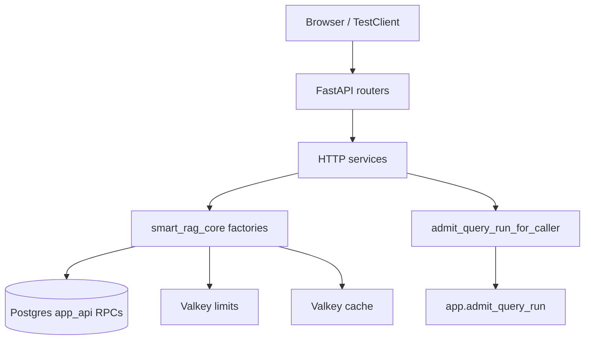
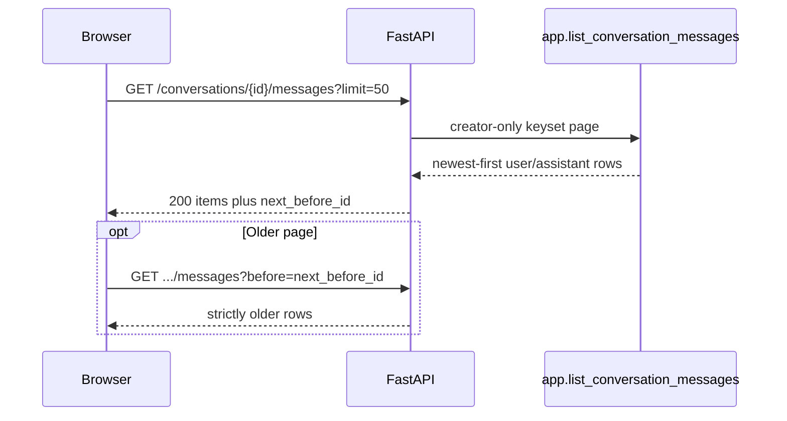

# FastAPI security (Phase 6 packet 5)

Thin FastAPI transport for authenticated RAG operations. Routers never inject
repositories. SSE event protocol, EventSource bodies, heartbeats, and resume
are packet 6. Conversation deletion and the 7/30-day reaper are packet 7
([MEMORY_DELETION.md](../agent/MEMORY_DELETION.md)). UI XSS encoding is
packet 8. CloudFront/WAF/KMS/S3 Object Lock are Phase 10.

Related: [AUTH_RATE_LIMIT_OWNERSHIP.md](../security/AUTH_RATE_LIMIT_OWNERSHIP.md) ·
[CONFIGURATION.md](../development/CONFIGURATION.md) ·
[QUERY_ADMISSION.md](../agent/QUERY_ADMISSION.md) ·
[SSE.md](./SSE.md) ·
[STREAMING_TIMEOUTS.md](../deployment/STREAMING_TIMEOUTS.md) ·
[AUDIT_CHAIN.md](../security/AUDIT_CHAIN.md) ·
[openapi.foundation.json](./openapi.foundation.json) ·
[docs index](../README.md)

## Dependency direction



Routers receive services through `Depends`. Services receive DSNs and optional
Valkey clients from `smart_rag_api.dependencies.services`. Identity is
JWKS-verified `CallerContext`. `X-Test-*` bypass requires `APP_ENV=test` and
`ALLOW_TEST_IDENTITY=true`. Staging and production reject that flag and
return HTTP 400 when those headers are present. JWKS requires JWT
`role=authenticated` and rejects `service_role` / `anon`.
Local Docker (`APP_ENV=local`) accepts the documented GoTrue `iss` pair
`http://127.0.0.1:54321/auth/v1` and
`http://host.docker.internal:54321/auth/v1` when `SUPABASE_URL` is one of
those origins; JWKS fetch stays on `SUPABASE_URL`. Staging and production
keep a single issuer. See [IDENTITY_PROPAGATION.md](../security/IDENTITY_PROPAGATION.md).

## Endpoint authorization matrix

| Method | Path | Caller | Authorization | Notes |
| --- | --- | --- | --- | --- |
| GET | `/health/live` | public | process up | Async; no dependency probe. Must not wait on readiness threads. |
| GET | `/health/ready` | public | `{status, query_ready, detail}` only | Coarse `detail` (`ok` / `not_query_ready`). Never names ParadeDB/Valkey/LightRAG/checkpointer. Mock mode keeps `query_ready=false`. Missing LightRAG may still be query-ready when Hybrid is healthy. Clears a stale `rate_limit_degraded` latch when both Valkey probes are `ok`. |
| GET | `/ops/ready` | owner/admin | named dependency probes | Full operator payload |
| GET | `/api/meta` | public | handshake fields | Packet 6 enforces `min_client_version` |
| GET | `/me` | authenticated | live profile role | Client role claims ignored |
| POST | `/admin/invitations` | owner/admin | live role + privileged Auth settings | AUTH_ADJACENT. JSON omits `raw_token` (mail only). Only **owner** may invite `owner`. `APP_ENV=test` may set `X-Test-Invitation-Token` |
| POST | `/invitations/accept` | authenticated | JWT/test email, not body email | AUTH_ADJACENT |
| POST | `/admin/users/{user_id}/offboard` | owner/admin AAL2 | `apply_offboarding_security` | AUTH_ADJACENT |
| GET | `/documents` | authenticated | `list_visible_documents_page` ACL | LOW_RISK_READ; `limit` default 50 max 200; keyset `cursor=created_at,id` |
| GET | `/documents/{id}` | authenticated | ACL + current version | 404 if missing/unauthorized |
| DELETE | `/documents/{id}` | owner/admin | `delete_visible_document` wraps `exclude_version_from_retrieval` | COST_MUTATION; unseen **404**; visible member **403**; **204** |
| POST | `/documents/uploads` | member+ `upload_enabled` | quota reserve | COST_MUTATION; `signed_url` is null locally (Phase 10 CloudFront) |
| POST | `/documents/uploads/finalize` | member+ upload | finalize RPC | COST_MUTATION |
| POST/GET | `/conversations` | authenticated | creator insert / `list_user_conversations_page` | COST_MUTATION on create; GET `limit` default 50 max 200; keyset `cursor` |
| GET | `/conversations/{id}` | creator or owner/admin | non-deleted | 404 otherwise |
| DELETE | `/conversations/{id}` | creator or owner/admin | **204**; foreign/tombstoned **404** | Immediate purge; see [MEMORY_DELETION.md](../agent/MEMORY_DELETION.md) |
| GET | `/conversations/{id}/messages` | creator | `app.list_conversation_messages` | `limit` default 50 max 100; `before` UUID keyset. 200 `{items:[{message_id, role, content, created_at}], next_before_id}`. Roles `user`/`assistant` only. Full content, HTML-escaped. Foreign/deleted/missing → generic **404** `not_found`. LOW_RISK_READ. |
| POST | `/conversations/{id}/title` | creator | `app.get_conversation_title_source` then optional `app.update_conversation_title` | COST_MUTATION. One bounded `conversation_title_v1` call while the stored title is still the first-prompt fallback. Model failure keeps the fallback. Same generic **404** as GET. See [ADR-llm-conversation-titles.md](../adr/ADR-llm-conversation-titles.md). |
| POST | `/conversations/{id}/messages` | creator | handshake then idempotent Auto admit **composite** | **Requires** `Idempotency-Key` header or body `idempotency_key` (400 if missing). JSON Accept → 202 `{run_id, stream_path}`; `Accept: text/event-stream` streams immediately. See [SSE.md](./SSE.md) |
| GET | `/runs/{run_id}` | creator only | IDOR → 404 | Not audit-visible to other members |
| POST | `/runs/{run_id}/cancel` | creator | pending/running | Stops live SSE, persists `cancelled` |
| GET | `/runs/{run_id}/events` | creator only | Bearer resume; no handshake | `after` / `Last-Event-ID`; tombstone → 404 |
| GET | `/runs/{run_id}/citations` | creator | IDs/provenance escaped | No snippet/passage. ACL + current-version recheck; failed recheck → `source_unavailable` and `chunk_id` null |
| POST | `/runs/{run_id}/feedback` | creator | thumbs 1 or 5 | Comment escaped |
| GET | `/graph/entities/search` | authenticated | ACL SQL, 3s timeout | LOW_RISK_READ. No vendor prose |
| POST | `/graph/inspect` | authenticated | existing inspect | FastAPI `COST_MUTATION`. Preauth `/graph` prefix is owned by the API-hardening agent |
| GET | `/ingestion/versions/{version_id}/status` | authenticated | `get_version_ingestion_status` ACL | **404** if missing or unauthorized (no existence leak). `last_error` sanitized |
| GET | `/tables` | authenticated | current-version manifests | No storage paths |
| POST | `/tables/analyze` | authenticated | `TableQueryPlan` extra=forbid | 404 missing parquet |
| GET | `/tools` | authenticated | in-code registry + live role, overlaying `app.tool_catalog.active` | Unauthorized names omitted. Owner/admin still see seed-disabled tools. Executor remains in-code. |
| POST | `/admin/tools` | owner/admin | allow-listed keys only | DB seed is not executor authority |
| POST | `/admin/tools/{key}/enable` | owner/admin | allow-list recheck | Writes catalog seed `active`; `GET /tools` overlays it |
| POST | `/admin/tools/{key}/permissions` | owner/admin | live role still gates execute | Upserts by tool + role; creates catalog row when missing |
| GET | `/usage/me` | authenticated | caller totals; `scope=me` | No prompt text |
| GET | `/usage/company` | owner/admin | company totals; `scope=company` | Members/viewers 403 |
| GET | `/admin/graph/entity-rules` | owner/admin | list RPC | LOW_RISK_READ 120 after the role gate. Members/viewers 403 |

Existing ingestion/glossary/entity-rule mutations keep owner/admin checks and
now consume FastAPI-owned rate limits after the role gate.

## CORS, headers, errors, limits

- Exact origins from `CORS_ALLOW_ORIGINS`. Defaults include local frontend
  `:3000` and Playwright `:3010`. Wildcards fail settings validation.
  Staging and production require HTTPS origins and reject loopback.
  Credentialed responses never send `Access-Control-Allow-Origin: *`.
- CORS Allow-Headers in staging/production/local:
  `Authorization, Content-Type, Idempotency-Key, Last-Event-ID,
  X-Client-Version, X-Request-ID`. `X-Test-*` is injected only when
  `APP_ENV=test`.
- `/docs`, `/redoc`, and `/openapi.json` are mounted only for `local` and
  `test`. Staging and production set those URLs to `None`. FastAPI `version`
  matches settings `API_VERSION` (default `0.1.0`).
- Staging and production require `VALKEY_LIMITS_URL` at settings load.
- `API_BIND_HOST` defaults to `0.0.0.0` for Docker/Caddy. The host firewall
  must drop public access to port 8000.
- Security headers: `nosniff`, `DENY` framing, `no-store`, empty CSP default-src.
- Generic JSON errors. Untrusted content is never `text/html`.
- `REQUEST_MAX_BODY_BYTES` (default 1 MiB) rejects oversized `Content-Length`
  with HTTP 413. POST/PUT/PATCH without a numeric `Content-Length` fail
  closed with HTTP 411. GET/HEAD/OPTIONS/DELETE without a body skip the
  gate so SSE resume is unchanged.
- Schema `extra=forbid` on mutation bodies. Extra fields → 422
  `validation_failed`.

## Retrieval cache

`smart_rag_core.retrieval.cache_store.RetrievalCacheStore` uses the cache
Valkey instance (never limits Valkey). Keys come from
`hybrid_cache_key` (principal/ACL hash, profile, index version, visibility
generation). Values are `cache_payload` IDs/ranks only (TTL 30s). Profile
blobs use TTL 300s.

Every hit calls `recheck_retrieval_candidates` (or a test double). ACL,
delete, or current-version mismatch drops the entry, emits
`cache_recheck_failed`, and never returns stale IDs. Events:
`cache_hit`, `cache_miss`, `cache_invalidated`, `cache_recheck_failed`.

## CPU offload

Lifespan starts a bounded `ThreadPoolExecutor` (`max_workers=8`) on
`application.state.offload_executor` and shuts it down on exit. It is never
left `None` while the process is serving.
`smart_rag_core.runtime.offload.OffloadExecutor` owns a bounded process pool
(CPU slices with p95 > 10 ms) and a thread pool (blocking I/O).
`sample_event_loop_lag` measures loop delay. Packet 6 proves 15s persisted
heartbeats and five held fixture streams (no OpenAI). Packet 8 owns live
Composite LLM heartbeat proof.

## Audit export (local)

`LocalHmacAuditExporter` verifies `previous_hash` chains and HMAC-signs the
head. Mutation, gap, fork, empty snapshot, passage-like payload keys, or
empty HMAC secret → `ready=false`. Full passage text is forbidden. Phase 10
must replace HMAC with a KMS key unavailable to database roles, 15-minute
anchors, and S3 Object Lock.

## Phase 10 blockers

- Named Valkey ACL users + Secrets Manager rotation (Compose uses
  `requirepass` on the private network; ADR-private-service-tls omits TLS
  locally).
- Hosted Auth throttle proof (`local_auth_throttling_proven=False`).
- CloudFront signed upload URLs, WAF, origin restriction.
- KMS chain-head anchors and Object Lock export.

## Packet 6 (implemented)

See [SSE.md](./SSE.md). Handshake (`X-Client-Version`) is enforced on
`POST /conversations/{conversation_id}/messages` before admit. Resume is
`GET /runs/{run_id}/events`. Conversation deletion is `DELETE /conversations/{id}` (204). Reaper and LangSmith deletion retry: [MEMORY_DELETION.md](../agent/MEMORY_DELETION.md).

### Conversation transcript

`GET /conversations/{conversation_id}/messages` is a creator-only read of
persisted `app.messages` rows. It does not invent history: only `user` and
`assistant` roles are returned, with full HTML-escaped `content`. Query
parameters: `limit` (default 50, minimum 1, maximum 100) and optional
`before` (UUID of the previous page's last `message_id`). Response
`next_before_id` is that last id when the page is full, otherwise `null`.
Missing, deleted, and foreign conversations return the same generic
`404 {"detail":"not_found"}` as `GET /conversations/{id}`.



Live Composite LLM streaming remains packet 8. CloudFront/WAF/Caddy IaC
and a staging 50s CDN stream remain Phase 10; local 90s contract files are
in [STREAMING_TIMEOUTS.md](../deployment/STREAMING_TIMEOUTS.md).

## Verification

```text
uv run python scripts/ci/check_openapi.py
uv run python -m pytest tests/unit/test_fastapi_security.py tests/contract/test_query_admission_api.py tests/contract/test_conversation_transcript.py tests/contract/test_retrieval_cache.py tests/unit/test_package_imports.py tests/contract/test_import_boundaries.py tests/unit/test_backend_middleware.py -q
```

Packet 6 SSE:

```text
uv run python -m pytest tests/unit/test_sse_protocol.py tests/contract/test_sse_resume.py tests/contract/test_sse_heartbeat.py tests/contract/test_streaming_timeout_contract.py -q
```
