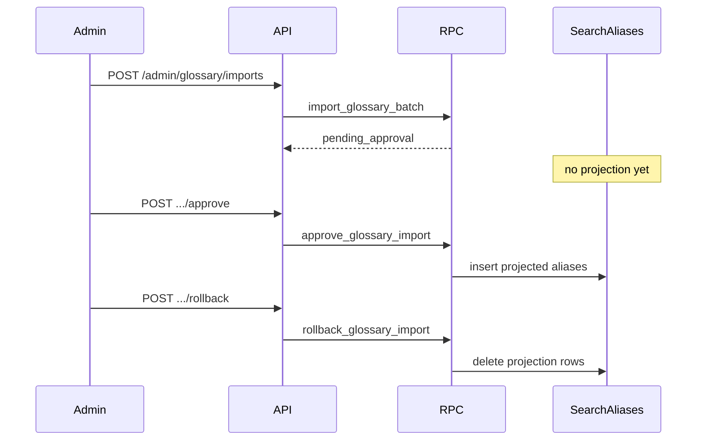

# Glossary import API (Phase 4 Packet 1)

Owner/admin private glossary import. Pending batches do not populate
`search_aliases`. Private alias and canonical text stay in Postgres and must
not appear in Git, logs, traces, or HTTP error bodies.

Related: [DATASET_SPEC.md](../evaluation/DATASET_SPEC.md) ·
[08-data-dictionary.md](../architecture/08-data-dictionary.md) ·
[ENTITY_RULES.md](../graph/ENTITY_RULES.md) ·
[phase-04-hybrid-rag-evidence.md](../development/phase-04-hybrid-rag-evidence.md)

## Routes

| Method | Path | Caller | Effect |
| --- | --- | --- | --- |
| POST | `/admin/glossary/imports` | owner, admin | Validate and persist a pending import. Duplicate `idempotency_key` reuses one row |
| POST | `/admin/glossary/imports/{import_id}/approve` | owner, admin | Project aliases into `search_aliases` |
| POST | `/admin/glossary/imports/{import_id}/rollback` | owner, admin | Delete the projection for that import |

Members and viewers receive `403 forbidden`. Validation and RPC rejections
return `400` with a reason code only (`alias_cycle`, `alias_conflict`,
`duplicate_alias`, `cross_scope_conflict`, `high_collision_rule`, `forbidden`).

## Lifecycle



## Limits

- At most 500 entries and 20 aliases per entry per import.
- Identifier rules with high-collision patterns such as `\d{1,3}` are rejected.
- Audit payloads record import id and counts only.

## Verification

```powershell
uv run pytest tests/unit/test_glossary_openapi.py tests/unit/test_glossary_validation.py -q
uv run pytest tests/contract/test_glossary_import.py -q
```

[docs index](../README.md)
