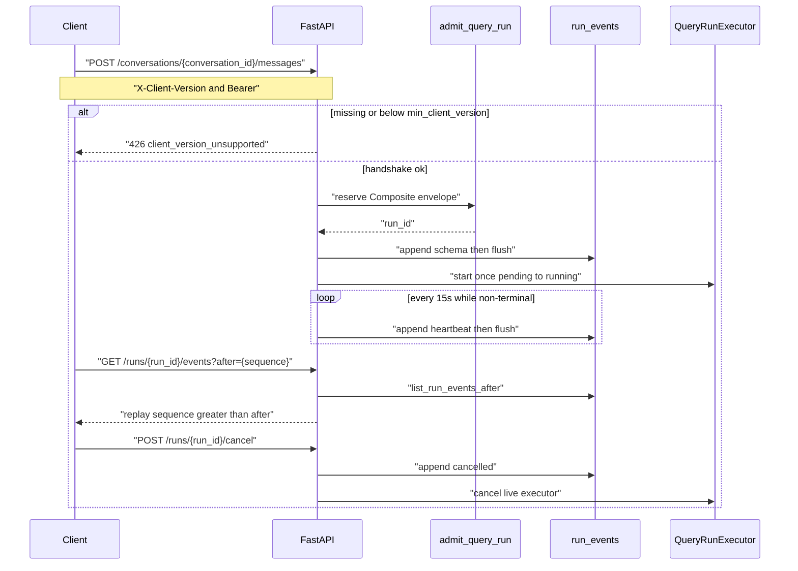

# Server-Sent Events

Bearer fetch SSE for Auto chat. FastAPI 0.141 has no `EventSourceResponse`;
frames are written with `StreamingResponse` and media type `text/event-stream`.

Related: [FASTAPI_SECURITY.md](./FASTAPI_SECURITY.md) ·
[STREAMING_TIMEOUTS.md](../deployment/STREAMING_TIMEOUTS.md) ·
[ADR-api-sse-compatibility](../adr/ADR-api-sse-compatibility.md) ·
[openapi.foundation.json](./openapi.foundation.json)

## Handshake then admit

`GET /runs/{run_id}/events` requires Bearer and ownership. It does **not**
repeat the version handshake. Tombstoned `conversations.deleted_at` denies
resume with 404. Reconnect never starts a second paid graph.

## Transport

- `POST /conversations/{conversation_id}/messages` with `Accept: text/event-stream`
  admits (after handshake) then streams. JSON Accept keeps HTTP 202
  `{run_id, stream_path}` where `stream_path=/runs/{run_id}/events`.
- Duplicate idempotency keys return the existing run stream.
- `GET /runs/{run_id}/events?after={sequence}` also honors `Last-Event-ID`.
  Replay is strictly `sequence > after`. `after=0` or omitted means from start.
- Headers on SSE responses: `Content-Type: text/event-stream`,
  `Cache-Control: no-cache`, `Connection: keep-alive`, `X-Accel-Buffering: no`.

## Event catalog

Clients ignore unknown additive types (log and continue). Payloads use
`extra=forbid`. Citation preview is IDs/ranks only. Errors never include
tracebacks, secrets, source HTML, or passages.

| Type | Role |
| --- | --- |
| `schema` | First event on a new stream. Carries `sse_schema_version`. |
| `status` | Stage/status. |
| `heartbeat` | Every 15 seconds, persisted, while the run is non-terminal. |
| `route_correction` | Single-correction diagnostic. |
| `limitation` | Named limitation code. |
| `deadline` | Deadline exhaustion notice. |
| `partial` | Verified partial terminal (after `deadline` when exhausted). |
| `cache` | Cache diagnostic. |
| `coverage` | Coverage score without passage text. |
| `optional_tool_disclosure` | Selected optional tool keys. |
| `citation_preview` | Citation IDs and ranks. No passage text. |
| `token_delta` | Generated token delta. Never retrieved source. |
| `usage` | Token counts without prompts. |
| `completed` | Success terminal. |
| `cancelled` | Cancel terminal. |
| `error` | Sanitized `{code}`. |

Exactly one terminal among `completed`, `cancelled`, `error`, `partial`.
Conversation summary and assistant-message persist run only after that
terminal is yielded. Those writes must not emit a second `error`.

Live `LangGraphQueryRunExecutor` compiles **per execute** with
`build_query_graph_deps`: Hybrid (DSN-based, ParadeDB optional), counted
`model_gateway` (mock gateway is still a gateway), pinned `answer_v1` /
`verified_v1` bodies, optional process LightRAG adapter, structured-table
`structured_table_query`, per-run `app_api` connection, and per-run
`cancel_check`. Missing Hybrid or gateway fails closed. A failed per-run
`app_api` connect is `error.code=app_api_connection_unbound`; the executor
does not continue with `connection=None`. Concurrent Combined retrieves
serialize `query_budget` onto the shared LightRAG adapter. Studio's
module-level `graph` stays unbound.

## Sanitization and reconnect

- Exception messages are discarded. Retrieved source text is never stored
  or streamed. Payload keys `passage`, `snippet`, `html`, and traceback-like
  names are stripped or rejected in `app.append_run_event`.
- Disconnect without cancel keeps already-paid usage. Reconnect resumes
  from `after` and does not invoke LangGraph again when status is already
  running/completed/cancelled/partial or this process has no live executor.
  While status is `running`, a replica with an empty local registry
  **replays only** and must not persist `error` `{code: worker_unavailable}`
  (that unique terminal would block the owning replica from appending
  `completed`). `worker_unavailable` is only for a true orphan: `pending`
  with no startable input on this process.

## Retention (packet 7)

Completed idempotency keys default to seven days and completed events to
30 days through `app.reap_query_run_retention`. Conversation deletion
purges keys/events immediately. Tombstones deny resume. See
[MEMORY_DELETION.md](../agent/MEMORY_DELETION.md).
