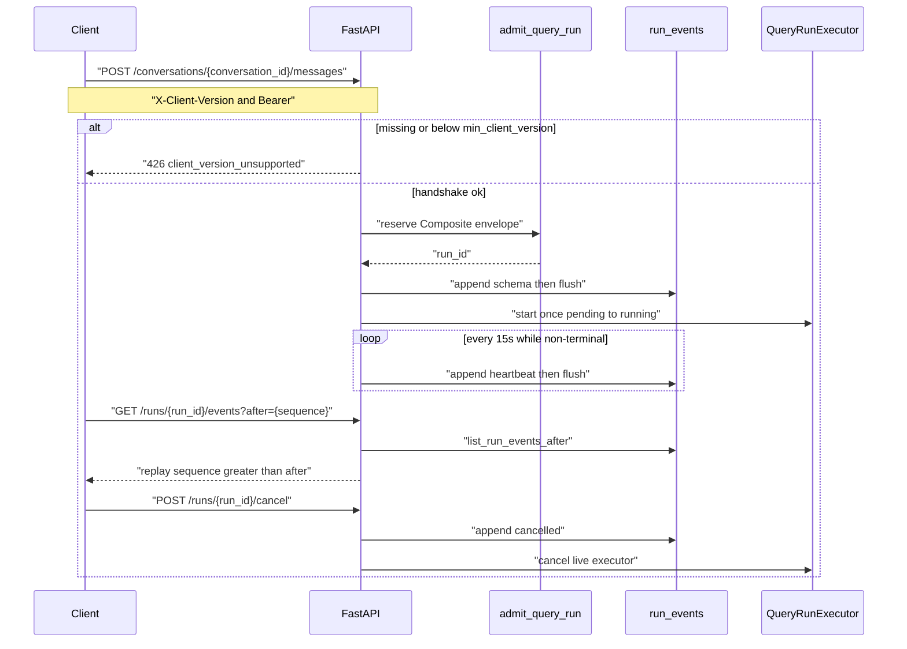
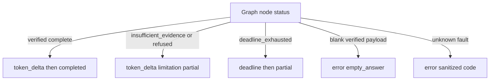
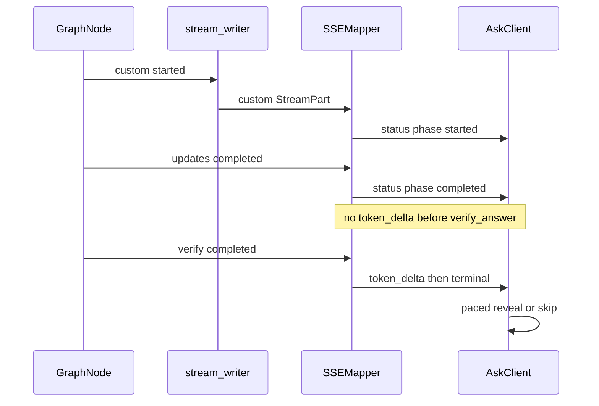
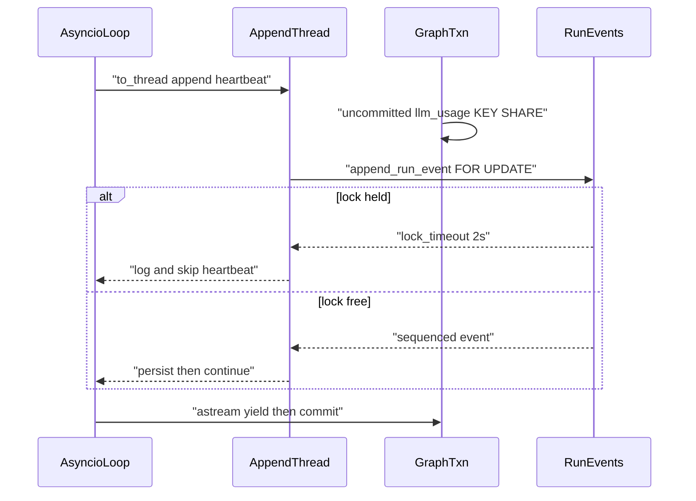

# Server-Sent Events

Bearer fetch SSE for Auto chat. FastAPI 0.141 has no `EventSourceResponse`;
frames are written with `StreamingResponse` and media type `text/event-stream`.

Related: [FASTAPI_SECURITY.md](./FASTAPI_SECURITY.md) ·
[STREAMING_TIMEOUTS.md](../deployment/STREAMING_TIMEOUTS.md) ·
[ADR-api-sse-compatibility](../adr/ADR-api-sse-compatibility.md) ·
[openapi.foundation.json](./openapi.foundation.json)

## Handshake then admit

`GET /runs/{run_id}/events` requires Bearer and ownership. It does **not**
repeat the version handshake. Tombstoned `conversations.deleted_at` denies
resume with 404. Reconnect never starts a second paid graph.

## Transport

- `POST /conversations/{conversation_id}/messages` with `Accept: text/event-stream`
  admits (after handshake) then streams. JSON Accept keeps HTTP 202
  `{run_id, stream_path, requested_search_scope}` where
  `stream_path=/runs/{run_id}/events`. Optional POST body `search_scope` is
  `auto` when omitted (`company_documents`, `general_knowledge`, and `web`
  are also valid). Resume is GET-only and never sends `search_scope`.
- Duplicate idempotency keys return the existing run stream. A different
  `search_scope` on the same key is a key collision.
- `GET /runs/{run_id}/events?after={sequence}` also honors `Last-Event-ID`.
  Replay is strictly `sequence > after`. `after=0` or omitted means from start.
- Headers on SSE responses: `Content-Type: text/event-stream`,
  `Cache-Control: no-cache`, `Connection: keep-alive`, `X-Accel-Buffering: no`.

## Event catalog

Clients ignore unknown additive types (log and continue). Payloads use
`extra=forbid`. Citation preview is IDs/ranks only. Errors never include
tracebacks, secrets, source HTML, or passages.

| Type | Role |
| --- | --- |
| `schema` | First event on a new stream. Carries `sse_schema_version`. |
| `status` | Stage/status. Optional additive `phase` (`started`/`completed`/`failed`) for live progress; omitted on legacy rows. Web research emits `web_search` (Searching…) and `web_read` (Reading…) before the existing `verify_answer` (Verifying…). Payloads are keys only: never query text, URL bodies, or excerpts. |
| `tool_progress` | Optional-tool progress. `tool_key` and `phase` only. No args, results, or display text. |
| `heartbeat` | Every 15 seconds, persisted, while the run is non-terminal. |
| `route_correction` | Single-correction diagnostic. |
| `limitation` | Named limitation code. |
| `deadline` | Deadline exhaustion notice. |
| `partial` | Verified partial terminal (after `deadline` when exhausted). |
| `cache` | Cache diagnostic. |
| `coverage` | Coverage score without passage text. |
| `optional_tool_disclosure` | Selected optional tool keys. |
| `citation_preview` | Citation IDs and ranks. Company rows use chunk/table IDs. Web rows use `web_source_id` values. No passage, excerpt, or span text. HTTP `GET /runs/{id}/citations` may include an ACL-rechecked `evidence_excerpt`; SSE never copies it. |
| `answer_origin` | Additive origin (`origin` only: `general_knowledge`, `company_documents`, `user_supplied_text`, `ambiguous`, `web`). Emitted before `token_delta` on new answers. Schema major version stays `1`. Historical/null payloads omit the event. |
| `token_delta` | Generated token delta. Never retrieved source. |
| `usage` | Accumulated provider prompt and completion tokens for this query run (profile, search, answer, verifier). Optional billed `cost_usd` when `app.llm_usage` is available. Emitted after verify, before the terminal. Counts are 0 when no model ran. Conversation-title generation is not in this event; Ask Run Details adds it under **This chat**. No prompts. |
| `completed` | Success terminal. |
| `cancelled` | Cancel terminal. |
| `error` | Sanitized `{code}`. |

Ask never infers origin from `route_family`. Citation chips render only
for `company_documents` or a missing legacy origin. General, user-text,
deterministic, ambiguous, and unknown origins hide chips.

Exactly one terminal among `completed`, `cancelled`, `error`, `partial`.
Conversation summary and assistant-message persist run only after that
terminal is yielded. Those writes must not emit a second `error`.

Expected company refusals (`insufficient_evidence`, `refused`) and
deadline/budget partials (`deadline_exhausted`,
`answer_deadline_reserve_exhausted`) emit a non-empty refusal token when
one is available, an optional `limitation`, and exactly one `partial`.
They are not `error` and not `empty_answer`. `empty_answer` is reserved
for a supposedly releasable `verified` payload that is blank. Unknown
faults stay one sanitized `error`. Generate-time expected refusals skip
the verifier node; the mapper still emits `verify_answer` completed so
Ask can accept the refusal tokens.

Live `LangGraphQueryRunExecutor` is **process-cached** on `app.state`
(checkpointer pool, memory store, compiled graph). Each execute still
calls `build_query_graph_deps`: Hybrid (DSN-based, ParadeDB optional),
counted `model_gateway` (mock gateway is still a gateway), pinned
`answer_v1` / `verified_v1` bodies, optional process LightRAG adapter,
structured-table `structured_table_query`, per-run `app_api` connection,
and per-run `cancel_check`. Missing Hybrid or gateway fails closed. A
failed per-run `app_api` connect is `error.code=app_api_connection_unbound`;
the executor does not continue with `connection=None`. Concurrent Combined
retrieves serialize `query_budget` onto the shared LightRAG adapter.
Studio's module-level `graph` stays unbound. Local Compose warms the
cached executor after startup so the first Ask run does not open hosted
pools under the Composite 50s envelope.

## Progress, verify, then tokens

Live LangGraph uses `stream_mode=["updates","custom"]` version `v2`.
Custom node-start writer events may arrive before the matching updates
completion. The mapper emits `status.phase` and optional `tool_progress`.
`token_delta` is held until `verify_answer` completes. Replay is
monotonic and first-terminal-wins. `deadline` is diagnostic; `partial`
is the terminal. Node `status=routing_rejected` with
`detail=deadline_exhausted` maps to that pair. Other routing rejects
(empty query, invalid plan) stay `error` `{code: routing_rejected}`.

## Sanitization and reconnect

- Exception messages are discarded. Retrieved source text is never stored
  or streamed. Payload keys `passage`, `snippet`, `html`, `excerpt`,
  `excerpts`, `web_sources`, `body`, `text`, and traceback-like names are
  stripped or rejected in the SSE mapper and `app.append_run_event`.
- Disconnect without cancel keeps already-paid usage. Reconnect resumes
  from `after` and does not invoke LangGraph again when status is already
  running/completed/cancelled/partial or this process has no live executor.
  While status is `running`, a replica with an empty local registry
  **replays only** and must not persist `error` `{code: worker_unavailable}`
  (that unique terminal would block the owning replica from appending
  `completed`). `worker_unavailable` is only for a true orphan: `pending`
  with no startable input on this process.

## Persist offload and run-row locks

Heartbeat and executor appends run in `asyncio.to_thread` so a synchronous
Postgres wait cannot freeze the SSE event loop or LangGraph `astream`.
Sequence order is unchanged: each append is awaited before the next event.
Exactly one terminal remains required.

`PostgresRunEventStore` keeps autocommit off. After `SET ROLE app_api` each
transaction applies `SET LOCAL lock_timeout TO '2s'`. That matches the
intended `app_api` GUC. Hosted login-role sessions do not always inherit
role timeouts after `SET ROLE`, so the store must set the limit itself.

`app.append_run_event` takes `SELECT … FROM app.runs FOR UPDATE`. An
uncommitted `llm_usage` insert on the graph `app_api` connection holds
KEY SHARE on the same row until the executor commits after an `astream`
yield. A heartbeat that hits that lock must fail in two seconds, not sit
until the 120-second statement timeout. Heartbeat failures are logged and
skipped. Status and terminal append failures keep the previous None-return
path so the executor can persist a sanitized `error`. Logs include
`run_id`, `sse_event_type`, SQLSTATE or reason, and elapsed seconds.
They never include DSNs, JWTs, payload bodies, or exception text.

This is the c31e50dc stall class. Disabling LangSmith tracing is not the
fix. Authenticated live timing after this repair is still unverified.

## Retention (packet 7)

Completed idempotency keys default to seven days and completed events to
30 days through `app.reap_query_run_retention`. Conversation deletion
purges keys/events immediately. Tombstones deny resume. See
[MEMORY_DELETION.md](../agent/MEMORY_DELETION.md).
