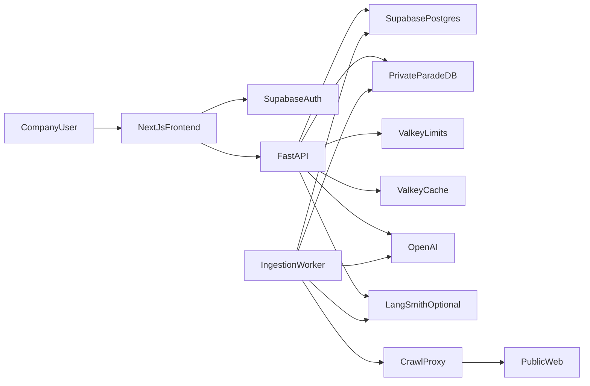

# System context

Actors and external systems for Smart RAG. Local topology is current; managed cloud is planned.

## Trust boundaries

- Browser holds only public Supabase config and user JWTs.
- FastAPI verifies JWTs (Phase 2+) and never exposes ParadeDB/Valkey/LightRAG publicly.
- Canonical evidence and security state live in Supabase; ParadeDB is derived BM25 only.
- OpenAI receives bounded evidence only after governance sign-off.
- LangSmith receives redacted run metadata only when `LANGSMITH_TRACING=true`.
  See [LANGSMITH_TRACING.md](../development/LANGSMITH_TRACING.md).

## Links

- [docs index](../README.md)
- [Containers](./02-containers.md)
