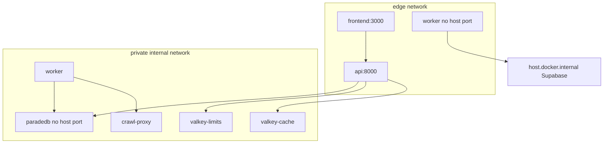
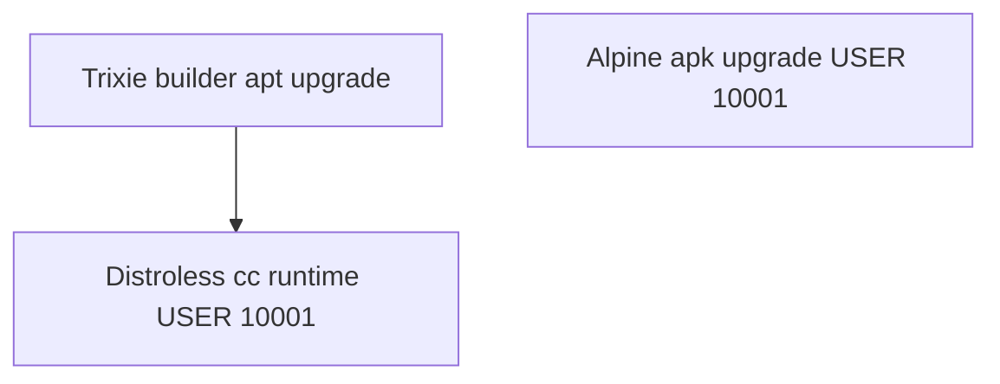

# Containers

## Local (current)

Published developer ports only: frontend and API. ParadeDB, both Valkey instances, ClamAV, crawl-proxy, and the worker have **no host ports** in `docker-compose.yml`. The worker also joins `edge` so `host.docker.internal:54322` is reachable; Compose `private` is `internal: true` and cannot route to the Docker host gateway. See [LOCAL_RELEASE_CANDIDATE.md](../deployment/LOCAL_RELEASE_CANDIDATE.md).

Application images use a split base: CPython services build on official
`python:3.11-slim-trixie` and copy onto `gcr.io/distroless/cc-debian13:nonroot`
so perl-base is not in the scanned runtime. Frontend and parser pin official
Alpine digests and run `apk upgrade --no-cache` as root before
`USER 10001:10001`. Digests: [`IMAGE_DIGESTS.md`](../../infra/paradedb/IMAGE_DIGESTS.md).
uv stays `ghcr.io/astral-sh/uv:0.11.23`; frontend corepack stays `pnpm@9.15.0`
on the build stage. The frontend runner deletes bundled npm. Distroless has no
`/bin/sh`, so `api`, `worker`, and `crawl-proxy` Compose healthchecks use
exec-form `CMD python -c ...`. API/worker/agents also copy an `ldd` closure of
libffi and native-wheel libraries onto the distroless runtime (no dpkg
database, so perl-base is not scanned). See
[ADR-alpine-application-bases-trivy.md](../adr/ADR-alpine-application-bases-trivy.md).

Packet 8 local proof uses the optional overlay [`docker-compose.packet8.yml`](../../docker-compose.packet8.yml). It attaches ClamAV and ParadeDB to a non-internal `packet8-host` bridge and publishes ClamAV `:13310`, ParadeDB `:54329`, and crawl-proxy `:18080` so host pytest can reach them. The default `private` network stays `internal: true`. Do not apply that overlay in staging or production.

## Staging / production (planned)

Vercel frontend, CloudFront/WAF → EC2 Compose (API blue/green, worker, ParadeDB, Valkey, crawl proxy), managed Supabase, SES. See Phase 10–11.

## Links

- [System context](./01-system-context.md)
- [Deployment](./04-deployment.md)
- [docs index](../README.md)
