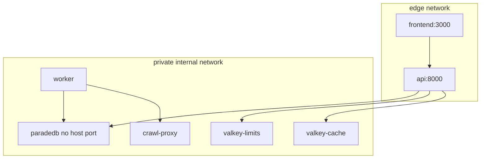

# Containers

## Local (current)

Published developer ports only: frontend and API. ParadeDB, both Valkey instances, and crawl-proxy have **no host ports**.

## Staging / production (planned)

Vercel frontend, CloudFront/WAF → EC2 Compose (API blue/green, worker, ParadeDB, Valkey, crawl proxy), managed Supabase, SES. See Phase 10–11.

## Links

- [System context](./01-system-context.md)
- [Deployment](./04-deployment.md)
- [docs index](../README.md)
