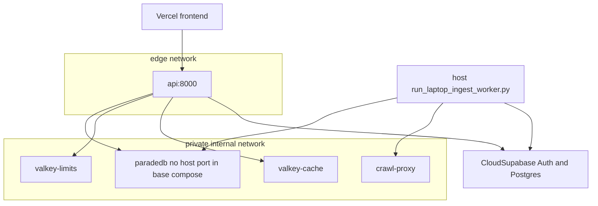
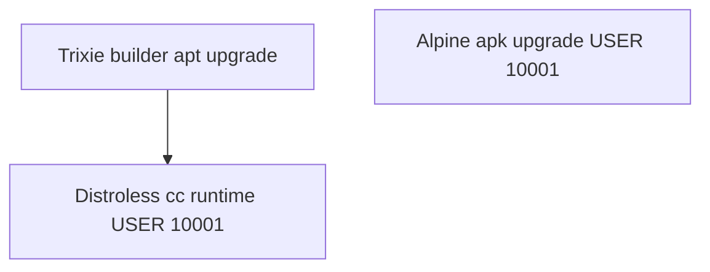
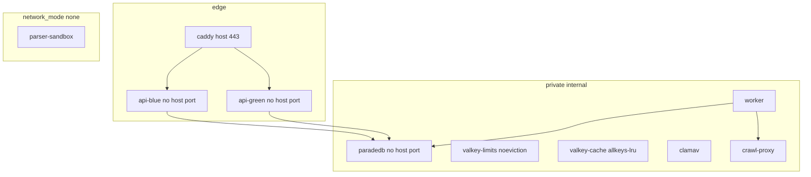

# Containers

## Local (current)

The UI is the Vercel project `smart-rag-staging`. Published developer port: API only. ParadeDB, both Valkey instances, ClamAV, crawl-proxy, and the distroless Compose `worker` have **no host ports** in `docker-compose.yml`. The Compose `worker` is behind the non-default `compose-worker` profile because it cannot launch `--network none` parser containers. Local ingest uses `scripts/ops/run_laptop_ingest_worker.py`. Auth/Postgres/Storage are the cloud project; Compose `private` is `internal: true` and cannot route to the Docker host gateway.

Application images use a split base: CPython services build on official
`python:3.11-slim-trixie` and copy onto `gcr.io/distroless/cc-debian13:nonroot`
so perl-base is not in the scanned runtime. Frontend and parser pin official
Alpine digests and run `apk upgrade --no-cache` as root before
`USER 10001:10001`. Digests: [`IMAGE_DIGESTS.md`](../../infra/paradedb/IMAGE_DIGESTS.md).
uv stays `ghcr.io/astral-sh/uv:0.11.23`; frontend corepack stays `pnpm@9.15.0`
on the build stage. The frontend runner deletes bundled npm. Distroless has no
`/bin/sh`, so `api`, `worker`, and `crawl-proxy` Compose healthchecks use
exec-form `CMD python -c ...`. API/worker/agents also copy an `ldd` closure of
libffi and native-wheel libraries onto the distroless runtime (no dpkg
database, so perl-base is not scanned). See
[ADR-alpine-application-bases-trivy.md](../adr/ADR-alpine-application-bases-trivy.md).

Packet 8 local proof uses the optional overlay [`docker-compose.packet8.yml`](../../docker-compose.packet8.yml). It attaches ClamAV and ParadeDB to a non-internal `packet8-host` bridge and publishes ClamAV `127.0.0.1:13310`, ParadeDB `127.0.0.1:55432`, and crawl-proxy `127.0.0.1:18080` so the host worker and host pytest can reach them. The default `private` network stays `internal: true`. Do not apply that overlay in staging or production.

## Staging / production (Packet 1 IaC)

Vercel frontend, CloudFront/WAF → EC2 Compose (Caddy, API blue/green, worker,
digest-pinned ParadeDB, split Valkey, crawl proxy, provider-egress stub,
ClamAV, parser-sandbox with `network_mode: none`). Managed Supabase is
canonical; LightRAG stays in-process. SES is sandbox in staging. Live apply
is Blocked in Packet 1. Packet 3 asserts origin/egress/timeout IaC; live
CDN/scan/alarm remain Blocked. See [MANAGED_STAGING.md](../deployment/MANAGED_STAGING.md).

Do not apply `docker-compose.packet8.yml` in staging.

## Links

- [System context](./01-system-context.md)
- [Deployment](./04-deployment.md)
- [docs index](../README.md)
