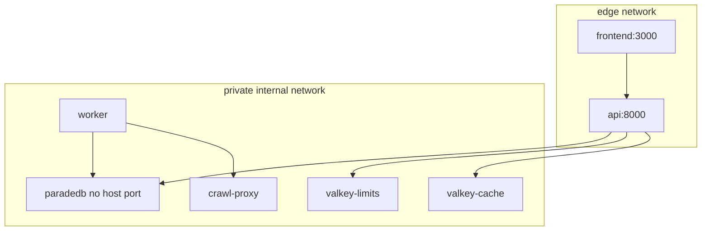

# Containers

## Local (current)

Published developer ports only: frontend and API. ParadeDB, both Valkey instances, ClamAV, and crawl-proxy have **no host ports** in `docker-compose.yml`.

Packet 8 local proof uses the optional overlay [`docker-compose.packet8.yml`](../../docker-compose.packet8.yml). It attaches ClamAV and ParadeDB to a non-internal `packet8-host` bridge and publishes ClamAV `:13310`, ParadeDB `:54329`, and crawl-proxy `:18080` so host pytest can reach them. The default `private` network stays `internal: true`. Do not apply that overlay in staging or production.

## Staging / production (planned)

Vercel frontend, CloudFront/WAF → EC2 Compose (API blue/green, worker, ParadeDB, Valkey, crawl proxy), managed Supabase, SES. See Phase 10–11.

## Links

- [System context](./01-system-context.md)
- [Deployment](./04-deployment.md)
- [docs index](../README.md)
