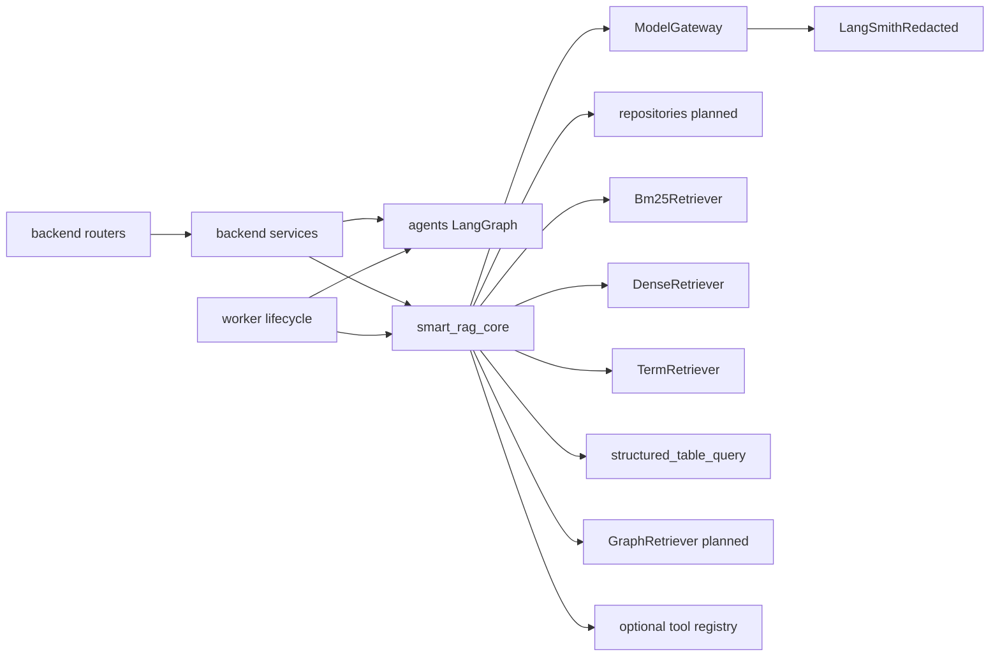

# Components

| Component | Ownership | Phase status |
| --- | --- | --- |
| FastAPI routers/middleware | `apps/backend` | foundation live/ready |
| LangGraph query admission / routing / fusion / optional tools / answer / verifier / ingestion probe | `apps/agents` | query: `enforce_admission` → memory → prepare → plan → branches → one correction → fuse → tables → optional tools → answer → verify; ingestion: lease/ledger probe |
| Worker entrypoint | `apps/worker` | process contract only |
| Settings / logging / model gateway / LangSmith | `packages/core` | Gateway tracing live; production query-graph feedback is Phase 6 |
| Hybrid retrieval / BM25 / LightRAG | `packages/core` | Phase 4 Packet 2–7 dense/BM25/term/rerank/coverage/tables; LightRAG Phase 5 |
| Next.js UI | `apps/frontend` | scaffold; Stitch Phase 8 |

## Links

- [Containers](./02-containers.md)
- [Workspace boundaries](../development/WORKSPACE_BOUNDARIES.md)
- [Hybrid retrieval contract](../retrieval/HYBRID_RETRIEVAL_CONTRACT.md)
- [Structured-table contract](../retrieval/STRUCTURED_TABLE.md)
- [LangSmith tracing](../development/LANGSMITH_TRACING.md)
- [Query routing](../agent/QUERY_ROUTING.md)
- [Combined fusion](../agent/COMBINED_FUSION.md)
- [Answer verification](../agent/ANSWER_VERIFICATION.md)
- [Optional tools](../agent/OPTIONAL_TOOLS.md)
- [docs index](../README.md)
