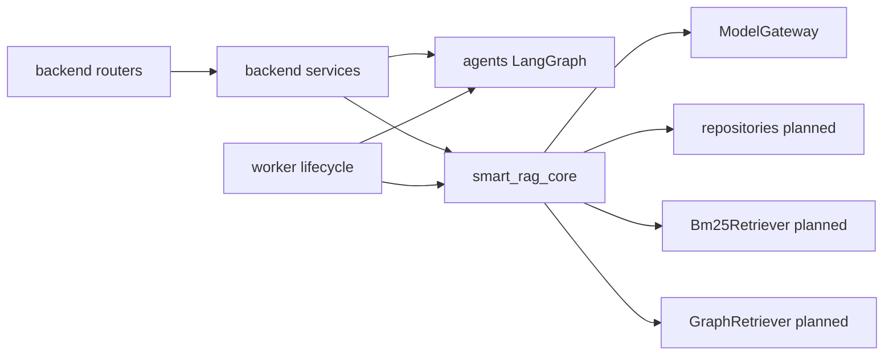

# Components

| Component | Ownership | Phase status |
| --- | --- | --- |
| FastAPI routers/middleware | `apps/backend` | foundation live/ready |
| LangGraph query/ingestion scaffolds | `apps/agents` | loadable, unconfigured business |
| Worker entrypoint | `apps/worker` | process contract only |
| Settings / logging / model gateway | `packages/core` | Phase 1 Packet 4 |
| Hybrid retrieval / BM25 / LightRAG | `packages/core` | planned Phases 4–5 |
| Next.js UI | `apps/frontend` | scaffold; Stitch Phase 8 |

## Links

- [Containers](./02-containers.md)
- [Workspace boundaries](../development/WORKSPACE_BOUNDARIES.md)
- [docs index](../README.md)
