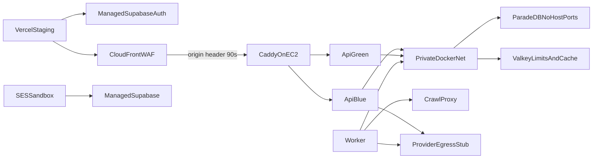

# Deployment

## Local (current)

| Node | Port / exposure | State |
| --- | --- | --- |
| Next.js | host 3000 | scaffold |
| FastAPI | host 8000 | live + unconfigured ready |
| Worker | private + edge, no host port | local candidate; `host.docker.internal` for Supabase |
| ParadeDB | private only | pg_search health |
| Valkey limits/cache | private only | auth + distinct policies |
| Crawl proxy | private only | deny-by-default |
| Supabase CLI | 54321+ when installed | stock Phase 1 config |

Start: `.\scripts\dev.ps1` · Stop: `.\scripts\stop.ps1` · Reset: `.\scripts\reset.ps1 -ConfirmReset` · Candidate freeze: [LOCAL_RELEASE_CANDIDATE.md](../deployment/LOCAL_RELEASE_CANDIDATE.md)

## Staging (Packet 1 IaC; live apply Blocked)

Reviewed Terraform and `infra/ec2/docker-compose.staging.yml`. Live
CloudFront/EC2/Supabase/Vercel/SES are **not** proven. See
[MANAGED_STAGING.md](../deployment/MANAGED_STAGING.md).

EC2 is rebuildable, encrypted EBS, IMDSv2 hop 1, SSM-only, CloudFront
origin-facing prefix list ingress, no SSH. ParadeDB/Valkey/LightRAG have no
public path. Frontend stays on Vercel with public keys only. Packet 3
asserts origin 403, egress deny-by-default, unpublished private ports, and
90s CloudFront/Caddy timeouts in IaC. Live CDN requests, port scans, and
CloudWatch alarm delivery remain Blocked.

## Links

- [Containers](./02-containers.md)
- [Availability triggers](./AVAILABILITY_AND_ISOLATION_TRIGGERS.md)
- [docs index](../README.md)
