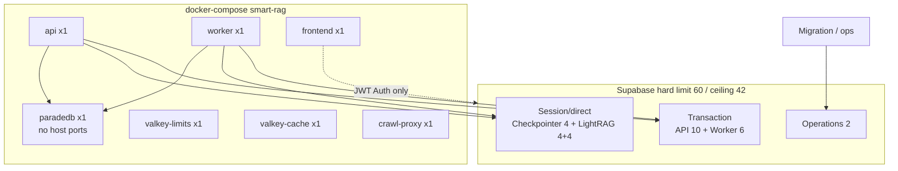
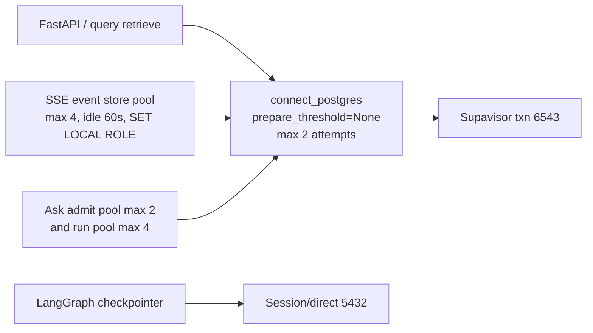

# Database connections and pool budgets

Packet 6 proves worst-case Supabase connections stay below **70%** of the selected
tier hard limit using the **actual** Compose process inventory (not planned
replicas). Canonical Auth/Postgres is the cloud project; see
[ADR-cloud-only-supabase-no-local-fixture.md](../adr/ADR-cloud-only-supabase-no-local-fixture.md).

## Selected tier (managed smart-rag Free/Nano-class)

| Setting | Proven value |
| --- | --- |
| Selected tier hard limit | **60** direct connections |
| 70% budget ceiling | **42** connections |
| Reserved operations | **2** |
| Worst-case provisional sum | **30** |
| Gate | **30 < 42** ✓ |

Managed custody of pooler wiring and production pool changes remains
**Phase 10**; this packet proves local role settings + documented math
against the selected Nano limit. Managed Pro pooling is **Not Run**.
Local worst-case math remains **30 < 42**.

## Process inventory (from `docker-compose.yml`)

| Compose service | Replicas | Publishes host ports | Supabase consumers |
| --- | --- | --- | --- |
| `api` | 1 (no `deploy.replicas`) | yes (`API_HOST_PORT`) | txn + session/direct pools |
| `worker` | 1 | no | txn + LightRAG session |
| `paradedb` | 1 | **none** (private network only) | independent BM25 budget |
| `valkey-limits` | 1 | no | none (Valkey) |
| `valkey-cache` | 1 | no | none (Valkey) |
| `crawl-proxy` | 1 | no (expose 8080 internal) | none |
| `frontend` | 1 | yes | Auth/Storage via Supabase URL only |



**Multiplication:** with one API and one worker process, provisional caps are used
as-is. Adding API/worker replicas would multiply txn/session pools and must
re-run this gate (ADR + resize if ≥42).

## Per-service pool caps (proven candidates)

| Service | Pool mode | Cap | Role |
| --- | --- | --- | --- |
| FastAPI request/RPC | transaction (Supavisor) | 10 | `app_api` |
| FastAPI checkpointer | session/direct | 4 | `app_checkpointer` |
| FastAPI LightRAG adapter | session/direct | 4 | `app_lightrag` |
| Worker ingestion/index | transaction | 6 | `app_worker` |
| Worker LightRAG adapter | session/direct | 4 | `app_lightrag` |
| Operations/migrations | direct | 2 | bootstrap / ops (not runtime) |

**Worst-case sum:** 10 + 4 + 4 + 6 + 4 + 2 = **30** (< 42).

Transaction pooling must not carry session GUC identity; checkpointer and
LightRAG never use transaction mode. `app.validate_caller_context` takes typed
arguments only (contract: `tests/contract/test_connection_budgets.py`).

## Prepared statements on the transaction pooler

Supavisor transaction mode (port `6543`) reuses backend sessions across
clients. Psycopg 3 names prepared statements by default; a later checkout
then raises `DuplicatePreparedStatement` during Hybrid retrieve, citation
persist, or conversation RPC.

Runtime rule: every FastAPI/query `psycopg.connect` that may use
`API_SUPABASE_DB_URL` / `SUPABASE_DB_URL` must go through
`smart_rag_core.settings.postgres_connect.connect_postgres`, which sets
`prepare_threshold=None`. The helper retries at most once inside a 1.0s
budget when SQLSTATE class `08` or a wrapped socket/DNS/connect error
has no SQLSTATE. The delay is at most 100 ms and never exceeds remaining
budget. Authentication failures (`28P01`) are not retried. Logs include
only operation, attempt, and a fixed `transient_connect` reason.

SSE `PostgresRunEventStore` lends sessions from a
`BoundedConnectionPool` (`smart_rag_core.settings.postgres_pool`): at most
`EVENT_STORE_POOL_MAX_SIZE` = 4 per API process, counted inside the
FastAPI request/RPC cap of 10 above. A session idle for 60 seconds or
more is closed instead of reused. A caller that waits more than 2 seconds
for a free session gets `event_store_busy`. Each transaction runs
`SET LOCAL ROLE app_api; SET LOCAL lock_timeout TO '2s'`, so no pooled
server session keeps `app_api` after commit. Any operation error rolls
back best-effort, closes that session, and re-raises. Read-only
`list_after` may retry once before any row is returned. Append and
terminal writes never auto-replay.

Ask admission uses two more pools in
`smart_rag_api.services.api_postgres_pool`, also inside that cap of 10:
admission max 2, and the per-run `app_api` connection max 4
(4 + 2 + 4 = 10). Admit and the user-message insert share one admission
session as two transactions (`SET LOCAL ROLE app_api` each), so a question
does not open a second pooler handshake for the insert. The run pool is
filled once at API startup and reused after each run releases it. A
checkout that finds every slot lent opens one direct connection and closes
it, which is the ephemeral connect this path used before pooling. Idle
sessions older than 60 seconds are closed.

SSE event-store and LangGraph checkpointer already
disable prepares (`prepare_threshold=None` / `0`). asyncpg LightRAG uses
`statement_cache_size=0`. Do not add named prepares on pooler DSNs.



Verification: `uv run pytest tests/unit/test_postgres_dsn.py tests/unit/test_hybrid_run.py tests/unit/test_general_chat_generate.py tests/unit/test_query_sse_event_store.py tests/unit/test_api_postgres_pool.py tests/unit/test_readiness.py -q`

## Role timeouts / work_mem / application_name

Applied in `20260813150000_audit_chain_role_timeouts_v1.sql` and introspected via
`pg_roles.rolconfig` (login as the role applies GUCs; `SET ROLE` alone does not).

| Role | `statement_timeout` | `lock_timeout` | `idle_in_transaction_session_timeout` | `work_mem` | `application_name` |
| --- | --- | --- | --- | --- | --- |
| `app_api` | 15s | 2s | 5s | 8MB | `smart-rag-api` |
| `app_worker` | 60s | 5s | 15s | 16MB | `smart-rag-worker` |
| `app_checkpointer` | 30s | 3s | 10s | 16MB | `smart-rag-checkpointer` |
| `app_lightrag` | 120s | 5s | 30s | 16MB | `smart-rag-lightrag` |
| `app_audit_writer` | 15s | 2s | 5s | 8MB | `smart-rag-audit` |

Long-document Hybrid ingest (Phase 3 overlay Packet 14) does **not** change
those role defaults. `apply_long_document_write_timeouts` issues
`SET LOCAL statement_timeout = '300s'` and
`SET LOCAL idle_in_transaction_session_timeout = '180s'` inside the
embedding-ledger and canonical-write transactions only. See
[INGESTION_LIMITS.md](../ingestion/INGESTION_LIMITS.md).

### Verification SQL

```sql
SELECT rolname, rolconfig
FROM pg_roles
WHERE rolname IN (
  'app_api', 'app_worker', 'app_checkpointer', 'app_lightrag', 'app_audit_writer'
)
ORDER BY rolname;
```

## ParadeDB (independent host budget)

Does **not** consume Supabase connections. See [07-bm25-projection.md](./07-bm25-projection.md).

## Verification commands

```powershell
uv run python scripts/ci/check_migrations.py
uv run pytest tests/contract/test_connection_budgets.py -q
```

Related: [06-database-workload-isolation.md](./06-database-workload-isolation.md) ·
[08-data-dictionary.md](./08-data-dictionary.md) ·
[AUDIT_CHAIN.md](../security/AUDIT_CHAIN.md) ·
[CONFIGURATION.md](../development/CONFIGURATION.md)
