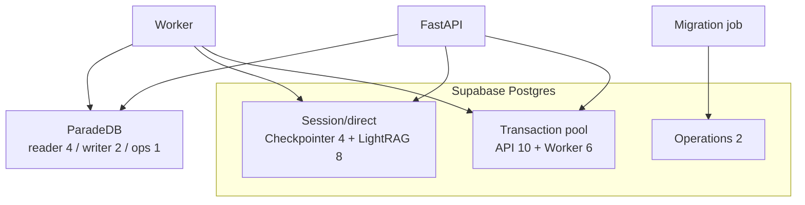

# Database connections and pool budgets

Provisional caps from Phase 2 plan. Packet 6 proves worst-case totals stay below **70%** of the selected Supabase tier hard limit before production bulk ingest.

## Supabase tier assumption (local + managed target)

| Setting | Provisional value |
| --- | --- |
| Selected tier hard limit | 60 direct connections (Micro/small dev default; resize before bulk ingest) |
| 70% budget ceiling | 42 connections |
| Reserved operations | 2 |

## Per-service pool caps (provisional)

| Service | Pool mode | Cap | Purpose |
| --- | --- | --- | --- |
| FastAPI request/RPC | transaction (Supavisor) | 10 | CRUD, retrieval RPCs, health metadata |
| FastAPI checkpointer | session/direct | 4 | LangGraph query resume |
| FastAPI LightRAG adapter | session/direct | 4 | Graph context reads |
| Worker ingestion/index | transaction | 6 | Jobs, canonical writes, outbox claim |
| Worker LightRAG adapter | session/direct | 4 | Graph indexing |
| Operations/migrations | direct | 2 | DDL, bootstrap, health probes |

**Worst-case sum:** 10 + 4 + 4 + 6 + 4 + 2 = **30** (< 42 ceiling at 60-connection tier).

Transaction pooling must not carry session GUC identity; checkpointer and LightRAG never use transaction mode.

## ParadeDB (independent host budget)

| Pool | Cap |
| --- | --- |
| API BM25 reader | 4 |
| Worker BM25 writer | 2 |
| Operations | 1 |

ParadeDB connections do **not** consume Supabase pool budget. See [07-bm25-projection.md](./07-bm25-projection.md).

## Connection flow



## Timeouts (provisional defaults)

| Role | `statement_timeout` | `lock_timeout` | `idle_in_transaction_session_timeout` |
| --- | --- | --- | --- |
| API transaction | 15s | 2s | 5s |
| API session (checkpointer/LightRAG) | 30s | 3s | 10s |
| Worker transaction | 60s | 5s | 15s |
| Worker session (LightRAG) | 120s | 5s | 30s |
| Operations/migrations | 600s | 10s | 60s |
| ParadeDB reader | 10s | 2s | 5s |
| ParadeDB writer | 30s | 3s | 10s |

Packet 3 applies these via role `ALTER ROLE` settings once runtime roles exist.

## Verification

```powershell
uv run python scripts/ci/check_migrations.py
npx supabase db reset --yes
uv run pytest tests/contract/test_schema_reset.py -q
```

Related: [06-database-workload-isolation.md](./06-database-workload-isolation.md) · [08-data-dictionary.md](./08-data-dictionary.md)
