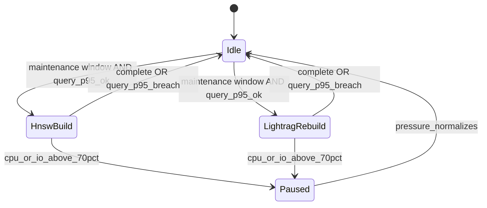

# Database workload isolation

Connection caps limit concurrency; this document defines **workload isolation**: timeouts, memory bounds, maintenance concurrency, and the escalation ladder when user-query SLOs or database pressure breach gates.

## Isolation controls (Packet 3+ runtime)

| Control | API txn | Worker txn | Session pools | Maintenance |
| --- | --- | --- | --- | --- |
| `work_mem` cap | 8MB | 16MB | 16MB | 64MB (maintenance role) |
| Query tagging | `app=api` | `app=worker` | `app=session` | `app=maintenance` |
| HNSW build | forbidden | forbidden | forbidden | one at a time |
| LightRAG clean rebuild | forbidden | serialized job | serialized job | one at a time |

## Maintenance concurrency

HNSW creation/reindex and clean LightRAG rebuilds run **one at a time** in approved windows and pause automatically when Hybrid query p95 breaches its gate or database CPU/IO exceeds **70%**.

## Escalation ladder (signed triggers)

1. **Tune and vertical resize** — index params, `work_mem`, tier RAM/CPU.
2. **Read replica for Hybrid candidates** — when sustained read-heavy CPU/IO > 70% for three 15-minute windows in a week; revalidate every candidate ID/current-version/ACL on primary before evidence assembly.
3. **Dedicated LightRAG Postgres** — when graph rebuild/storage dominates or replica lag cannot meet deletion/ACL semantics; accessed only through `GraphRetriever`.

No replica or graph store bypasses primary canonical authorization.

## Observability hooks

- Tag every pooled connection with deployable + route (`api/query`, `worker/ingest`, `worker/bm25`, `worker/graph`).
- Emit pool wait time, active connections, and `pg_stat_activity` counts per role in Phase 9 load tests.
- ParadeDB isolation metrics remain separate (CPU/memory/lag/rebuild duration).

## Related

- [05-database-connections.md](./05-database-connections.md)
- [AVAILABILITY_AND_ISOLATION_TRIGGERS.md](./AVAILABILITY_AND_ISOLATION_TRIGGERS.md)
- [QUALITY_TARGETS.md](../QUALITY_TARGETS.md)
