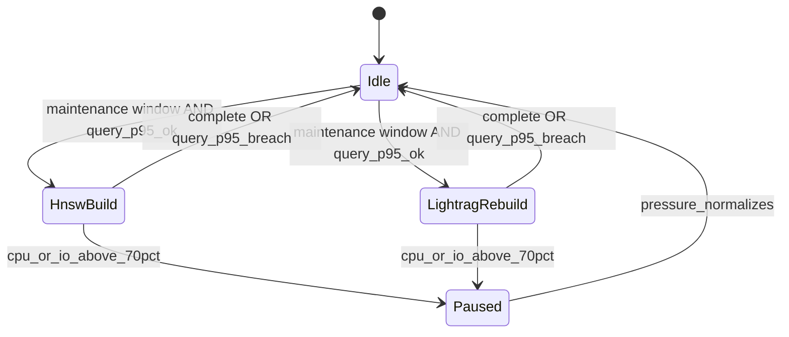

# Database workload isolation

Connection caps limit concurrency; this document defines **workload isolation**:
timeouts, memory bounds, maintenance concurrency, and the escalation ladder when
user-query SLOs or database pressure breach gates.

Packet 6 applied role-specific timeouts / `work_mem` / `application_name` in
migration `20260813150000_audit_chain_role_timeouts_v1.sql`. Values and
introspection SQL live in [05-database-connections.md](./05-database-connections.md).

## Isolation controls

| Control | API txn (`app_api`) | Worker txn (`app_worker`) | Session (`app_checkpointer` / `app_lightrag`) | Maintenance |
| --- | --- | --- | --- | --- |
| `statement_timeout` | 15s | 60s | 30s / 120s | window-approved window |
| `lock_timeout` | 2s | 5s | 3s / 5s | 10s |
| `idle_in_transaction_session_timeout` | 5s | 15s | 10s / 30s | 60s |
| `work_mem` cap | 8MB | 16MB | 16MB | 64MB (ops role) |
| Query tagging | `application_name=smart-rag-api` | `smart-rag-worker` | `smart-rag-checkpointer` / `smart-rag-lightrag` | ops job name |
| HNSW build | forbidden | forbidden | forbidden | one at a time |
| LightRAG clean rebuild | forbidden | serialized job | serialized job | one at a time |

## Maintenance pause / isolation triggers

HNSW creation/reindex and clean LightRAG rebuilds run **one at a time** in
approved windows and **pause automatically** when:

- Hybrid query p95 breaches its signed gate, or
- database CPU/IO exceeds **70%**.

Foreground query traffic must not share unbounded `work_mem` with maintenance.

## Escalation ladder (signed triggers)

1. **Tune and vertical resize** — index params, `work_mem`, tier RAM/CPU.
2. **Read replica for Hybrid candidates** — when sustained read-heavy CPU/IO >
   70% for three 15-minute windows in a week; revalidate every candidate
   ID/current-version/ACL on **primary** before evidence assembly.
   **Not provisioned in Phase 2** — design only.
3. **Dedicated LightRAG Postgres** — when graph rebuild/storage dominates or
   replica lag cannot meet deletion/ACL semantics; accessed only through
   `GraphRetriever`.

No replica or graph store bypasses primary canonical authorization.

## Observability hooks

- Tag every pooled connection with deployable `application_name` (applied).
- Emit pool wait time, active connections, and `pg_stat_activity` counts per
  role in Phase 9 load tests (**unverified** here; no load claims).
- ParadeDB isolation metrics remain separate (CPU/memory/lag/rebuild duration).

## Related

- [05-database-connections.md](./05-database-connections.md)
- [AVAILABILITY_AND_ISOLATION_TRIGGERS.md](./AVAILABILITY_AND_ISOLATION_TRIGGERS.md)
- [QUALITY_TARGETS.md](../QUALITY_TARGETS.md)
