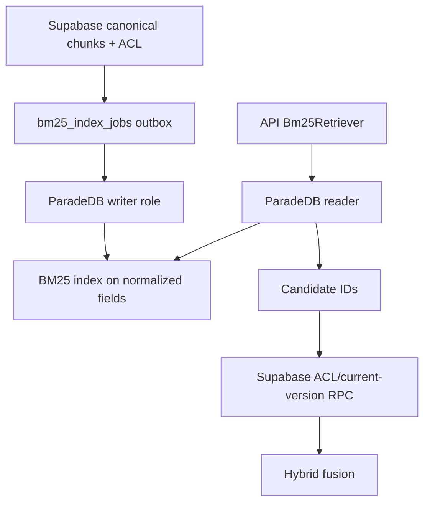

# BM25 projection (ParadeDB / `pg_search`)

Canonical passages, ACL, and current-version state live in Supabase. ParadeDB
holds only a rebuildable lexical projection keyed by canonical chunk/version IDs.

## Pins (Phase 2 Packet 1)

| Item | Value |
| --- | --- |
| Image | `paradedb/paradedb:pg17@sha256:dca046b8a0ddd070c368d5254cbb7f596b3b7bc67bc2efa7c0fbe881087883bb` |
| Postgres | 17.10 |
| `pg_search` | 0.25.2 |
| Normalization | `arabic_norm_v1` |
| Tokenizer | `pdb.unicode_words` (no English stemmer on Arabic) |
| Network | Private Compose `private` network only |

## Independent connection / resource budget (Packet 6)

ParadeDB connections **do not** consume the Supabase 60-connection hard limit.

| Pool | Cap | Consumer |
| --- | --- | --- |
| API BM25 reader | 4 | `api` via `PARADEDB_URL` (reader creds) |
| Worker BM25 writer | 2 | `worker` via writer creds |
| Operations | 1 | bootstrap / rebuild |

**Worst-case ParadeDB:** 4 + 2 + 1 = **7** (independent of Supabase 30).

| Resource | Bound (Compose) |
| --- | --- |
| Container memory | `mem_limit: 2g` / deploy limit 2G |
| CPUs | deploy limit `2.0` |
| Statement timeout (reader / writer) | 10s / 30s (documented targets; applied in ParadeDB role bootstrap when roles login) |
| Public host ports | **none** — `docker-compose.yml` omits `ports:` for `paradedb` |
| Provider egress | none (internal `private` network) |
| Encrypted volume | local Docker volume; managed EBS encryption deferred to Phase 10 |

### No-public-port proof

```yaml
# docker-compose.yml service paradedb
# No ports: published intentionally omitted.
networks:
  - private
```

Contract: `tests/contract/test_compose_topology.py` (private services) plus Packet 6
docs review of Compose inventory.

## Split / rebuild triggers (linked to quality targets)

If any of the following fire, reduce the BM25 envelope or move the service via ADR:

- BM25 index memory/CPU > **70%** of its allocation
- p95 top-75 exceeds the signed Hybrid BM25 target
- projection lag > **five minutes** under normal ingestion
- clean rebuild misses the signed maintenance window

See [QUALITY_TARGETS.md](../QUALITY_TARGETS.md).

## Data flow



## Verification

```powershell
uv run pytest tests/contract/test_paradedb_bm25.py tests/contract/test_compose_topology.py -q
```

Related: [ARABIC_NORMALIZATION.md](../retrieval/ARABIC_NORMALIZATION.md) ·
[BM25_PROJECTION_CONTRACT.md](../retrieval/BM25_PROJECTION_CONTRACT.md) ·
[05-database-connections.md](./05-database-connections.md)
