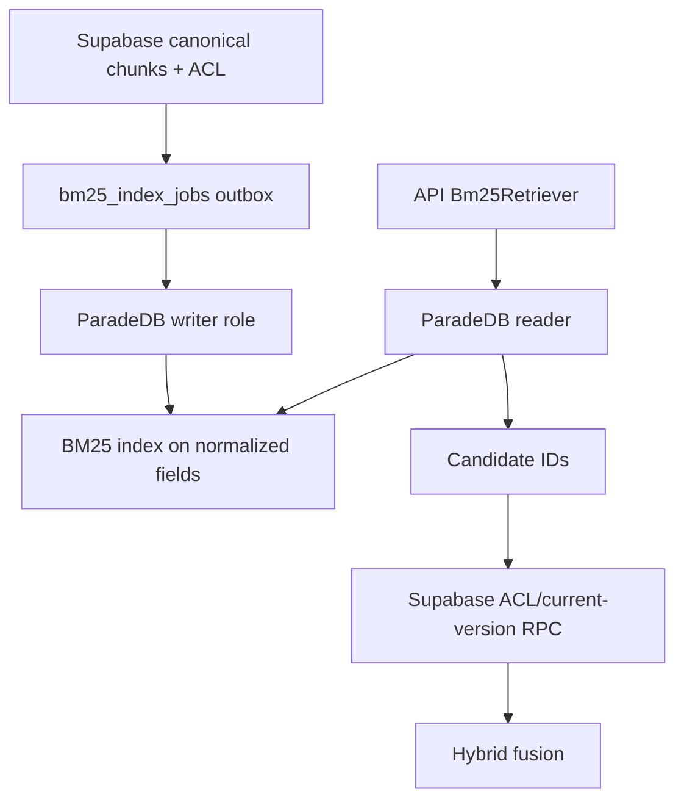

# BM25 projection (ParadeDB / `pg_search`)

Canonical passages, ACL, and current-version state live in Supabase. ParadeDB holds only a rebuildable lexical projection keyed by canonical chunk/version IDs.

## Pins (Phase 2 Packet 1)

| Item | Value |
| --- | --- |
| Image | `paradedb/paradedb:pg17@sha256:dca046b8a0ddd070c368d5254cbb7f596b3b7bc67bc2efa7c0fbe881087883bb` |
| Postgres | 17.10 |
| `pg_search` | 0.25.2 |
| Normalization | `arabic_norm_v1` |
| Tokenizer | `pdb.unicode_words` (no English stemmer on Arabic) |
| Network | Private Compose network only; no public host port |

## Resource envelope (provisional)

| Pool | Cap |
| --- | --- |
| API read | 4 |
| Worker writer | 2 |
| Ops | 1 |

Split triggers and rebuild SLOs remain as signed in [QUALITY_TARGETS.md](../QUALITY_TARGETS.md).

## Data flow



## Verification

```powershell
uv run pytest tests/contract/test_paradedb_bm25.py -q
```

Related: [ARABIC_NORMALIZATION.md](../retrieval/ARABIC_NORMALIZATION.md) · [BM25_PROJECTION_CONTRACT.md](../retrieval/BM25_PROJECTION_CONTRACT.md)
