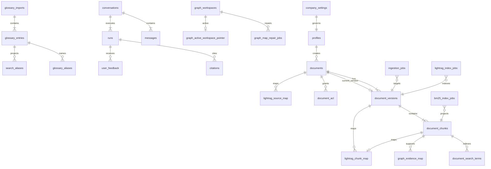

# Data dictionary (Phase 2 Packet 2)

Authoritative Supabase schema in `app`, server-only internals in `private`, search normalizer in `search`, LangGraph checkpoints in `langgraph`, LightRAG vendor storage in private schema `lightrag` (Packet 2 captured; not Graph Ready). ParadeDB holds derived `bm25_chunks` only.

## Legend

| Column | Meaning |
| --- | --- |
| Authority | `authority` = canonical source of truth; `derived` = rebuildable projection |
| Phase | Owning implementation phase for primary writers |

## Core entity diagram

## Identity and policy

| Object | Schema | Authority | Writers | Readers | Retention | Cardinality | Deletion | Idempotency | Phase |
| --- | --- | --- | --- | --- | --- | --- | --- | --- | --- |
| `profiles` | `app` | authority | Auth bootstrap (Pkt 3), admin APIs | API RLS, worker read | life of membership | ≤ active users | cascade on auth user delete | upsert by `user_id` | 2 schema / 3 RLS |
| `company_settings` | `app` | authority | owner/admin APIs | all roles read policy fields | indefinite singleton | 1 row | none (singleton) | singleton upsert | 2 schema / 3 RLS |
| `allowed_email_domains` | `app` | authority | owner/admin | invitation/auth checks | until removed | small list | hard delete | domain unique | 2 schema / 3 auth |
| `team_invitations` | `app` | authority | owner/admin invite API | invite accept flow | 24h TTL + audit | bounded active invites | revoke/accept | `token_hash` unique | 2 schema / 3 auth |
| `mfa_recovery_requests` | `app` | authority | isolated Auth Admin boundary | security operations | workflow lifetime | sparse active requests | status transition | request `id` | 2 auth |
| `mfa_recovery_verifications` | `app` | authority | isolated Auth Admin boundary | security operations | durable recovery proof | one per request | append-only | `recovery_request_id` PK | 2 auth |
| `revoked_sessions` | `app` | authority | isolated Auth Admin / API RPC | request identity gate | session lifetime | bounded revoked sessions | auth-user cascade | `session_id` PK | 2 auth |
| `auth_rate_limit_buckets` | `private` | authority | FastAPI degraded limiter | FastAPI only | rolling windows | bounded keys | window expiry GC | `(bucket_key, window_start)` PK | 2 schema / 6 runtime |

## Documents and evidence

| Object | Schema | Authority | Writers | Readers | Retention | Cardinality | Deletion | Idempotency | Phase |
| --- | --- | --- | --- | --- | --- | --- | --- | --- | --- |
| `documents` | `app` | authority | ingestion/API | Hybrid RPC, UI | until deleted + policy | ≤ 10k versions env | soft `deleted_at`; graph/BM25 enqueue | document `id` | 2 schema / 3 ingest |
| `document_versions` | `app` | authority | ingestion worker / quota reserve | retrieval recheck, status API | version history | multiple per doc | uploading shells hard-deleted on quota expiry; later statuses soft delete | `(document_id, version_number)` | 3 ingestion |
| `document_sources` | `app` | authority | upload/crawl | audit, ingestion | with version | few per version | cascade on document | source `id` | 3 ingestion |
| `document_acl` | `app` | authority | owner/admin ACL API | Hybrid RPC | while grant active | per restricted user | revoke timestamp | active grant unique | 2 schema / 3 RLS |
| `source_approval_requests` | `app` | authority | member request; admin review | admin UI | audit window | pending crawls | status transition | request `id` | 2 schema / 3 crawl |
| `document_scan_events` | `app` | authority | scanner worker | audit, promotion gate | scan evidence | many per version | cascade | append-only insert | 3 ingestion |
| `document_chunks` | `app` | authority | ingestion embed worker | Hybrid/graph resolver | corpus lifetime | ≤ 1M chunks env | soft delete + BM25 remove job | `(version_id, chunk_index)` | 3 ingestion / 4 retrieval |
| `document_tables` | `app` | authority | table parser | structured tool / `resolve_structured_table` | with version | sheets/tables | cascade | table `id` | 3 ingestion / 4 packet 7 |
| `document_table_columns` | `app` | authority | table parser | structured tool | with table | columns per table | cascade | `(table_id, ordinal)` | 3 ingestion |
| `document_search_terms` | `app` | authority | ingestion indexer | Hybrid term search | with chunk | many | cascade | term row `id` | 4 retrieval |
| `search_aliases` | `app` | derived projection | owner/admin glossary approve | Hybrid alias recall | until rollback | glossary size | hard delete on rollback | normalized alias unique | 4 retrieval |
| `glossary_imports` | `app` | authority | owner/admin import RPC | admin/audit | import lifetime | sparse batches | retain after rollback | `idempotency_key` unique | 4 packet 1 |
| `glossary_entries` | `app` | authority | owner/admin import RPC | worker read after import | with import | per batch | cascade with import | `(import_id, entry_key)` | 4 packet 1 |
| `glossary_aliases` | `app` | authority | owner/admin import RPC | worker read after import | with entry | per entry | cascade | alias row `id` | 4 packet 1 |

## Jobs and projections

| Object | Schema | Authority | Writers | Readers | Retention | Cardinality | Deletion | Idempotency | Phase |
| --- | --- | --- | --- | --- | --- | --- | --- | --- | --- |
| `ingestion_jobs` | `app` | authority | API admit; worker lease | worker, admin | completed + DLQ policy | queue depth | archive/DLQ | `idempotency_key` UNIQUE | 3 ingestion |
| `bm25_index_jobs` | `app` | authority | ingestion/delete paths | BM25 worker | until projected | outbox depth | completed/DLQ | `idempotency_key` UNIQUE | 3 ingest / 4 query |
| `bm25_index_versions` | `app` | authority | ops/admin activate | BM25 worker/reader | all versions metadata | small | deactivate only | version_number unique | 2 schema / 4 BM25 |
| `lightrag_index_jobs` | `app` | authority | graph eligibility changes | graph worker | until indexed | queue depth | completed/DLQ | `idempotency_key` UNIQUE | 5 graph |
| `dead_letter_jobs` | `app` | authority | workers | admin replay | admin retention | failed jobs | manual archive | `idempotency_key` UNIQUE | 3 ingestion |
| `bm25_chunks` | ParadeDB `public` | derived | BM25 writer | BM25 reader | rebuildable | ≤ canonical chunks | purge/rebuild | chunk_id PK | 2 schema / 3 projection |
| `bm25_index_meta` | ParadeDB `public` | derived | BM25 writer | reader | with index | singleton | rebuild | singleton row | 2 schema / 4 BM25 |

## Graph mapping (canonical side)

| Object | Schema | Authority | Writers | Readers | Retention | Cardinality | Deletion | Idempotency | Phase |
| --- | --- | --- | --- | --- | --- | --- | --- | --- | --- |
| `lightrag_source_map` | `app` | authority | graph worker | resolver | while graph indexed | ≤ graph docs | cascade on document | `document_id` PK plus replay unique on version/workspace/pipeline | 5 packet 4 |
| `lightrag_chunk_map` | `app` | authority | graph worker | resolver | while mapped | graph chunks | cascade | `chunk_id` PK plus replay unique on workspace/version/vendor chunk | 5 packet 4 |
| `graph_evidence_map` | `app` | authority | graph mapper | Combined fusion | while valid and support ≥ 0.80 | many-to-many | cascade | object+chunk unique plus replay unique | 5 packet 4 |
| `graph_map_repair_jobs` | `app` | authority | graph mapper | worker | until repaired | per unavailable object/config | cascade | unique workspace/object/map_kind/config | 5 packet 4 |
| `graph_mapping_telemetry` | `app` | derived | graph mapper | ops | mapping runs | per language/type | cascade | append | 5 packet 4 |
| `graph_entity_rules` | `app` | authority | admin curation | graph indexer | until deactivated | small ruleset | soft deactivate | rule `id` | 5 graph |
| `graph_workspaces` | `app` | authority | graph worker (Pkt 3) | worker RW; API SELECT | until retired | few workspaces | state to `retired` | `workspace_key` unique | 5 packet 2 schema |
| `graph_active_workspace_pointer` | `app` | authority | graph worker (Pkt 7 FOR UPDATE) | worker RW; API SELECT | singleton | 1 row | none | fixed UUID | 5 packet 2 schema |
| `graph_writer_lease` | `app` | authority | graph worker (Pkt 3 writer RPCs) | worker only | singleton | 1 row | none | fixed UUID | 5 packet 3 occupy/heartbeat/release |
| `lightrag.schema_capture_status` | `lightrag` | derived | schema-admin bootstrap | `app_lightrag` | pin lifetime | 1 row | none | capture row | 5 packet 2 |
| `lightrag.lightrag_*` vendor tables | `lightrag` | derived | LightRAG runtime DML | `app_lightrag` only | rebuildable | vendor keys | workspace rebuild | vendor PKs | 5 packet 2 capture |

## Conversations and tools

| Object | Schema | Authority | Writers | Readers | Retention | Cardinality | Deletion | Idempotency | Phase |
| --- | --- | --- | --- | --- | --- | --- | --- | --- | --- |
| `conversations` | `app` | authority | chat API | creator (+ audit) | 90d undeleted | per user | immediate delete path Pkt 6 | conversation `id` | 2 schema / 6 agent |
| `messages` | `app` | authority | chat API | creator (+ audit) | with conversation | many | cascade | message `id` | 6 agent |
| `runs` | `app` | authority | LangGraph/API | creator (+ audit) | 30d payloads | concurrent runs cap | cascade | optional idempotency | 6 agent |
| `citations` | `app` | authority | answer assembler | UI/audit | with run | bounded per answer | cascade | `(run_id, citation_index)` | 6 agent |
| `user_feedback` | `app` | authority | chat UI | eval pipelines | 12 months | sparse | cascade | feedback `id` | 6 agent |
| `tool_catalog` / `tool_versions` / `tool_permissions` / `tool_usage_events` | `app` | authority | admin/catalog | progressive disclosure | catalog lifetime | small | deactivate/delete | tool_key unique | 6 agent |

## Usage, audit, checkpoints

| Object | Schema | Authority | Writers | Readers | Retention | Cardinality | Deletion | Idempotency | Phase |
| --- | --- | --- | --- | --- | --- | --- | --- | --- | --- |
| `llm_usage` | `app` | authority | model gateway | dashboards | 24mo aggregates | high append | none (aggregate) | usage row `id` | 6 agent |
| `budget_reservations` | `app` | authority | API reserve/commit | gateway | until settled | active reservations | release/commit | reservation `id` | 6 agent |
| `upload_quota_reservations` | `app` | authority | upload API (`reserve`/`finalize`) | Storage admit + cleanup | 15m admission; effective capability `min(reservation, JWT exp)` | active uploads | expire/release + Storage API cleanup | `(user_id, idempotency_key)` unique when key set | 2 schema / 5 storage |
| `retention_holds` | `app` | authority | admin/compliance | purge planners | until released | sparse | release only | hold `id` | 2 structure / later purge |
| `offboarding_requests` | `app` | authority | isolated Auth Admin boundary | ops | until completed | per subject | status machine | request `id` | 2 security effects / later export-purge |

## Private Storage buckets (Packet 5)

All buckets `public=false`. Browser JWT may `INSERT` only into `documents-quarantine` under `{auth.uid()}/{reservation_id}/{safe_filename}` with an active reservation; quarantine has **no** authenticated `SELECT`/`LIST`. Originals, web snapshots, table artifacts, and exports are privileged Storage Admin / worker only.

| Bucket | Path contract |
| --- | --- |
| `documents-quarantine` | `{auth.uid()}/{reservation_id}/{safe_filename}` |
| `documents-originals` | `documents/{document_id}/versions/{version_id}/{safe_filename}` |
| `web-snapshots` | `sources/{source_id}/crawls/{crawl_version}/{safe_filename}` |
| `table-artifacts` | `documents/{document_id}/versions/{version_id}/tables/{sheet}/{safe_filename}` |
| `exports` | `exports/{user_id}/{export_id}/{safe_filename}` |

See [ADR-upload-capability-and-storage-privilege.md](../adr/ADR-upload-capability-and-storage-privilege.md).
| `audit_events` | `app` | authority | audit writer fn | admin/chain export | 7 years | append-only | **blocked** | event `id` | 2 schema / 6 chain |
| `audit_chain_anchors` | `app` | authority | anchor job | compliance | 7 years | daily anchors | none | anchor_date unique | 6 chain |
| `restricted_read_events` | `app` | authority | evidence/download RPC | audit | 7 years | sparse | none | event `id` | 2 schema / 3 ACL |
| `admin_notifications` | `app` | authority | anomaly detectors | admin UI | until ack | bounded | ack only | notification `id` | 2 schema / 6 alerts |
| `langgraph.checkpoints*` | `langgraph` | authority | checkpointer | agents/worker | 30d undeleted runs | thread keyed | GC job | vendor PKs | 2 placeholder / 3 grants |

## Key invariants (schema-enforced)

- `documents.current_version_id` must reference a version belonging to the same document (trigger `app.enforce_document_current_version`).
- `documents.graph_eligible` requires `company_visible`, non-null current version, and no soft delete.
- Restricted visibility uses per-user `document_acl` grants only.
- `document_chunks.embedding` is `vector(1024)` per [ADR-embedding-model-dimension](../adr/ADR-embedding-model-dimension.md). Packet 2 adds HNSW cosine index `document_chunks_embedding_hnsw_idx` and trigram GIN indexes on `term_normalized` / `alias_normalized`.
- Retrieval RPCs `retrieve_dense_candidates`, `retrieve_term_candidates`,
  `recheck_retrieval_candidates`, `fetch_authorized_chunk_context`, and
  `resolve_structured_table` are `SECURITY INVOKER` for `app_api` only.
  Authorization predicates run before rank/limit or artifact return. Context
  fetch may return non-representative parent rows and trailing `provenance jsonb`
  (sheet/range/URL locators). Table paths never come from
  the client or model.
- `search_normalized` / `term_normalized` / `alias_normalized` use `search.normalize_arabic_v1` only.
- Pending glossary imports never write `search_aliases`; approval projects aliases; rollback deletes that projection.
- Queue tables share lease/idempotency columns; `idempotency_key` is UNIQUE per table.
- `audit_events` rejects UPDATE/DELETE (append-only trigger).
- RLS is enabled on all exposed tables; Storage quarantine INSERT is reservation-scoped; no authenticated SELECT on quarantine.
- `document_scan_events` is append-only; `result=clean` inserts are blocked for non-`app_worker` roles until Phase 3.
- ACL/visibility downgrade clears `graph_eligible` and atomically enqueues `graph_acl_remove`.
- Company retention defaults: `retention_days=365`, `quarantine_ttl_hours=24`, `legal_hold_enabled=false` (Phase 1 signed defaults).
- Packet 2 vendor tables are private to schema `lightrag` with FORCE RLS and `app_lightrag` DML only. `anon` / `authenticated` / `service_role` have no vendor access. AGE is absent.
- Packet 4 expands map tables with `version_id`, `workspace_key`,
  `pipeline_version`, `config_generation`, hashes, spans, method, score,
  support, language, and provenance. Queryable evidence rows have
  `support >= 0.80`. Packet 4 adds `graph_map_repair_jobs` and
  `graph_mapping_telemetry`. Expand-only; no DROP.
- `app.graph_workspaces.state` is exactly `building`, `active`, `updating`, `filtered_dirty`, `quarantined`, `disabled`, `retired`. Embedding pin CHECKs `text-embedding-3-large` / 1024. Packet 3 leaves successful index in `updating`. Packet 4 may set `active` when maps verify and the pointer already names the workspace. This is Graph Ready on the version, not a Packet 7 switch.
- `app.budget_reservations.reservation_kind` is `ingestion_daily`, `graph_index`, or `graph_maintenance`. The kinds never share caps.

## Related docs

- [05-database-connections.md](./05-database-connections.md)
- [06-database-workload-isolation.md](./06-database-workload-isolation.md)
- [07-bm25-projection.md](./07-bm25-projection.md)
- [HYBRID_RETRIEVAL_CONTRACT.md](../retrieval/HYBRID_RETRIEVAL_CONTRACT.md)
- [GLOSSARY_IMPORT.md](../api/GLOSSARY_IMPORT.md)
- [ADR-expand-contract-migrations](../adr/ADR-expand-contract-migrations.md)
- [ADAPTER_LIFECYCLE.md](../graph/ADAPTER_LIFECYCLE.md)
- [WORKSPACE_LIFECYCLE.md](../graph/WORKSPACE_LIFECYCLE.md)
- [MAPPING.md](../graph/MAPPING.md)
- [ADR-lightrag-runtime-attach-without-ddl.md](../adr/ADR-lightrag-runtime-attach-without-ddl.md)
