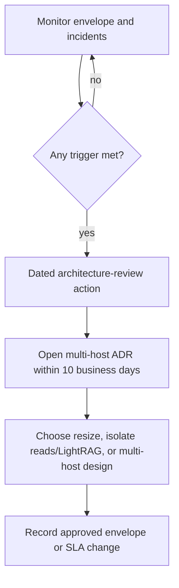

# Availability and workload-isolation triggers

Canonical copy of the single-host v1 availability posture and the multi-host / isolation review triggers from the [global contracts](../../.cursor/plans/hybrid-graph-rag/00-global-contracts.md). Accepted on 2026-08-12 via user message `approved`.

## Baseline posture (signed)

| Item | Value | Notes |
| --- | --- | --- |
| Service class | Best-effort | Single-host v1 |
| RTO | ≤ 4 hours | Restore to service |
| RPO | ≤ 24 hours | Maximum acceptable data loss window |
| Deploy interruption | Brief health-gated interruption accepted | Same-host blue/green |

## Multi-host availability ADR trigger

Open a multi-host availability ADR **within ten business days** when **any** of the following occurs:

1. Active users or concurrent runs exceed **80%** of the supported envelope for **30 days**.
2. EC2 or database CPU, memory, or IO is above **70%** for **three** 15-minute windows in a week **after tuning**.
3. **Two** availability incidents occur within **90 days**.
4. **One** incident misses RTO or RPO.
5. The business requires tighter targets than the signed RTO/RPO.

## Required review action

When a trigger fires, the named owner must:

1. Create a dated architecture-review action (not only an alarm).
2. Open or update the multi-host availability ADR within ten business days.
3. Select among: independent API/worker capacity; external rate-limit/cache service; database/read-workload isolation — rather than silently extending the single-host ceiling.
4. Record the decision, evidence links, and any envelope or SLA changes in [QUALITY_TARGETS.md](../QUALITY_TARGETS.md) only after approval.

| Field | Value |
| --- | --- |
| Trigger owner | engineering-lead (interim; confirm on sign-off) |
| Escalation | product-owner / client approver |
| Review SLA | 10 business days from trigger detection |
| Approval of this document | accepted 2026-08-12 (`approved`) |

## Related

- [QUALITY_TARGETS.md](../QUALITY_TARGETS.md) — QT-AVL-* and capacity IDs
- [RISK_REGISTER.md](../development/RISK_REGISTER.md)
- [Phase 1 foundation evidence](../development/phase-01-foundation-evidence.md)

