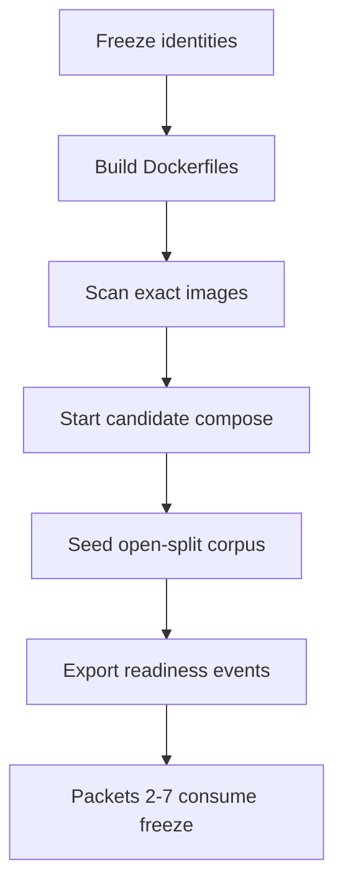

# Local release candidate

Phase 9 Packet 1 freezes the **local** candidate identity: digest-bound images
built from repository Dockerfiles, unpublished ParadeDB/Valkey/crawl-proxy
ports, an approved open-split evaluation corpus, and real public document
states. This is not managed EC2, Vercel, or hosted Supabase proof. Phase 10
owns those gates.

Related: [QUALITY_TARGETS.md](../QUALITY_TARGETS.md) ·
[sizing envelope](../../.cursor/plans/hybrid-graph-rag/shared/release/05-sizing-envelope.md) ·
[phase-09 evidence](../development/phase-09-local-release-candidate-evidence.md) ·
[QUALITY_COMMANDS.md](../development/QUALITY_COMMANDS.md) ·
[CONFIGURATION.md](../development/CONFIGURATION.md) ·
[LOCAL_SETUP.md](../development/LOCAL_SETUP.md) ·
[deployment C4](../architecture/04-deployment.md)

## Candidate identity

The candidate Compose file is `docker-compose.yml` only. Overlay
`docker-compose.packet8.yml` publishes ParadeDB `:54329`, ClamAV `:13310`, and
crawl-proxy `:18080` for host pytest. That overlay is **not** candidate
identity. Health and private-port proof must use `docker-compose.yml` without
publishing those ports.

Later packets consume these committed artifacts under
`docs/deployment/phase-09/`:

| Artifact | Consumed as |
| --- | --- |
| `candidate-identity-freeze.json` | Git SHA, lock hashes, migration hashes, ParadeDB digest, BM25/LightRAG pins, `APP_ENV=local` |
| `candidate-image-manifest.json` | Image name, Id (`sha256:…`), RepoDigest when present, created, user `10001` |
| `candidate-scan-summary.json` | Compact severity counts. Packet 6 re-runs full SBOM/Trivy |
| `candidate-health.json` | `/health/live`, `pg_search` via exec, Valkey auth, unpublished private ports |
| `candidate-migrations.json` | File hashes versus `supabase_migrations.schema_migrations` |
| `candidate-corpus-manifest.json` | Open-split case ids, visibility, content hashes, document/version ids |
| `candidate-readiness-export.json` | Real public-state events with driver, job/version ids, timestamps |
| `candidate-sizing-baseline.json` | Local Docker CPU/RAM and seeded counts mapped onto QT-CAP envelopes |
| `candidate-seed-counts.json` | Version/chunk/graph-eligible counts plus blockers |
| `candidate-command-log.json` | Host orchestrator commands and exit codes |
| `candidate-packet3-gate-matrix.json` | Packet 3 Passed/Failed/Blocked/Not Run matrix |
| `candidate-packet3-quality.json` | Per-class routing/recall/citation/refusal/Combined labels |
| `candidate-packet3-latency.json` | First-evidence p95 and signed deadline/call ceilings |
| `candidate-packet3-cost-ledger.json` | Mock call/token/USD ledger (USD may be 0) |
| `candidate-packet3-bm25.json` | Tokenizer/Arabic/75/300/lag/outage/rebuild classification |
| `candidate-packet3-graph.json` | Mapping/survival/ETA/seven-day feasibility |
| `candidate-gold-id-map.json` | Packet 2 retrieve-subset gold UUIDs; not the Phase 4 157-case sidecar |
| `candidate-packet4-gate-matrix.json` | Packet 4 P09-04-A–E Passed/Failed/Blocked/Not Run matrix |
| `candidate-packet4-workload.json` | Frozen concurrency, hardware, pools, and telemetry (no secrets) |
| `candidate-packet4-contention.json` | HNSW/graph/budget-lock/BM25-subset maintenance beside foreground |
| `candidate-packet4-streams.json` | Five Composite timings, lag, heartbeats, resume |
| `candidate-packet4-pools.json` | `pg_stat_activity` snapshot versus 30 < 42 |
| `candidate-packet4-resources.json` | Docker stats peaks; OCR/Valkey-OOM/EC2 Not Run |
| `candidate-packet4-bm25.json` | Worker re-projection through existing `Bm25ProjectionService` |
| `candidate-packet5-gate-matrix.json` | Packet 5 P09-05-A–E Passed/Failed/Blocked/Not Run matrix |
| `candidate-packet5-fault-matrix.json` | Kill/deny/fill/restart commands and timelines (no secrets) |
| `candidate-packet5-reconcile.json` | Pre/post canonical counts and health after restore |
| `candidate-packet6-gate-matrix.json` | Packet 6 P09-06-A–E Passed/Failed/Blocked/Not Run matrix |
| `candidate-packet6-scans.json` | pip-audit/pnpm/gitleaks plus tar Trivy compact rows |
| `candidate-packet6-restore.json` | Disposable `app`+`lightrag` dump/restore and bucket inventory |
| `candidate-packet6-rebuild.json` | ParadeDB volume destroy and worker BM25 re-projection |
| `candidate-packet6-sizing.json` | Local RTO/RPO decision without EC2/QT-CAP-001 claims |
| `candidate-packet7-gate-matrix.json` | Packet 7 P09-07-A–E matrix; wrapper stays pending |
| `candidate-packet7-phase10-handoff.json` | Local blockers plus Phase 10 managed ownership |
| `candidate-packet7-promotion-manifest.json` | Exact artifacts Phase 10 may consume; rollback; no-go |

A changed git SHA, lockfile, Dockerfile, or image Id invalidates Packet 1
evidence. Rebuild and reseed; do not reuse a stale digest.

## Private-port invariant

ParadeDB, Valkey limits, Valkey cache, and crawl-proxy have **no** host
`ports:` in the candidate Compose file. LightRAG has no public server (no
Compose service, no ports `9621`/`9624`). The API and frontend remain the
only developer host endpoints (`8000` / `3000`).

The worker joins both `private` and `edge` and uses
`extra_hosts: host.docker.internal:host-gateway`. Compose `private` is
`internal: true`, so a worker on `private` alone cannot reach host Supabase
at `host.docker.internal:54322`. The worker still publishes **no** host
ports. API already used the same dual-network pattern.

API and worker images prefetch `cl100k_base` / `gpt-4o-mini` tiktoken
encodings at build time (`TIKTOKEN_CACHE_DIR=/app/.tiktoken`). The worker
has no public DNS on `private`; a runtime download of those encodings fails
closed.

Seed Hybrid Ready from inside the worker container so ParadeDB is reached on
the private network:

```powershell
uv run python scripts/phase09_candidate.py seed
```

That execs `python -m smart_rag_core.release.cli seed --output-dir /tmp/phase09`
in the worker and copies JSON artifacts out. Do not leave
`docker-compose.packet8.yml` attached after a host-side seed drill: overlay
ParadeDB `:54329` is not candidate identity. Recreate private services from
`docker-compose.yml` only, then re-prove unpublished ports.

`graph_eligible` is set only after `documents.current_version_id` exists
(`documents_graph_eligible_requires_company_visible`).
`deletion_pending` is driven on a `graph_ineligible` version because
`app.exclude_version_from_retrieval` cannot keep `graph_eligible = true`
once `deleted_at` is set (`document_versions_graph_eligible_requires_open`).

## Seed command and corpus

Open splits only: development and qualification from
`smart_rag_core.evaluation.loader.load_open_splits`. Holdout stays
`HoldoutAccess.denied()`. Never set `SMART_RAG_HOLDOUT_ACCESS=true` for this
packet. Production paths and holdout ids fail closed.

The local candidate corpus is a **labeled subset**, not the 10,000-version
QT-CAP-001 envelope. Restricted/ACL documents are seeded and marked
graph-ineligible; they must never be LightRAG-indexed.

Full freeze → build → scan → stack → seed:

```powershell
uv run python scripts/phase09_candidate.py all
uv run python scripts/ci/check_phase09_packet1.py
```

Subcommands: `ports-static`, `freeze`, `supabase`, `build`, `scan`, `up`,
`health`, `migrations`, `seed`, `sizing`.

`reset.ps1 -ConfirmReset` is destructive. Prefer `pnpm exec supabase start`
plus candidate `docker compose -f docker-compose.yml up` when the database
is already migrated.

## How later packets consume the freeze

1. Read `candidate-image-manifest.json` and refuse to run against a different
   image Id (`reject_digest_mismatch`).
2. Read `candidate-identity-freeze.json` and fail on lock/migration/profile
   drift.
3. Use `candidate-corpus-manifest.json` case/version ids; do not add holdout
   or production files.
4. Treat `candidate-readiness-export.json` as the proven public-state set.
   Do not SQL-stamp `hybrid_ready` or `graph_ready`.
5. Map load (Packet 4) and restore (Packet 6) onto
   `candidate-sizing-baseline.json` without claiming managed proof.
6. Packet 6 re-runs full SBOM/Trivy; Packet 1 stores compact summaries and
   gitignored dumps under `.tmp-phase09/`.
7. Packet 2 runs local hard CI/security gates against these Ids. It does not
   rebuild images. `scripts/ci/check_phase09_packet2.py --mode candidate`
   fail-closes extras beyond Phase 2 integration. Overlay malware/proxy/BM25
   tests use `--mode overlay` only while `docker-compose.packet8.yml` is
   attached, then the overlay is removed. Packet 2 ran schema determinism
   (two matching resets) and reseeded; later packets must consume the
   rewritten `candidate-corpus-manifest.json` document/version ids. Image Ids
   stay the Packet 1 freeze. Old-API/new-schema smoke is Blocked until a
   prior API digest exists. Do not retry Trivy via docker.sock.
8. Packet 3 measures quality/latency/BM25/graph against signed
   [QUALITY_TARGETS.md](../QUALITY_TARGETS.md) on this corpus. Live-model
   Recall@K and Combined +10pp stay Not Run under `MOCK_MODEL_MODE=true`.
   Overlay ParadeDB `:54329` is attached only for host typed-query tests and
   ranked-ID `--live`, then detached. Overlay recreate empties the BM25
   projection; Packet 4 must not assume seed BM25 rows until a worker
   re-projection through existing `Bm25ProjectionService`. Do not claim
   QT-CAP-001/002 from the labeled 8-case subset.
9. Packet 4 freezes the 8-doc workload, re-projects BM25 from the worker
   (unpublished ParadeDB; no image rebuild), and runs foreground
   Hybrid/Combined/table/inspection traffic beside BM25/HNSW/graph
   maintenance plus five Composite streams. Overlay
   `docker-compose.packet8.yml` is detached when host ports are published.
   Managed pooling/EC2/CDN stay Phase 10 Not Run. Packet 5 owns
   kill/deny/fill/restart.
10. Packet 5 records a canonical snapshot, kills/restarts the worker, stops
    ParadeDB (volume kept) to prove dense+term degrade, independently
    stops/denies/fills each Valkey instance, then restores candidate
    health. Overlay is not candidate identity. Named ACL users and CDN
    SSE remain Phase 10. Do not destroy ParadeDB volumes here (Packet 6).
11. Packet 6 runs local egress pytest, host pip-audit/pnpm/gitleaks, and
    Trivy via `docker save` plus `trivy image --input` tar (never
    docker.sock). It dumps `app`+`lightrag` into a disposable database,
    inventories the four durable buckets, then destroys the ParadeDB volume
    and rebuilds BM25 through existing `Bm25ProjectionService`. Do not
    restore into live `postgres`, treat ParadeDB as canonical, or claim
    QT-CAP-001/EC2 from local NCPU.
12. Packet 7 classifies remaining local blockers and the Phase 10 handoff.
    It does not rebuild images, check its own checkbox, or set the wrapper
    complete. Critical Trivy findings are a local no-go until identity is
    re-frozen and Packets 1-6 are re-run.



## Sizing

Signed envelopes remain QT-CAP-001 10,000 versions, QT-CAP-002 1e6 chunks,
QT-CAP-005 2,000 graph versions, with Phase 5 Packet 8 reduced graph
advertisement QT-CAP-005-P8 = 15. Packet 1 records local Docker `NCPU` /
`MemTotal` and Compose `mem_limit` values. It does **not** claim instance-
equivalent EC2 or managed Supabase capacity.

## Failure modes

- Digest mismatch or rebuilt images: rebuild; previous evidence is invalid.
- Migration drift: stop; do not seed.
- Holdout/production/unapproved files: reset and reseed the approved set.
- Fake or duplicate Hybrid/Graph Ready: stop; use BM25 verify and mapping
  verify.
- Published ParadeDB/Valkey/LightRAG ports: recreate private services from
  `docker-compose.yml` only.
- Unresolved Critical Trivy findings: rebuild blocker. If Trivy cannot run,
  record Blocked/Not Run; do not invent a pass. Packet 1 already attempted
  Trivy via `aquasec/trivy` docker.sock on 2026-08-17; that hung Docker
  Desktop and filled the host disk. Do not retry docker.sock Trivy on this
  host. Packet 6 uses `docker save` plus `trivy image --input` tar only.
- Graph Ready unreachable under mock-model mapping: record Failed/Blocked;
  do not SQL-stamp `graph_ready`.
- Docker Desktop / WSL unresponsive: stop live `up`/`seed`; keep freeze and
  image Ids; reboot Windows if `vmmemWSL` stays StopPending. Packet 2 must
  not start until candidate health and seed artifacts exist.

[docs index](../README.md)
