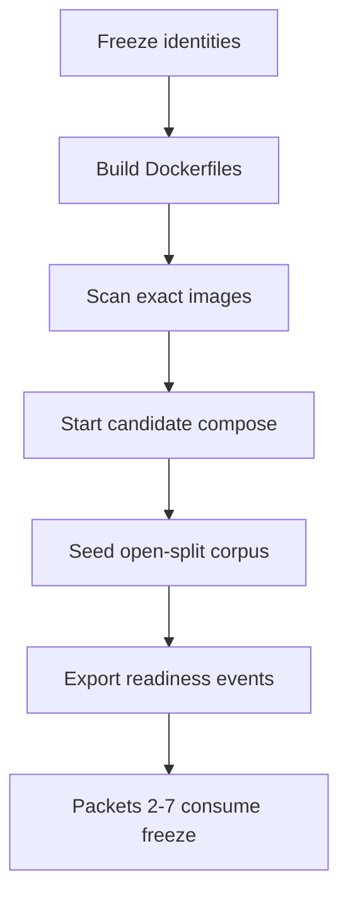

# Local release candidate

Phase 9 Packet 1 freezes the **local** candidate identity: digest-bound images
built from repository Dockerfiles, unpublished ParadeDB/Valkey/crawl-proxy
ports, an approved open-split evaluation corpus, and real public document
states. This is not managed EC2, Vercel, or hosted Supabase proof. Phase 10
owns those gates.

Related: [QUALITY_TARGETS.md](../QUALITY_TARGETS.md) ·
[sizing envelope](../../.cursor/plans/hybrid-graph-rag/shared/release/05-sizing-envelope.md) ·
[phase-09 evidence](../development/phase-09-local-release-candidate-evidence.md) ·
[QUALITY_COMMANDS.md](../development/QUALITY_COMMANDS.md) ·
[CONFIGURATION.md](../development/CONFIGURATION.md) ·
[LOCAL_SETUP.md](../development/LOCAL_SETUP.md) ·
[deployment C4](../architecture/04-deployment.md)

## Candidate identity

The candidate Compose file is `docker-compose.yml` only. Overlay
`docker-compose.packet8.yml` publishes ParadeDB `:54329`, ClamAV `:13310`, and
crawl-proxy `:18080` for host pytest. That overlay is **not** candidate
identity. Health and private-port proof must use `docker-compose.yml` without
publishing those ports.

Later packets consume these committed artifacts under
`docs/deployment/phase-09/`:

| Artifact | Consumed as |
| --- | --- |
| `candidate-identity-freeze.json` | Git SHA, lock hashes, migration hashes, ParadeDB digest, BM25/LightRAG pins, `APP_ENV=local` |
| `candidate-image-manifest.json` | Image name, Id (`sha256:…`), RepoDigest when present, created, user `10001` |
| `candidate-scan-summary.json` | Compact severity counts. Packet 6 re-runs full SBOM/Trivy |
| `candidate-health.json` | `/health/live`, `pg_search` via exec, Valkey auth, unpublished private ports |
| `candidate-migrations.json` | File hashes versus `supabase_migrations.schema_migrations` |
| `candidate-corpus-manifest.json` | Open-split case ids, visibility, content hashes, document/version ids |
| `candidate-readiness-export.json` | Real public-state events with driver, job/version ids, timestamps |
| `candidate-sizing-baseline.json` | Local Docker CPU/RAM and seeded counts mapped onto QT-CAP envelopes |
| `candidate-seed-counts.json` | Version/chunk/graph-eligible counts plus blockers |
| `candidate-command-log.json` | Host orchestrator commands and exit codes |

A changed git SHA, lockfile, Dockerfile, or image Id invalidates Packet 1
evidence. Rebuild and reseed; do not reuse a stale digest.

## Private-port invariant

ParadeDB, Valkey limits, Valkey cache, and crawl-proxy have **no** host
`ports:` in the candidate Compose file. LightRAG has no public server (no
Compose service, no ports `9621`/`9624`). The API and frontend remain the
only developer host endpoints (`8000` / `3000`).

Seed Hybrid Ready from inside the worker container so ParadeDB is reached on
the private network:

```powershell
uv run python scripts/phase09_candidate.py seed
```

That execs `python -m smart_rag_core.release.cli seed --output-dir /tmp/phase09`
in the worker and copies JSON artifacts out. Do not publish ParadeDB to make
host pytest easier; that would change candidate identity.

## Seed command and corpus

Open splits only: development and qualification from
`smart_rag_core.evaluation.loader.load_open_splits`. Holdout stays
`HoldoutAccess.denied()`. Never set `SMART_RAG_HOLDOUT_ACCESS=true` for this
packet. Production paths and holdout ids fail closed.

The local candidate corpus is a **labeled subset**, not the 10,000-version
QT-CAP-001 envelope. Restricted/ACL documents are seeded and marked
graph-ineligible; they must never be LightRAG-indexed.

Full freeze → build → scan → stack → seed:

```powershell
uv run python scripts/phase09_candidate.py all
uv run python scripts/ci/check_phase09_packet1.py
```

Subcommands: `ports-static`, `freeze`, `supabase`, `build`, `scan`, `up`,
`health`, `migrations`, `seed`, `sizing`.

`reset.ps1 -ConfirmReset` is destructive. Prefer `pnpm exec supabase start`
plus candidate `docker compose -f docker-compose.yml up` when the database
is already migrated.

## How later packets consume the freeze

1. Read `candidate-image-manifest.json` and refuse to run against a different
   image Id (`reject_digest_mismatch`).
2. Read `candidate-identity-freeze.json` and fail on lock/migration/profile
   drift.
3. Use `candidate-corpus-manifest.json` case/version ids; do not add holdout
   or production files.
4. Treat `candidate-readiness-export.json` as the proven public-state set.
   Do not SQL-stamp `hybrid_ready` or `graph_ready`.
5. Map load (Packet 4) and restore (Packet 6) onto
   `candidate-sizing-baseline.json` without claiming managed proof.
6. Packet 6 re-runs full SBOM/Trivy; Packet 1 stores compact summaries and
   gitignored dumps under `.tmp-phase09/`.



## Sizing

Signed envelopes remain QT-CAP-001 10,000 versions, QT-CAP-002 1e6 chunks,
QT-CAP-005 2,000 graph versions, with Phase 5 Packet 8 reduced graph
advertisement QT-CAP-005-P8 = 15. Packet 1 records local Docker `NCPU` /
`MemTotal` and Compose `mem_limit` values. It does **not** claim instance-
equivalent EC2 or managed Supabase capacity.

## Failure modes

- Digest mismatch or rebuilt images: rebuild; previous evidence is invalid.
- Migration drift: stop; do not seed.
- Holdout/production/unapproved files: reset and reseed the approved set.
- Fake or duplicate Hybrid/Graph Ready: stop; use BM25 verify and mapping
  verify.
- Published ParadeDB/Valkey/LightRAG ports: recreate private services from
  `docker-compose.yml` only.
- Unresolved Critical Trivy findings: rebuild blocker. If Trivy cannot run,
  record Blocked/Not Run; do not invent a pass. Packet 1 already attempted
  Trivy via `aquasec/trivy` docker.sock on 2026-08-17; that hung Docker
  Desktop and filled the host disk. Do not retry docker.sock Trivy on this
  host until Packet 6 after Docker Desktop and WSL recover.
- Graph Ready unreachable under mock-model mapping: record Failed/Blocked;
  do not SQL-stamp `graph_ready`.
- Docker Desktop / WSL unresponsive: stop live `up`/`seed`; keep freeze and
  image Ids; reboot Windows if `vmmemWSL` stays StopPending. Packet 2 must
  not start until candidate health and seed artifacts exist.

[docs index](../README.md)
