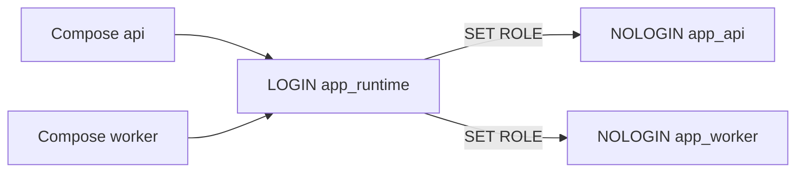
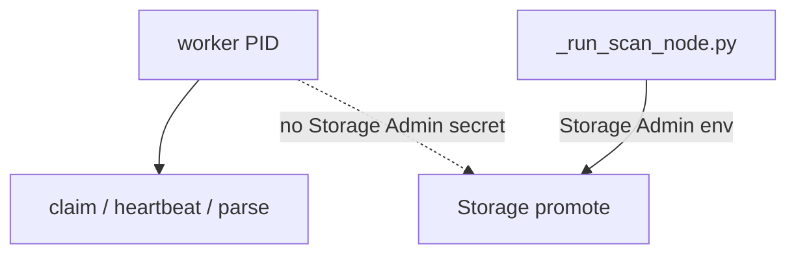

# Local runtime database roles

Local Compose API and worker must not connect as the Postgres superuser.
Migration `app_api` / `app_worker` / `app_checkpointer` / `app_lightrag`
remain **NOLOGIN**. Runtime containers use a dedicated **LOGIN** wrapper that can
`SET ROLE` those NOLOGIN roles.

Related: [AUTHORIZATION_MODEL.md](../security/AUTHORIZATION_MODEL.md) ·
[IDENTITY_PROPAGATION.md](../security/IDENTITY_PROPAGATION.md) ·
[PROTECTED_MIGRATION_CREDENTIALS.md](../security/PROTECTED_MIGRATION_CREDENTIALS.md) ·
[CONFIGURATION.md](../development/CONFIGURATION.md) ·
[LOCAL_SETUP.md](../development/LOCAL_SETUP.md) ·
[docs index](../README.md)

## Connect and SET ROLE



Python still issues `SET ROLE app_api` (API) or `SET ROLE app_worker`
(worker) after connect. Connecting as `postgres` would bypass that
least-privilege story. The wrapper is a member of those roles so
`SET ROLE` succeeds without SUPERUSER.

## Create the LOGIN wrapper (operator SQL, not a migration)

Run against the cloud project with `OPERATOR_SUPABASE_DB_URL`. Do not commit
the password. This is **not** a `supabase/migrations/` file so GRANT/NOLOGIN
contracts stay intact.

Daily `.\scripts\dev.ps1` does not create the wrapper.

```powershell
uv run python scripts/ops/ensure_app_runtime_role.py
```

The script writes `APP_RUNTIME_DB_PASSWORD` into gitignored `.env` and
`.env.compose` when missing, then `CREATE`/`ALTER ROLE app_runtime` and
`GRANT` of `app_api`, `app_worker`, `app_checkpointer`, and
`app_lightrag`. Equivalent SQL:

```sql
CREATE ROLE app_runtime LOGIN PASSWORD 'replace-me'
  NOSUPERUSER NOCREATEDB NOCREATEROLE INHERIT;
GRANT app_api TO app_runtime;
GRANT app_worker TO app_runtime;
GRANT app_checkpointer TO app_runtime;
GRANT app_lightrag TO app_runtime;
```

Reset drops this role. Re-run the script after every reset.

## Compose environment

| Variable | Service | Purpose |
| --- | --- | --- |
| `API_SUPABASE_DB_URL` | api | Required hosted transaction-pooler DSN as `app_runtime` |
| `WORKER_SUPABASE_DB_URL` | worker | Required hosted session/direct DSN as `app_runtime` |
| `LANGGRAPH_CHECKPOINT_URL` | api, worker | Required hosted session/direct DSN |
| `LIGHTRAG_DB_URL` | api, worker | Optional hosted session/direct DSN; unset keeps LightRAG idle |

Compose fails closed if those required names are missing. Do **not** set
them to `postgresql://postgres:` DSNs. Host pytest may still use an
explicit non-hosted operator DSN for opt-in destructive suites; that DSN
is not Compose runtime. See
[ADR-cloud-only-supabase-no-local-fixture.md](../adr/ADR-cloud-only-supabase-no-local-fixture.md).

## Storage Admin is not on the worker PID

`docker-compose.yml` does **not** inject `SUPABASE_STORAGE_ADMIN_SECRET`
into `worker`. Isolated worker settings still refuse a `storage_admin`
field. Local scan/promote uses
[`scripts/ops/_run_scan_node.py`](../../scripts/ops/_run_scan_node.py)
with `SUPABASE_STORAGE_ADMIN_SECRET` in **that process only**. There is
no `scan-promote` sidecar in this Compose file.



Worker ingestion that needs promote will fail closed without that
separate loader. Do not copy the secret back onto the worker service.

## Failure modes

| Case | Result |
| --- | --- |
| Hosted DSN names unset | Compose interpolation fails before start |
| Wrapper missing after `db reset` | Connect/auth fail; recreate `app_runtime` |
| Superuser DSN copied from pytest `.env` | Forbidden; use `API_SUPABASE_DB_URL` / `WORKER_SUPABASE_DB_URL` instead of `SUPABASE_DB_URL` |
| Storage Admin on worker env | Not present in Compose; keep it off that PID |

## Verification

```bash
# CI and local interpolation proof (placeholders in tracked .env.example):
docker compose --env-file .env.example config --quiet
```

Confirm interpolated `api` / `worker` `SUPABASE_DB_URL` values do not
contain `postgresql://postgres:`. Confirm `SUPABASE_STORAGE_ADMIN_SECRET`
is absent from the `worker` service. Do not treat this as a live
Supabase CLI login-role proof; that SQL is operator-run.
