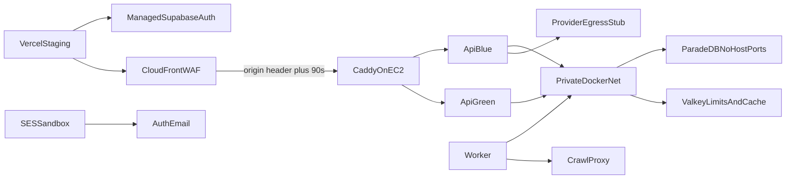

# Managed staging

Phase 10 Packet 1 reviewed isolated staging topology. **IaC policy is
asserted in-repo. Live AWS/Supabase/Vercel/SES apply is Blocked** until a
valid session and Terraform/OpenTofu exist. This file does not invent
project ids, distribution domains, or provision timestamps.

Related: [infra/ec2](../../infra/ec2/README.md) ·
[STREAMING_TIMEOUTS.md](./STREAMING_TIMEOUTS.md) ·
[phase-10 evidence](../development/phase-10-managed-staging-evidence.md) ·
[LOCAL_RELEASE_CANDIDATE.md](./LOCAL_RELEASE_CANDIDATE.md)

## Intended plan, features, and regions

Packet 1 freeze (not a prior client-signed region):

| Item | Intended value | Live |
| --- | --- | --- |
| AWS region | `us-east-1` | Blocked |
| Supabase region | `us-east-1` | Blocked |
| Supabase plan | Pro (PITR required for QT-AVL-003 RPO ≤24h) | Blocked |
| Auth | Asymmetric JWT/JWKS, no HS256 fallback | Blocked |
| Storage buckets | documents-quarantine, documents-originals, web-snapshots, table-artifacts | Blocked |
| Pooling | Supavisor transaction 6543 (API/RPC), session 5432 (LangGraph/LightRAG) | Blocked |
| `pg_search` on managed Supabase | never | n/a |
| SES | sandbox only | Blocked |
| Vercel | public keys only | Blocked |

Envelope stays the Phase 9 reduce: QT-CAP-001-P9=8 Hybrid versions,
QT-CAP-002-P9=16 chunks, QT-CAP-005-P8=15 graph versions. Do not claim
10k/1M.

## Phase 9 identities consumed

From
[candidate-packet7-promotion-manifest.json](./phase-09/candidate-packet7-promotion-manifest.json):

| Image | Id |
| --- | --- |
| api | `sha256:a65f1aa43fbf6fd353257a75fa9462e79a5bb187741d75e36a0429216e3633ec` |
| worker | `sha256:e6259d06f129ec14158e90acf1807dbaed0baa040bef9781fac60d46a97fe96e` |
| frontend | `sha256:e47efc373a151c7c79039009fd04f459f997127beafb00747cd91c4a9b96a5c1` |
| crawl-proxy | `sha256:7d78834e21cc87d2ba133d4d131f1aa6d05b2de808d80296bf6658a8e04e62d3` |
| parser-sandbox | `sha256:f7717ab4ec1e06d8113a19c080a05c1db6050b3b70e3bcfd73d61dd013ed6e0a` |

ParadeDB `paradedb/paradedb:pg17@sha256:dca046b8a0ddd070c368d5254cbb7f596b3b7bc67bc2efa7c0fbe881087883bb`.
Valkey `valkey/valkey:8.1-alpine@sha256:a038175878d66b9d274fbf8be73c0305e93798b83917647f167e18cef3c71eec`.

Seed identity:
[candidate-corpus-manifest.json](./phase-09/candidate-corpus-manifest.json)
(`holdout_opened: false`). Production corpus/users are forbidden.

## IaC versus live-Blocked



| Layer | Committed | Live Packet 1 |
| --- | --- | --- |
| Terraform under `infra/ec2/` | Reviewed: encrypted EBS, IMDSv2 hop 1, SSM-only, CloudFront prefix list, WAF, SES sandbox | Apply Blocked |
| `docker-compose.staging.yml` | Blue/green API, digest-pinned ParadeDB/Valkey, no private host ports | Not started |
| Staging `Caddyfile` | 90s, `flush_interval -1`, current+previous origin headers | Not started |
| Network scan | Policy only | Blocked (no scan artifact) |
| Vercel/SES env | Public-key allow-list | Apply Blocked |
| GitHub OIDC / SSM migrate | Reviewed IaC and protected workflows | Live assume/SendCommand Blocked |

CloudFront `OriginReadTimeout` / `OriginKeepaliveTimeout` are **90** in
`infra/ec2/cloudfront_waf.tf`. AWS API max OriginReadTimeout is 120. The
Terraform provider website still mentions 60; do not lower the IaC value.
Live CDN 50-second SSE remains Packet 4.

## Packet 2 OIDC and protected migrations

Reviewed under `infra/ec2/oidc.tf`, `ssm.tf`, `secrets.tf`, and
`.github/workflows/staging-migrate.yml`. GitHub OIDC may assume only the
environment-scoped role and send only named SSM documents. Workflows store
no AWS keys. Secret **resources** exist without values. Live assume, SSM
migrate, and 90-day rotation are **Blocked**. See
[PROTECTED_MIGRATION_CREDENTIALS.md](../security/PROTECTED_MIGRATION_CREDENTIALS.md)
and [PROTECTED_MIGRATION.md](../runbooks/PROTECTED_MIGRATION.md).

## Packet 3 origin, egress, ports, WAF, and 90s timeouts

Reviewed under `infra/ec2/Caddyfile`, `vpc.tf`, `cloudfront_waf.tf`,
`cloudwatch.tf`, `docker-compose.staging.yml`, and
`provider-egress/`. Direct origin without a matching CloudFront header is
403 in Caddy; origin SG HTTPS is CloudFront prefix-list only. Provider
egress is deny-by-default; the crawl SSRF tests stay required. Parser uses
`network_mode: none`; ParadeDB stays on the internal `private` network.
WAF visibility metrics and CloudWatch denial filters exist in IaC. **Live
CDN request matrix, live port scan, and live CloudWatch alarm delivery are
Blocked** (no distribution, EC2, or WAF logs). See
[CRAWL_EGRESS_AND_PROXY.md](../runbooks/CRAWL_EGRESS_AND_PROXY.md) and
[STREAMING_TIMEOUTS.md](./STREAMING_TIMEOUTS.md).

## Packet 4 JWKS, origin rotation, CDN SSE, ParadeDB, Valkey

Application JWKS (no HS256, unknown `kid`, rollover fixtures) can Pass.
Managed staging dashboard JWKS rollover is **Not Run** (Packet 1 did not
provision a project). Dual origin headers and the
[origin-secret-rotation.md](../runbooks/origin-secret-rotation.md) procedure
pass policy (`overlap <= 15` minutes); **live rotation is Blocked**. The
real 50-second CloudFront SSE stream is **Blocked** — local EventSource is
not CDN. Application ParadeDB dense+term degrade and Valkey fail-closed
tests can Pass from Phase 9 plus unit/contract reuse; **live EC2
ParadeDB/Valkey kill is Blocked**. ParadeDB snapshots are not canonical.

The Packet 4 checkbox stays **unchecked** while P10-04-C is Blocked.

## Packet 5 KMS/Object Lock, alarms, SES, pooling, envelope

Reviewed under `infra/ec2/kms_s3_audit.tf`, `alerts.tf`, `cloudwatch.tf`,
and [alert-routing.md](../runbooks/alert-routing.md). Object Lock
GOVERNANCE 7 years and a rotating audit KMS key exist in IaC. The instance
role is denied `kms:Decrypt`/`kms:Sign`. Local HMAC export is **not** KMS.
SNS `staging-ops` plus a 50 USD MONTHLY COST budget notify SNS only; there
is **no production email**. Application 70% pause and local 30<42
connection math can Pass. **Live PutObject, SNS ack, SES send, managed Pro
pooling, and EC2 measurements are Blocked**. Envelope decision: keep
QT-CAP-001-P9=8 / QT-CAP-002-P9=16 / QT-CAP-005-P8=15. Do not claim 10k/1M.

The Packet 5 checkbox stays **unchecked** while live KMS/SNS/SES/resources
are Blocked. Packets 1–4 remaining unchecked is not a Packet 5 failure.

## Packet 6 restore, reconciliation, rebuild, instance, skew

Runbooks under [storage-db-reconciliation.md](../runbooks/storage-db-reconciliation.md),
[bm25-rebuild.md](../runbooks/bm25-rebuild.md), and
[instance-rebuild.md](../runbooks/instance-rebuild.md). Local Phase 9
dump/restore is supporting only (`restore_returncode: 1` is warnings;
`live_database_overwritten: false`). It is **not** managed PITR. Live
isolated Supabase PITR plus the four durable buckets, live reconciliation,
timed EC2 instance rebuild, CloudFront/Vercel deploy orders, and live Caddy
drain are **Blocked**. Phase 9 empty ParadeDB re-projection can Pass as
derived-projection evidence; a ParadeDB snapshot is never canonical.
Rebuild only after reconciliation. RTO ≤4h and RPO ≤24h remain **targets,
not measurements**. Envelope stays QT-CAP-001-P9=8 / QT-CAP-002-P9=16 /
QT-CAP-005-P8=15.

The Packet 6 checkbox stays **unchecked** while P10-06-A/B/D/E are Blocked.
Packets 1–5 remaining unchecked is not a Packet 6 failure.

## Packet 7 release suite and external assessment

Packet 7 consumes committed
[packet 1–6 gate matrices](./phase-10/packet1-gate-matrix.json)
and does **not** re-run those pytest suites. Local policy artifacts exist,
but a complete production-equivalent suite is **Blocked** while live apply,
CDN 50-second SSE, origin rotation, KMS PutObject, SNS ack, SES send, PITR
restore, EC2 rebuild, and Caddy drain remain Blocked.

Committed custody/IaC can Pass: GitHub OIDC without long-lived secrets,
private ports, digest-pinned ParadeDB, expand/contract
`find_migration_violations`, and Vercel public env only. Live OIDC assume
stays **Blocked** in the same row. Invented origin HTTP 200/403 is Failed.

Independent assessment:
[phase-10-external-assessment-scope.md](../security/phase-10-external-assessment-scope.md)
is **scope only**, status **not run**. There is no third-party pentest
report. Trivy is image scan, not Packet 7-C. Do not claim Critical=0 from
an assessment that did not happen.

Promotion inputs:
[phase10-phase11-promotion-manifest.json](./phase-10/phase10-phase11-promotion-manifest.json).
Recommendation is **no-go for Phase 11**. Envelope stays
QT-CAP-001-P9=8 / QT-CAP-002-P9=16 / QT-CAP-005-P8=15. Do not advertise
10k/1M. Do not apply Terraform from this clone. Holdout stays closed.

The Packet 7 checkbox stays **unchecked**. All seven Phase 10 checkboxes
stay unchecked. Wrapper stays `pending`.

## Verification

```powershell
uv run python scripts/phase10_staging.py assert-iac
uv run python scripts/ci/check_phase10_packet1.py
uv run python scripts/ci/check_phase10_packet2.py
uv run python scripts/ci/check_phase10_packet3.py
uv run python scripts/ci/check_phase10_packet4.py
uv run python scripts/ci/check_phase10_packet5.py
uv run python scripts/ci/check_phase10_packet6.py
uv run python scripts/ci/check_phase10_packet7.py
```
