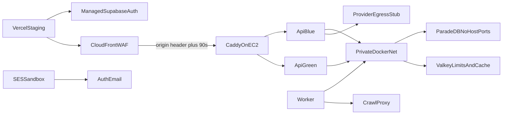

# Managed staging

Phase 10 Packet 1 reviewed isolated staging topology. **IaC policy is
asserted in-repo. Live AWS/Supabase/Vercel/SES apply is Blocked** until a
valid session and Terraform/OpenTofu exist. This file does not invent
project ids, distribution domains, or provision timestamps.

Related: [infra/ec2](../../infra/ec2/README.md) ·
[STREAMING_TIMEOUTS.md](./STREAMING_TIMEOUTS.md) ·
[phase-10 evidence](../development/phase-10-managed-staging-evidence.md) ·
[LOCAL_RELEASE_CANDIDATE.md](./LOCAL_RELEASE_CANDIDATE.md)

## Intended plan, features, and regions

Packet 1 freeze (not a prior client-signed region):

| Item | Intended value | Live |
| --- | --- | --- |
| AWS region | `us-east-1` | Blocked |
| Supabase region | `us-east-1` | Blocked |
| Supabase plan | Pro (PITR required for QT-AVL-003 RPO ≤24h) | Blocked |
| Auth | Asymmetric JWT/JWKS, no HS256 fallback | Blocked |
| Storage buckets | documents-quarantine, documents-originals, web-snapshots, table-artifacts | Blocked |
| Pooling | Supavisor transaction 6543 (API/RPC), session 5432 (LangGraph/LightRAG) | Blocked |
| `pg_search` on managed Supabase | never | n/a |
| SES | sandbox only | Blocked |
| Vercel | public keys only | Blocked |

Envelope stays the Phase 9 reduce: QT-CAP-001-P9=8 Hybrid versions,
QT-CAP-002-P9=16 chunks, QT-CAP-005-P8=15 graph versions. Do not claim
10k/1M.

## Phase 9 identities consumed

From
[candidate-packet7-promotion-manifest.json](./phase-09/candidate-packet7-promotion-manifest.json):

| Image | Id |
| --- | --- |
| api | `sha256:a65f1aa43fbf6fd353257a75fa9462e79a5bb187741d75e36a0429216e3633ec` |
| worker | `sha256:e6259d06f129ec14158e90acf1807dbaed0baa040bef9781fac60d46a97fe96e` |
| frontend | `sha256:e47efc373a151c7c79039009fd04f459f997127beafb00747cd91c4a9b96a5c1` |
| crawl-proxy | `sha256:7d78834e21cc87d2ba133d4d131f1aa6d05b2de808d80296bf6658a8e04e62d3` |
| parser-sandbox | `sha256:f7717ab4ec1e06d8113a19c080a05c1db6050b3b70e3bcfd73d61dd013ed6e0a` |

ParadeDB `paradedb/paradedb:pg17@sha256:dca046b8a0ddd070c368d5254cbb7f596b3b7bc67bc2efa7c0fbe881087883bb`.
Valkey `valkey/valkey:8.1-alpine@sha256:a038175878d66b9d274fbf8be73c0305e93798b83917647f167e18cef3c71eec`.

Seed identity:
[candidate-corpus-manifest.json](./phase-09/candidate-corpus-manifest.json)
(`holdout_opened: false`). Production corpus/users are forbidden.

## IaC versus live-Blocked



| Layer | Committed | Live Packet 1 |
| --- | --- | --- |
| Terraform under `infra/ec2/` | Reviewed: encrypted EBS, IMDSv2 hop 1, SSM-only, CloudFront prefix list, WAF, SES sandbox | Apply Blocked |
| `docker-compose.staging.yml` | Blue/green API, digest-pinned ParadeDB/Valkey, no private host ports | Not started |
| Staging `Caddyfile` | 90s, `flush_interval -1`, current+previous origin headers | Not started |
| Network scan | Policy only | Blocked (no scan artifact) |
| Vercel/SES env | Public-key allow-list | Apply Blocked |
| GitHub OIDC / SSM migrate | Reviewed IaC and protected workflows | Live assume/SendCommand Blocked |

CloudFront `OriginReadTimeout` / `OriginKeepaliveTimeout` are **90** in
`infra/ec2/cloudfront_waf.tf`. AWS API max OriginReadTimeout is 120. The
Terraform provider website still mentions 60; do not lower the IaC value.
Live CDN 50-second SSE remains Packet 3/4.

## Packet 2 OIDC and protected migrations

Reviewed under `infra/ec2/oidc.tf`, `ssm.tf`, `secrets.tf`, and
`.github/workflows/staging-migrate.yml`. GitHub OIDC may assume only the
environment-scoped role and send only named SSM documents. Workflows store
no AWS keys. Secret **resources** exist without values. Live assume, SSM
migrate, and 90-day rotation are **Blocked**. See
[PROTECTED_MIGRATION_CREDENTIALS.md](../security/PROTECTED_MIGRATION_CREDENTIALS.md)
and [PROTECTED_MIGRATION.md](../runbooks/PROTECTED_MIGRATION.md).

## Verification

```powershell
uv run python scripts/phase10_staging.py assert-iac
uv run python scripts/ci/check_phase10_packet1.py
uv run python scripts/ci/check_phase10_packet2.py
```
