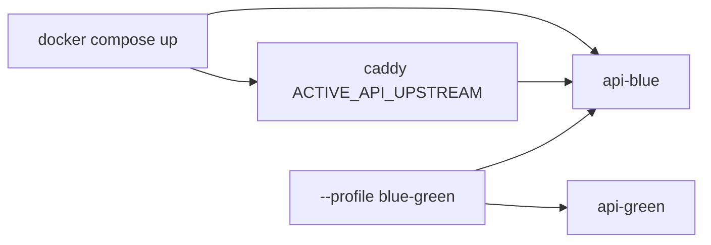

# Staging Compose API color

`infra/ec2/docker-compose.staging.yml` keeps **one active API color** by
default. `QueryRunRegistry` is process-local; two colors at once split
in-memory runs and double checkpointer/Valkey pools.

Related: [STREAMING_TIMEOUTS.md](./STREAMING_TIMEOUTS.md) ·
[LOCAL_RELEASE_CANDIDATE.md](./LOCAL_RELEASE_CANDIDATE.md) ·
[instance rebuild](../runbooks/instance-rebuild.md) ·
[demo local ingest / AWS ask](../runbooks/demo-local-ingest-aws-ask.md) ·
[docs index](../README.md)

Do **not** start the base file alone on `t3.micro`. Use
`docker-compose.t3micro.yml`. Default overlay `up -d` starts ParadeDB and
split Valkey. Edge API/Caddy/proxies need `--profile t3micro-edge` and
`Caddyfile.http443` (`http_port 443`, `auto_https off`). Worker,
`api-green`, ClamAV, and parser stay on `not-on-t3micro`. Optional
`demo-reproject` fills ParadeDB from hosted `authorized_current` without
leaving the ingest stack up. Do not run it on AWS until the instance is
ready. See [demo-local-ingest-aws-ask.md](../runbooks/demo-local-ingest-aws-ask.md).

## Default versus drain



| Command | API processes |
| --- | --- |
| `docker compose -f infra/ec2/docker-compose.staging.yml up -d` | `api-blue` only |
| `docker compose -f infra/ec2/docker-compose.staging.yml --profile blue-green up -d` | `api-blue` and `api-green` for drain/cutover |

`api-green` is defined with Compose profile `blue-green`. Caddy still
depends on `api-blue` and proxies `ACTIVE_API_UPSTREAM` (default
`api-blue:8000`). Point that variable at `api-green:8000` only after
the green slot is healthy and the old color is draining.

## Failure modes

| Case | Result |
| --- | --- |
| Both colors without the profile | Does not happen; green is not started |
| Both colors with `--profile blue-green` | Two `QueryRunRegistry` maps; resume/cancel can miss the owning process |
| Host too small (`t3.micro`) | Start the overlay, not both API colors; Packet 5 load is not claimed |

## Verification

```bash
docker compose -f infra/ec2/docker-compose.staging.yml config --services
```

The default service list must include `api-blue` and must **not**
include `api-green` unless `--profile blue-green` is passed.

This document does not claim Packet 5 load, dual API slots, or a proven
50s CDN stream.
