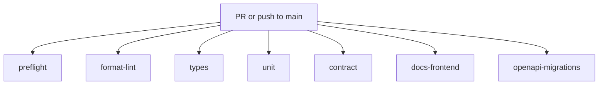

# CI tiers

GitHub PR and nightly callers run reusable jobs in parallel. They do **not**
run `check.py --tier fast` as one job. Each caller only `uses:` a child
workflow. There is no `needs:` graph.

Parallel PR/nightly jobs: `preflight`, `format-lint`, `types`, `unit`,
`contract`, `docs-frontend`, `openapi-migrations`. Main runs `unit`,
`contract`, and `compose`. Local `uv run python scripts/check.py --tier fast`
still includes `types`. Types is a real `python -m pyright` run. Local
full-repo Pyright is **0** errors as of 2026-08-16; see
[PYRIGHT_BASELINE.md](./PYRIGHT_BASELINE.md). A red `types` job is not a
pass. Remote GitHub conclusion remains unverified until a run URL is
recorded.

| Tier | Workflow | GitHub jobs |
| --- | --- | --- |
| PR fast | `.github/workflows/pr-fast.yml` | `preflight`, `format-lint`, `types`, `unit`, `contract`, `docs-frontend`, `openapi-migrations` |
| Main | `.github/workflows/main.yml` | `unit`, `contract`, `compose` |
| Nightly | `.github/workflows/nightly.yml` | same parallel reusable jobs as PR fast |

`FAST_TIERS` in `scripts/check.py` remains `format`, `lint`, `types`,
`unit`, `contract`, `docs`, `frontend`. GitHub maps `format`+`lint` to
`format-lint` and `docs`+`frontend` to `docs-frontend`, then adds
`preflight` and `openapi-migrations`. See
[QUALITY_COMMANDS.md](./QUALITY_COMMANDS.md).

As of 2026-08-16 the local full-repo Pyright count is **0** errors, so
`types` is expected to exit 0 locally. See
[PYRIGHT_BASELINE.md](./PYRIGHT_BASELINE.md). A workflow file is not remote
execution evidence.

**Future (not fake-green):** Supabase reset/RLS, LightRAG, retrieval evals, load, restore — Phases 2–10.

Phase 9 Packet 1 candidate freeze/seed
(`scripts/phase09_candidate.py`, `scripts/ci/check_phase09_packet1.py`),
Packet 2 local CI/security gates (`scripts/ci/check_phase09_packet2.py`),
Packet 3 quality/latency/BM25/graph measurement
(`scripts/ci/check_phase09_packet3.py`), Packet 4
foreground-plus-maintenance load (`scripts/ci/check_phase09_packet4.py`),
Packet 5 worker/ParadeDB/Valkey fault recovery
(`scripts/ci/check_phase09_packet5.py`), Packet 6 egress/tar-Trivy/
disposable restore/ParadeDB rebuild
(`scripts/ci/check_phase09_packet6.py`), and Packet 7 blocker/handoff
classification (`scripts/ci/check_phase09_packet7.py`)
are local gates. They are not added to the GitHub PR job graph. See
[LOCAL_RELEASE_CANDIDATE.md](../deployment/LOCAL_RELEASE_CANDIDATE.md).

Phase 10 Packet 1 managed-staging IaC/policy
(`scripts/phase10_staging.py`, `scripts/ci/check_phase10_packet1.py`)
is also a local gate. It parses committed Terraform/Compose/Caddy/inventory
in Python. It is not added to the GitHub PR job graph and does not apply
cloud resources. See [MANAGED_STAGING.md](../deployment/MANAGED_STAGING.md).

Phase 10 Packet 2 OIDC/protected-migration policy
(`scripts/ci/check_phase10_packet2.py`) is a local gate. It parses committed
OIDC roles, named SSM documents, protected workflows, and secret prefixes.
It reuses `scripts/ci/check_migrations.py`. It is not added to `pr-fast.yml`.
Live OIDC assume and SSM migrate stay Blocked. See
[PROTECTED_MIGRATION_CREDENTIALS.md](../security/PROTECTED_MIGRATION_CREDENTIALS.md).

Phase 10 Packet 3 origin/egress/timeout policy
(`scripts/ci/check_phase10_packet3.py`) is a local gate. It parses committed
Caddy/SG/WAF/Compose/CloudWatch files and reuses crawl SSRF tests. It is
not added to `pr-fast.yml`. Live CDN request matrix, port scans, and
CloudWatch alarm delivery stay Blocked. See
[MANAGED_STAGING.md](../deployment/MANAGED_STAGING.md).

Phase 10 Packet 4 JWKS/origin/SSE/ParadeDB/Valkey
(`scripts/ci/check_phase10_packet4.py`) is a local gate. Application JWKS,
origin dual-header policy, ParadeDB degrade, and Valkey fail-closed can
Pass. Managed dashboard JWKS, live origin rotation, CloudFront 50-second
SSE, and EC2 kill stay Blocked. It is not added to `pr-fast.yml`. Packets
1–3 remaining unchecked is not a Packet 4 failure. See
[MANAGED_STAGING.md](../deployment/MANAGED_STAGING.md) and
[origin-secret-rotation.md](../runbooks/origin-secret-rotation.md).

Phase 10 Packet 5 KMS/Object Lock/alarm/pooling policy
(`scripts/ci/check_phase10_packet5.py`) is a local gate. Application
tamper tests, 70% pause, and local connection-budget math can Pass. Live
KMS PutObject, SNS ack, SES send, managed pooling, and EC2 measurements
stay Blocked. HMAC claimed as KMS is Failed. It is not added to
`pr-fast.yml`. Packets 1–4 remaining unchecked is not a Packet 5 failure.
See [MANAGED_STAGING.md](../deployment/MANAGED_STAGING.md) and
[alert-routing.md](../runbooks/alert-routing.md).

Phase 10 Packet 6 restore/rebuild/instance/skew
(`scripts/ci/check_phase10_packet6.py`) is a local gate. Phase 9 derived
BM25 rebuild and old-API/new-schema smoke can Pass as support. Live
managed PITR, reconciliation, timed EC2 rebuild, and Caddy/Vercel drain
stay Blocked. Local dump is not PITR. It is not added to `pr-fast.yml`.
Packets 1–5 remaining unchecked is not a Packet 6 failure. See
[MANAGED_STAGING.md](../deployment/MANAGED_STAGING.md),
[storage-db-reconciliation.md](../runbooks/storage-db-reconciliation.md),
[bm25-rebuild.md](../runbooks/bm25-rebuild.md), and
[instance-rebuild.md](../runbooks/instance-rebuild.md).

Phase 10 Packet 7 release-suite/assessment
(`scripts/ci/check_phase10_packet7.py`) is a local gate. It loads committed
Packets 1–6 JSON and does not re-run those pytest suites. Independent
assessment stays not run; Trivy is not Packet 7-C. Promotion remains
no-go/pending. It is not added to `pr-fast.yml`. Checking a Phase 10
checkbox or setting the wrapper complete is Failed. See
[MANAGED_STAGING.md](../deployment/MANAGED_STAGING.md) and
[phase-10-external-assessment-scope.md](../security/phase-10-external-assessment-scope.md).

Actions are pinned by commit SHA. The caller workflows use
`permissions: contents: read`; the secret scanner disables PR comments and
artifact upload. Nightly `schedule` runs Gitleaks across the full git
history, while `push` scans only new commits; `.gitleaks.toml` must
allowlist inert canaries, empty example key names, Action pin SHAs, and
Phase 9 image digests or Nightly preflight stays red. A local workflow
definition is not remote execution evidence, so a GitHub run URL and
conclusion must be recorded separately.

GitHub-hosted Ubuntu runners block the Chromium sandbox required by Mermaid
CLI. After the locked Node install, PR and nightly jobs use the pinned Puppeteer
CLI to install its compatible `chrome-headless-shell`, then pass the official
`--puppeteerConfigFile` workaround in `scripts/ci/puppeteer-no-sandbox.json`.
The explicit browser installation avoids depending on package lifecycle-script
behavior on a clean runner. The no-sandbox exception is limited to
least-privilege ephemeral CI jobs; local documentation checks retain the browser
sandbox.

[docs index](../README.md) · [Quality commands](./QUALITY_COMMANDS.md) · [Pyright baseline](./PYRIGHT_BASELINE.md)
