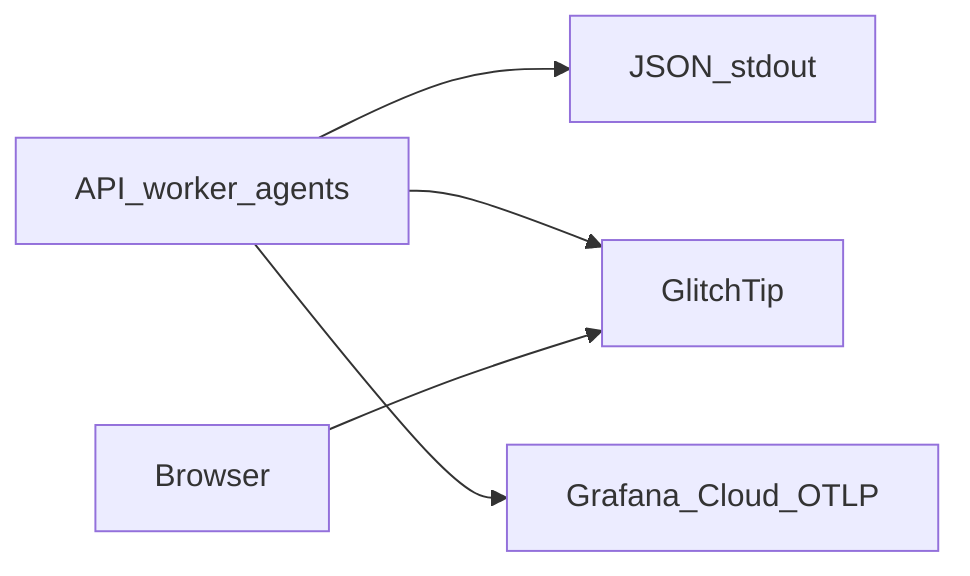

# GlitchTip and Grafana error telemetry

Production errors are grouped in GlitchTip and searchable in Grafana Cloud.
Both exports are off until their flags are set. The 1 GB staging host does
not run a log stack.

Related: [CONFIGURATION.md](./CONFIGURATION.md) ·
[ADR-hosted-error-telemetry.md](../adr/ADR-hosted-error-telemetry.md) ·
[LANGSMITH_TRACING.md](./LANGSMITH_TRACING.md) ·
[docs index](../README.md)



## What is stored

GlitchTip stores the exception type, a redacted message, and stack frames
(file, function, line) plus `request_id`, `run_id`, or `job_id` when that
work is in progress.

Grafana stores the same JSON fields as stdout: `timestamp`, `level`,
`service`, `environment`, `event`, redacted `message`, correlation ids,
`error_type`, and `exception_type`. Spans are named `http.request`,
`worker.job`, or `worker.bm25_job` and carry those ids only.

Stdout logs, `app.run_events`, job `last_error`, and `app.audit_events`
are unchanged.

## What is omitted

Exception text on the Grafana log line stays `[REDACTED]`. GlitchTip does
not receive local variables, source lines, cookies, authorization headers,
request bodies, prompts, or passage text. Bearer tokens and `sk-` keys in
an exception message are replaced before send. DSNs and the Grafana ingest
token are never written to logs.

## Operator setup

1. Create a free project at `https://app.glitchtip.com` and copy the DSN.
2. Create a free Grafana Cloud stack. Copy the OTLP base URL
   (`https://otlp-gateway-prod-<region>.grafana.net/otlp`) and an ingest
   token that can write logs and traces. The header value is
   `Authorization=Basic <token>`.
3. Set these on the API, worker, and agent processes:

```bash
GLITCHTIP_ENABLED=true
GLITCHTIP_DSN=https://<public-key>@app.glitchtip.com/<project>
OTEL_EXPORT_ENABLED=true
OTEL_EXPORTER_OTLP_ENDPOINT=https://otlp-gateway-prod-<region>.grafana.net/otlp
OTEL_EXPORTER_OTLP_HEADERS=Authorization=Basic <token>
```

4. Add the exact Grafana gateway hostname to
   [allowlist.txt](../../infra/ec2/provider-egress/allowlist.txt) and a
   matching `reverse_proxy` in
   [Caddyfile](../../infra/ec2/provider-egress/Caddyfile). Do not guess the
   region. `app.glitchtip.com` is already listed.
5. Optional browser errors: set `NEXT_PUBLIC_GLITCHTIP_DSN` to the same
   style of DSN. Leave it unset to keep the browser SDK idle. The CSP
   `connect-src` allows that DSN's origin only when the variable is present
   at build time.

A DSN or OTLP endpoint without its enable flag fails process startup.

## Finding a failed run

In Grafana, search logs for the `run_id` or `job_id` from the API response
header `X-Request-ID` or from `app.runs`. In GlitchTip, open the matching
error group and read the scrubbed stack. The database row
`app.run_events` with `event_type = 'error'` still has the short code.

## Failure modes

Export failures must not change the HTTP response or job result. The batch
exporters retry on their own schedule and drop data when the endpoint is
down. Missing flags mean no remote copy; stdout and the database records
remain. A half-set credential refuses to start rather than exporting to
the wrong place.
