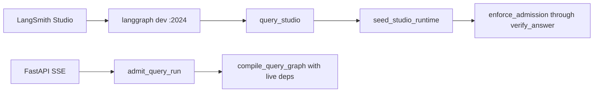

# LangGraph Studio

Local-only wiring so you can **see** the query graph topology and **invoke**
the same nodes without FastAPI chat. This is not production admission, SSE,
or a paid reservation.

Related: [LOCAL_SETUP.md](./LOCAL_SETUP.md) ·
[LANGSMITH_TRACING.md](./LANGSMITH_TRACING.md) ·
[QUERY_ADMISSION.md](../agent/QUERY_ADMISSION.md) ·
[QUERY_ROUTING.md](../agent/QUERY_ROUTING.md) ·
[CONFIGURATION.md](./CONFIGURATION.md) ·
[docs index](../README.md)

## What Studio runs

[`apps/agents/langgraph.json`](../../apps/agents/langgraph.json) registers
three checkpointer-free graphs:

| Graph ID | Export | Use in Studio |
| --- | --- | --- |
| `query_studio` | `query/studio.py:graph` | Type a query and step through nodes |
| `query` | `query/graph.py:graph` | Inspect the production-shaped graph. Invoking it without `authorized_runtime` ends at `admission_rejected` |
| `ingestion` | `ingestion/graph.py:graph` | Probe lease graph only. Invalid lease without worker config |



`query_studio` prepends `seed_studio_runtime`. That node copies
`envelope_for_family` ceilings into a synthetic `AuthorizedRuntimeContext`
with `status=studio_local`. It does **not** call `admit_query_run`, debit
company/user budget rows, or open Postgres. FastAPI continues to compile
`compile_query_graph` with live Hybrid/gateway bindings.

The default Studio graph is still unbound (`QueryGraphDeps()`): no sockets,
no OpenAI client, mock/deterministic node behavior. A non-empty query walks
prepare → plan → branches → correction → fusion → answer → verify. Expect
`answer_call_count=0` unless you later bind a live gateway. This does not
prove retrieval quality against canonical evidence.

## Prerequisites

1. Workspace sync: `uv sync --all-packages --group dev --python 3.11 --frozen`.
   The `langgraph-cli[inmem]` extra provides `langgraph dev`.
2. A LangSmith account. Open Studio in the browser at the printed
   `smith.langchain.com/studio/?baseUrl=...` URL and sign in. Keep
   `LANGSMITH_TRACING=false` (default) unless you intentionally export
   redacted gateway spans. See [LANGSMITH_TRACING.md](./LANGSMITH_TRACING.md).
3. Optional: `LANGSMITH_API_KEY` in gitignored `.env` if you want CLI/SDK
   tracing. Mock-model mode does not need a live OpenAI key. The local
   Agent Server starts without the key.

Safari and some networks block `localhost` callbacks. Use Chrome/Edge, or
add `--tunnel` as documented in
[LangGraph Studio](https://docs.langchain.com/oss/python/langgraph/studio).

## Start the local Agent Server

From the repository root, with the workspace venv. On Windows, use the
helper so the CLI does not crash on emoji in `cp1252` consoles:

```powershell
.\scripts\langgraph-studio.ps1
```

Equivalent (must run from `apps/agents` so `./src/...` graph paths resolve):

```powershell
$env:PYTHONUTF8 = "1"
$env:PYTHONIOENCODING = "utf-8"
Set-Location apps/agents
uv run langgraph dev --config langgraph.json --no-browser --allow-blocking
```

`--allow-blocking` is required when a node performs synchronous I/O. The
unbound Studio graph should not open sockets; the flag keeps Studio usable
if a later local bind adds sync adapters.

Expected URLs (CLI prints these):

- API: `http://127.0.0.1:2024`
- OpenAPI: `http://127.0.0.1:2024/docs`
- Studio: `https://smith.langchain.com/studio/?baseUrl=http://127.0.0.1:2024`

Open Studio, select graph **`query_studio`**, and submit:

```json
{
  "user_query": "What is the status of INV-SR-1001?",
  "route_family": "hybrid"
}
```

The Studio chat box also works: the seed node reads the last human
`messages[].content` when `user_query` is empty.

Optional fields: `routing_surface` (`production` or `diagnostic`),
`requested_manual_route` (diagnostic only). Unknown `route_family` values
fail closed with `admission_rejected`.

## Failure modes

| Condition | Behavior |
| --- | --- |
| Missing LangSmith browser session | Hosted Studio at smith.langchain.com cannot attach. Local `GET /ok` still works. |
| Missing `LANGSMITH_API_KEY` | Local API still starts. Gateway tracing stays off unless `LANGSMITH_TRACING=true`. |
| `query` graph invoked with empty state | `admission_rejected` (production-shaped fail-closed) |
| `query_studio` with empty query | Seed succeeds; `prepare_query` sets `routing_rejected` / `empty_query` |
| Unknown `route_family` | `admission_rejected`; no synthetic context |
| Unbound retrievers | Nodes run; evidence stays empty; no fabricated Hybrid success |
| `langgraph up` / Docker Agent Server | Not this local path. Checkpointer-free `langgraph.json` graphs still must not call `PostgresSaver.setup()` |

Interactive `langgraph dev` from `apps/agents` loaded `query`, `query_studio`,
and `ingestion`. `GET http://127.0.0.1:2024/ok` returned `{"ok":true}`. Keep
`LANGSMITH_TRACING=false`. Hosted Studio at smith.langchain.com still needs a
LangSmith browser login; the local API starts without `LANGSMITH_API_KEY`.

## Verification

```powershell
uv run pytest tests/contract/test_langgraph_config.py tests/unit/test_query_studio.py -q
uv run ruff check apps/agents/src/smart_rag_agents/query/studio.py apps/agents/src/smart_rag_agents/query/graph.py tests/contract/test_langgraph_config.py tests/unit/test_query_studio.py
$env:PYTHONUTF8 = "1"; uv run langgraph --help
```

`langgraph --help` must list `dev`. A full Studio session in the browser is
manual.

## Rollback

Stop the `langgraph dev` process. Leave `LANGSMITH_TRACING=false`. FastAPI
and the worker are unchanged: they never import `query_studio`.
