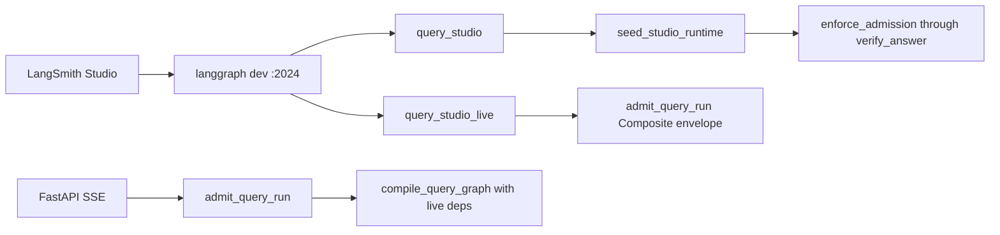

# LangGraph Studio

Local-only wiring so you can **see** the query graph topology and **invoke**
the same nodes without FastAPI chat. This is not production admission, SSE,
or a paid reservation.

Related: [LOCAL_SETUP.md](./LOCAL_SETUP.md) ·
[LANGSMITH_TRACING.md](./LANGSMITH_TRACING.md) ·
[QUERY_ADMISSION.md](../agent/QUERY_ADMISSION.md) ·
[QUERY_ROUTING.md](../agent/QUERY_ROUTING.md) ·
[CONFIGURATION.md](./CONFIGURATION.md) ·
[docs index](../README.md)

## What Studio runs

[`apps/agents/langgraph.json`](../../apps/agents/langgraph.json) registers
four graphs. `query`, `query_studio`, and `ingestion` stay checkpointer-free
module exports. `query_studio_live` is an Agent Server factory:

| Graph ID | Export | Use in Studio |
| --- | --- | --- |
| `query_studio` | `query/studio.py:graph` | Type a query, chat, and step through nodes. Synthetic `studio_local` only |
| `query_studio_live` | `query/studio_live.py:make_graph` | Authenticated live run. Default disabled. Never synthetic-admits |
| `query` | `query/graph.py:graph` | Inspect the production-shaped graph. Invoking it without `authorized_runtime` ends at `admission_rejected` |
| `ingestion` | `ingestion/graph.py:graph` | Probe lease graph only. Invalid lease without worker config |



`query_studio` prepends `seed_studio_runtime`. That node copies
`envelope_for_family` ceilings into a synthetic `AuthorizedRuntimeContext`
with `status=studio_local`. It does **not** call `admit_query_run`, debit
company/user budget rows, or open Postgres. FastAPI continues to compile
`compile_query_graph` with live Hybrid/gateway bindings.

`query_studio_live` is a separate factory. Introspection (`execution_runtime
is None`) compiles the same topology and opens zero sockets. Execution
requires `LANGGRAPH_STUDIO_LIVE_ENABLED=true` and
`LANGGRAPH_STUDIO_ACCESS_TOKEN` (a user JWT, never a service-role key).
Missing, expired, invalid, or revoked tokens reject before retrieval/model
work. Successful live turns call durable `admit_query_run` with the
Composite/Auto envelope. This packet does not claim a live JWT success.

### Live token setup, rotation, and removal

Do this only on a developer machine. Never paste the JWT into chat,
logs, traces, graph state, or documentation.

1. Sign in as the intended user and copy that user's access token into
   gitignored `.env` as `LANGGRAPH_STUDIO_ACCESS_TOKEN`. Do not use the
   service-role key.
2. Set `LANGGRAPH_STUDIO_LIVE_ENABLED=true` only while you need live
   Studio. Restart `langgraph dev`.
3. Select graph **`query_studio` first**. Prove greeting/topology with
   zero sockets. Only then select **`query_studio_live`**.
4. Rotate by replacing the env value with a freshly issued user JWT and
   restarting the Agent Server. Old tokens are rejected after expiry or
   session revocation.
5. Remove the token by deleting the env line, setting
   `LANGGRAPH_STUDIO_LIVE_ENABLED=false`, and restarting. Enabled
   without a token rejects and never synthetic-admits.

Live conversation IDs are `uuid5` of a Studio-live namespace plus the
thread id. A conversation row must already exist for that id or admit
fails `not_found`. Company traces still require
`assert_langsmith_export_permitted`.

The default Studio graph is still unbound (`QueryGraphDeps()`): no sockets,
no OpenAI client, mock/deterministic node behavior. A non-empty query walks
prepare → plan → branches → correction → fusion → answer → verify. Expect
`answer_call_count=0` unless you later bind a live gateway. This does not
prove retrieval quality against canonical evidence.

`query_studio` exposes LangGraph's standard typed `messages` channel with the
`add_messages` reducer. A Studio human turn is copied into `user_query`, and a
Studio-only terminal node appends one assistant turn from the verified answer
or the existing safe refusal/status. The adapter does not write production
conversation memory, admit a paid run, or turn an unbound retriever into
successful evidence.

## Prerequisites

1. Workspace sync: `uv sync --all-packages --group dev --python 3.11 --frozen`.
   The `langgraph-cli[inmem]` extra provides `langgraph dev`.
2. A LangSmith account. Open Studio in the browser at the printed
   `smith.langchain.com/studio/?baseUrl=...` URL and sign in.
3. `LANGSMITH_API_KEY` plus `LANGSMITH_TRACING=true` in gitignored
   `.env.compose` (and optionally `.env`). `langgraph.json` loads
   `../../.env.compose` from `apps/agents`. `scripts/langgraph-studio.ps1`
   also imports those files into the Agent Server process. Without the
   key, Studio shows “API key is missing” and chats are not traced.
   Open traces in `LANGSMITH_PROJECT` (local compose uses
   `smart-rag-demo-3`). See [LANGSMITH_TRACING.md](./LANGSMITH_TRACING.md).
   Mock-model mode does not need a live OpenAI key.

Safari and some networks block `localhost` callbacks. Use Chrome/Edge, or
add `--tunnel` as documented in
[LangGraph Studio](https://docs.langchain.com/oss/python/langgraph/studio).

## Start the local Agent Server

From the repository root, with the workspace venv. On Windows, use the
helper so the CLI does not crash on emoji in `cp1252` consoles:

```powershell
.\scripts\langgraph-studio.ps1
```

Equivalent (must run from `apps/agents` so `./src/...` graph paths resolve):

```powershell
$env:PYTHONUTF8 = "1"
$env:PYTHONIOENCODING = "utf-8"
Set-Location apps/agents
uv run langgraph dev --config langgraph.json --no-browser --no-reload --allow-blocking
```

`--allow-blocking` is required when a node performs synchronous I/O. The
unbound Studio graph should not open sockets; the flag keeps Studio usable
if a later local bind adds sync adapters. `--no-reload` is required because
the in-memory checkpointer writes `.langgraph_api/*.pckl` and would otherwise
hot-reload the server in a loop.

Expected URLs (CLI prints these):

- API: `http://127.0.0.1:2024`
- OpenAPI: `http://127.0.0.1:2024/docs`
- Studio: `https://smith.langchain.com/studio/?baseUrl=http://127.0.0.1:2024`

Open Studio, select graph **`query_studio`**, and submit:

```json
{
  "user_query": "What is the status of INV-SR-1001?",
  "route_family": "hybrid"
}
```

The Studio **Chat** view also works: the seed node reads the last human
`messages[].content` when `user_query` is empty, and the terminal adapter
returns an assistant message. Because the local graph is intentionally
unbound, document questions return `Insufficient authorized evidence.` until
live retrieval dependencies are explicitly bound; greetings and product-help
use the general-chat path when a gateway is bound.

Optional fields: `routing_surface` (`production` or `diagnostic`),
`requested_manual_route` (diagnostic only). Unknown `route_family` values
fail closed with `admission_rejected`.

## Failure modes

| Condition | Behavior |
| --- | --- |
| Missing LangSmith browser session | Hosted Studio at smith.langchain.com cannot attach. Local `GET /ok` still works. |
| Missing `LANGSMITH_API_KEY` | Agent Server still starts. Studio UI warns that the key is missing and chats are not exported. |
| `query` graph invoked with empty state | `admission_rejected` (production-shaped fail-closed) |
| `query_studio` with empty query | Seed succeeds; `prepare_query` sets `routing_rejected` / `empty_query` |
| Unknown `route_family` | `admission_rejected`; no synthetic context |
| Unbound retrievers | Nodes run; evidence stays empty; no fabricated Hybrid success |
| `query_studio_live` disabled or token missing | `admission_rejected` with a sanitized detail. Never `studio_local` |
| Expired, invalid, or revoked live JWT | Reject before model/retrieval. Token text is never logged |
| LangSmith export not permitted for company content | Reject the live export gate. Do not send company text |
| `langgraph up` / Docker Agent Server | Not this local path. Checkpointer-free `langgraph.json` graphs still must not call `PostgresSaver.setup()` |

Interactive `langgraph dev` from `apps/agents` loaded `query`, `query_studio`,
and `ingestion`. `GET http://127.0.0.1:2024/ok` returned `{"ok":true}`.
Hosted Studio at smith.langchain.com still needs a LangSmith browser login.
Studio traces require `LANGSMITH_API_KEY` and `LANGSMITH_TRACING=true` in
the Agent Server process.

The Studio banner that `langsmith-py/0.10.x` called `POST /runs/query`
(removed 2027-01-31) is a SmithDB query-API deprecation. This repo is
pinned to `langsmith==0.10.18`. Application export uses `@traceable` /
`wrap_openai`. The pinned Agent Server may still query the old endpoint.
That banner does not mean traces failed. Do not treat it as a missing key.

## Verification

```powershell
uv run pytest tests/contract/test_langgraph_config.py tests/unit/test_query_studio.py tests/unit/test_query_studio_live.py -q
uv run ruff check apps/agents/src/smart_rag_agents/query/studio.py apps/agents/src/smart_rag_agents/query/studio_live.py apps/agents/src/smart_rag_agents/query/graph.py tests/contract/test_langgraph_config.py tests/unit/test_query_studio.py tests/unit/test_query_studio_live.py
$env:PYTHONUTF8 = "1"; uv run langgraph --help
```

`langgraph --help` must list `dev`. A full Studio session in the browser is
manual.

## Rollback

Stop the `langgraph dev` process. To stop Studio export, set
`LANGSMITH_TRACING=false` in `.env.compose` and restart. Remove
`LANGGRAPH_STUDIO_ACCESS_TOKEN` and set
`LANGGRAPH_STUDIO_LIVE_ENABLED=false`. FastAPI and the worker are
unchanged: they never import `query_studio` or `query_studio_live`.
To drop live Studio only, remove the `query_studio_live` entry from
`langgraph.json` and leave unbound `query_studio` in place.
