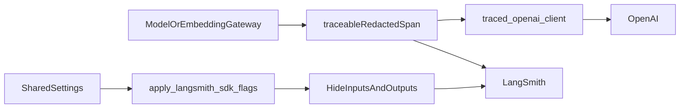
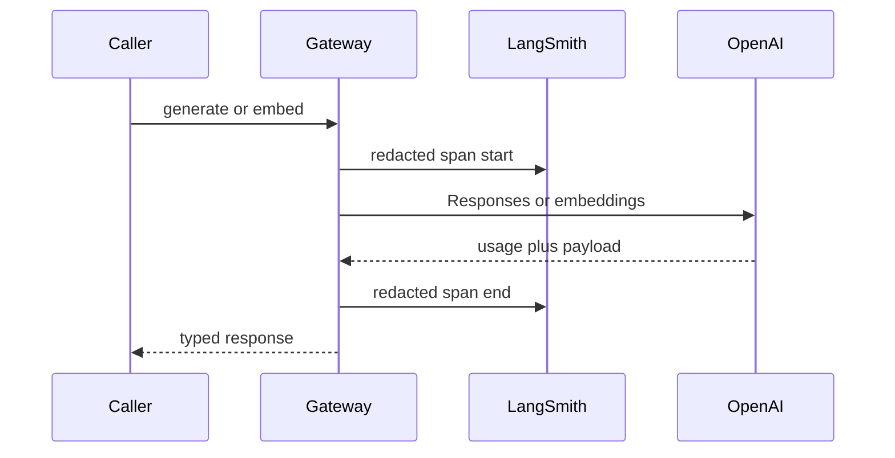

# LangSmith tracing for model and embedding calls

Every application OpenAI call goes through `ModelGateway`, `EmbeddingGateway`,
or `traced_embeddings_create`. Those boundaries emit a LangSmith span when
`LANGSMITH_TRACING=true`. Tracing is **off by default**, including mock-model
mode. This is gateway-level tracing, not the Phase 6 production query-graph
feedback loop.

Related: [CONFIGURATION.md](./CONFIGURATION.md) ·
[LANGGRAPH_STUDIO.md](./LANGGRAPH_STUDIO.md) ·
[demo-local-ingest-aws-ask.md](../runbooks/demo-local-ingest-aws-ask.md) ·
[SUBPROCESSOR_GOVERNANCE.md](../security/SUBPROCESSOR_GOVERNANCE.md) ·
[OPENAI_DATA_GOVERNANCE.md](../security/OPENAI_DATA_GOVERNANCE.md) ·
[docs index](../README.md)

## Data that is exported

Exported fields are limited to:

- Stable run names (`model.generate`, `model.query_profile`, `model.rerank`,
  `embedding.embed`, `openai.responses.rerank`, `openai.embeddings`)
- Operation, model id, prompt version, prompt SHA-256, candidate/excerpt
  counts, character counts
- SHA-256 prefixes of query/prompt/excerpt/input text (16 hex chars)
- Token usage, provider request id, mode, ranking count
- LightRAG extract `input_tokens`, `cached_input_tokens`, `output_tokens`,
  `total_tokens`, and `estimated_cost_usd`. The estimate uses the pinned
  standard API list price and is not a replacement for the OpenAI invoice.
- Correlation ids (`request_id`, `run_id`, `job_id`) when bound
- Ingest parent names (`ingestion.scan`, `ingestion.parse`,
  `ingestion.index`, `ingestion.graph`) with hashed document/version ids

Never exported: raw prompts, user queries, canonical excerpts, embedding
vectors, API keys, JWTs, emails, signed URLs, file bytes, or plot text.

`LANGSMITH_HIDE_INPUTS` and `LANGSMITH_HIDE_OUTPUTS` are forced `true` at
startup so `wrap_openai` child spans cannot send Responses `input` /
`instructions` bodies. Application `process_inputs` / `process_outputs`
hooks are the first control; hide flags are the second.

## Runtime flow





## Enablement

1. Set `LANGSMITH_TRACING=true` and `LANGSMITH_API_KEY` in the ignored env
   file. Startup fails if tracing is true without a key.
2. Optional: `LANGSMITH_PROJECT` (default `smart-rag`) and
   `LANGSMITH_ENDPOINT` for a non-default API URL.
3. Local default is still `MOCK_MODEL_MODE=true` (zero OpenAI cost). The
   operator may set `MOCK_MODEL_MODE=false` in gitignored `.env` and
   `.env.compose` to use a live OpenAI key **without org-matrix verification**.
   That is a local unsigned waiver (`APP_ENV=local` only). Compose interpolates
   `${MOCK_MODEL_MODE:-true}` and passes `OPENAI_API_KEY` into api/worker.
4. Org rows in
   [SUBPROCESSOR_GOVERNANCE.md](../security/SUBPROCESSOR_GOVERNANCE.md) and
   [OPENAI_DATA_GOVERNANCE.md](../security/OPENAI_DATA_GOVERNANCE.md) stay
   `unverified` until a console/DPA review. Do not set
   `SMART_RAG_SUBPROCESSOR_MATRIX_VERIFIED=true` to fake that review.
   Staging/production still require it. Do not ingest real company files into
   a hosted environment on this waiver.
5. Laptop **ingest** demo (Phase A): set `LANGSMITH_TRACING=true` on the
   **worker** (not the EC2 API). After a plot-slice upload, open project
   `LANGSMITH_PROJECT` and filter `ingestion.index` / `embedding.embed`.
   The 200-line graph file must also show `ingestion.graph` and
   `model.lightrag_llm`. Procedure:
   [demo-local-ingest-aws-ask.md](../runbooks/demo-local-ingest-aws-ask.md).

## Failure modes

| Condition | Behavior |
| --- | --- |
| Tracing off (default) | No LangSmith export. Model calls still go through the gateway. |
| Tracing on, missing key | Settings validation fails at process start. |
| LangSmith unreachable | SDK records a local tracing error; the OpenAI call is not retried for tracing. **unverified** live network failure until a key is used. |
| `wrap_openai` child span | I/O hidden by forced env flags; parent span has hashes/counts only. |
| Direct `OpenAI()` in packages/apps/scripts | Unit AST test fails. Use `traced_openai_client`. |

`block_openai_network` still denies only `api.openai.com`. It does not block
`api.smith.langchain.com`.

## Verification

```powershell
uv run pytest tests/unit/test_langsmith_tracing.py tests/unit/test_ingest_trace.py tests/unit/test_openai_rerank.py tests/unit/test_openai_lightrag.py tests/unit/test_model_gateway.py tests/unit/test_settings.py -q
uv run ruff check packages/core/src/smart_rag_core/observability packages/core/src/smart_rag_core/gateways/openai_rerank.py packages/core/src/smart_rag_core/gateways/openai_lightrag.py packages/core/src/smart_rag_core/gateways/model.py packages/core/src/smart_rag_core/gateways/embedding.py packages/core/src/smart_rag_core/settings/base.py tests/unit/test_langsmith_tracing.py tests/unit/test_ingest_trace.py tests/unit/test_openai_lightrag.py
```

Live LangSmith project visibility is **unverified** until
`LANGSMITH_TRACING=true` is used with a real key.

## Rollback

Set `LANGSMITH_TRACING=false` (the default) and restart API/worker. No
database migration is involved.
