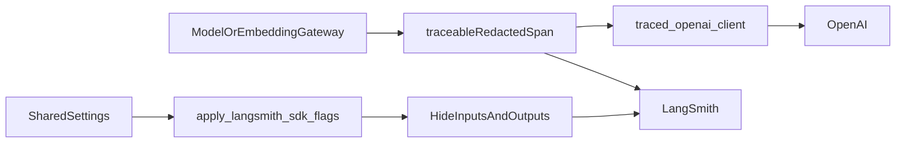
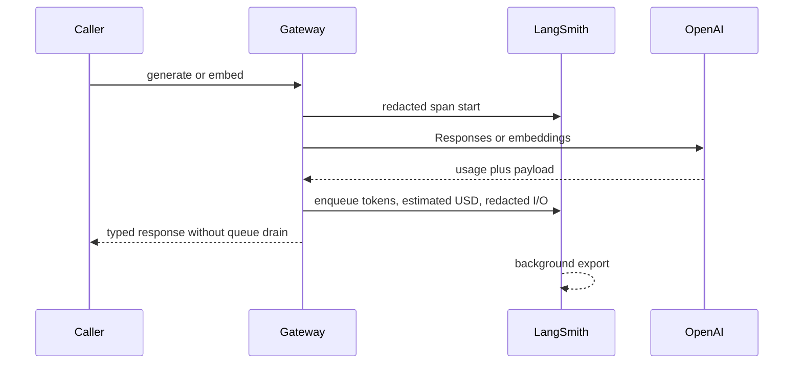
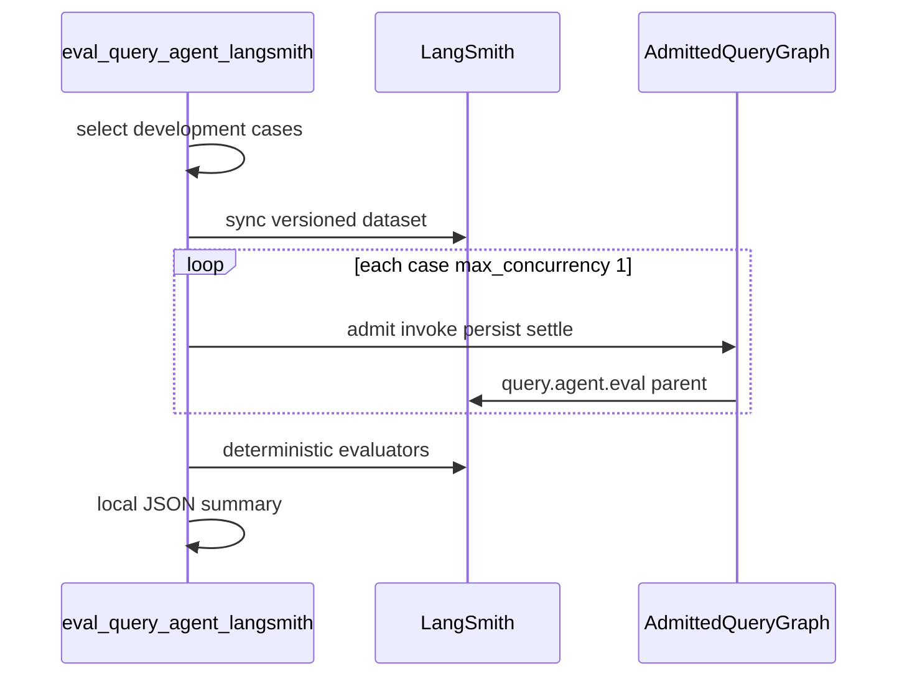
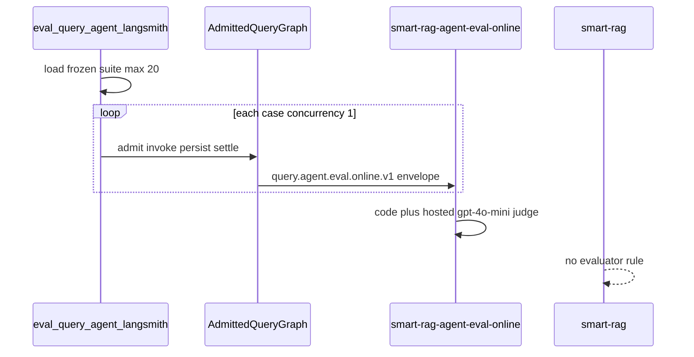

# LangSmith tracing for model and embedding calls

Every application OpenAI call goes through `ModelGateway`, `EmbeddingGateway`,
`traced_embeddings_create`, or `traced_embeddings_create_async`. Those
boundaries emit a LangSmith span when `LANGSMITH_TRACING=true`. Tracing is
**off by default**, including mock-model mode. This is gateway-level tracing,
not the Phase 6 production query-graph feedback loop.

Related: [CONFIGURATION.md](./CONFIGURATION.md) ·
[LANGGRAPH_STUDIO.md](./LANGGRAPH_STUDIO.md) ·
[demo-local-ingest-aws-ask.md](../runbooks/demo-local-ingest-aws-ask.md) ·
[SUBPROCESSOR_GOVERNANCE.md](../security/SUBPROCESSOR_GOVERNANCE.md) ·
[OPENAI_DATA_GOVERNANCE.md](../security/OPENAI_DATA_GOVERNANCE.md) ·
[docs index](../README.md)

## Data that is exported

Exported fields are limited to:

- Stable run names (`model.generate`, `model.query_profile`, `model.rerank`,
  `embedding.embed`, `openai.responses.rerank`,
  `openai.responses.query_profile`, `openai.responses.general_chat`,
  `openai.embeddings`)
- Operation, model id, prompt version, prompt SHA-256, candidate/excerpt
  counts, character counts
- SHA-256 prefixes of query/prompt/excerpt/input text (16 hex chars),
  including profile `user_query` and `recent_memory` hashes
- Token usage, provider request id, mode, ranking count
- LightRAG extract `input_tokens`, `cached_input_tokens`, `output_tokens`,
  `total_tokens`, and `estimated_cost_usd`. The estimate uses the pinned
  standard API list price and is not a replacement for the OpenAI invoice.
- Live `openai.embeddings` and model-gateway spans attach LangSmith-recognized
  `usage_metadata` with input/output/total tokens and the pinned estimated
  USD cost. Usage metadata remains visible and aggregatable while raw span
  I/O stays hidden unless local I/O export is on.
- `query.run.sse` parents are LLM runs (`ls_provider=openai`,
  `ls_model_name=gpt-4o-mini`) so LangSmith Usage/Cost can render. They
  attach `usage_metadata` (`input_tokens`, `output_tokens`, `total_tokens`,
  `input_cost`, `output_cost`, `total_cost`) for the whole Ask turn. With
  local I/O export the Output panel is `{text, input_tokens, output_tokens,
  total_tokens, estimated_cost_usd}` rather than a bare assistant string.
- Correlation ids (`request_id`, `run_id`, `job_id`) when bound
- Embedding `timeout_seconds` (numeric bound only; never input text)
- Ingest parent names (`ingestion.scan`, `ingestion.parse`,
  `ingestion.index`, `ingestion.graph`) with hashed document/version ids

Never exported by default: raw prompts, user queries, canonical excerpts,
embedding vectors, API keys, JWTs, emails, signed URLs, file bytes, or plot
text.

`LANGSMITH_HIDE_INPUTS` and `LANGSMITH_HIDE_OUTPUTS` are forced `true` at
startup so `wrap_openai` child spans cannot send Responses `input` /
`instructions` bodies. Application `process_inputs` / `process_outputs`
hooks are the first control; hide flags are the second.

Local debug exception: `LANGSMITH_EXPORT_IO=true` with `APP_ENV=local` and
`LANGSMITH_TRACING=true` clears the hide flags and attaches prompt /
completion text on gateway spans plus the user message (`input`) and
assistant reply (`output`) on the `query.run.sse` parent. Staging and
production reject the flag. API keys, JWTs, and embedding vectors stay
omitted. This is not org-matrix verification. See
[ADR-local-langsmith-export-io.md](../adr/ADR-local-langsmith-export-io.md).

## Query-run SSE parent and `GeneratorExit`

Successful FastAPI chats wrap executor consumption in a redacted LLM
parent named `query.run.sse`. Exported fields are correlation IDs, hashed
user/conversation IDs, routes, token counts, estimated USD, and hashes.
Raw query, answer, passages, JWTs, and emails stay out unless local
`LANGSMITH_EXPORT_IO=true`, which attaches the user message as `input`
and the assistant reply plus usage as `output`.

Request, graph-node, and gateway paths never call `Client.flush()`.
LangSmith's process background queue exports completed spans independently
of answer delivery. The backend calls the process-cached client's
`flush(timeout=2.0)` only during application shutdown; a tracing outage
there is logged and never raised.

`assert_langsmith_export_permitted` with `ContentClass.REAL_COMPANY`
must pass before company-document content can be traced. A denied gate
is a hard stop, not a silent untraced success.

Ask Run Details **This run** is the LangGraph SSE `usage` total for the
current question (profile, Hybrid embed/rerank, LightRAG query callbacks,
answer, verifier). Compare that number to the LangSmith **query.run.sse**
parent or the sum of those child spans. **This chat** is that total plus
earlier questions in the live Ask session and the conversation-title
OpenAI call after the first completed or partial turn.

Interpret stream close this way:

| Signal | Meaning |
| --- | --- |
| Natural `astream` exhaustion plus catalog terminal | Success. Do not treat later generator teardown as an error. |
| Client cancel / `CancelledError` after drain | Expected cancellation. Persist `cancelled`. |
| `GeneratorExit` on a completed run that already emitted a success terminal | Lifecycle artifact from closing the iterator. P06-11 drains first and does not convert this into `error`. |
| `GeneratorExit` or exception before a catalog terminal | Real failure. Persist sanitized `error`. Never hide it. |

Live LangSmith UI inspection that completed runs no longer surface
`GeneratorExit` as intended success remains **blocked** until
`LANGSMITH_TRACING=true` is used with a real key. Unit/contract proof
lives in `tests/unit/test_query_run_sse_trace.py` and
`tests/unit/test_query_sse_verified_final.py`.

## Runtime flow





## Enablement

1. Set `LANGSMITH_TRACING=true` and `LANGSMITH_API_KEY` in the ignored env
   file. Startup fails if tracing is true without a key.
2. Optional: `LANGSMITH_PROJECT` (default `smart-rag`) and
   `LANGSMITH_ENDPOINT` for a non-default API URL. Open the LangSmith UI
   on that exact project name. Local compose uses `.env.compose`; a host
   leftover `LANGSMITH_TRACING=false` from pytest no longer overrides it.
   To see the user message, assistant reply, prompt, and completion text on
   the laptop only, also set `LANGSMITH_EXPORT_IO=true` and restart
   API/worker. A new Ask run is required; old traces stay redacted. Token
   counts and estimated USD appear in LangSmith Usage/Cost on
   `query.run.sse` (LLM run) and on gateway spans even when the I/O flag
   stays false.
3. Startup also writes `LANGCHAIN_TRACING_V2` and `LANGCHAIN_PROJECT` so
   LangGraph node runs export to the same project. Gateway and SSE threads
   never synchronously drain traces. The long-lived SDK background queue
   exports them, and backend shutdown receives one bounded two-second drain.
   A 120-second greeting stall after model return is a run-row lock between
   uncommitted `llm_usage` and heartbeat `append_run_event`, not a
   LangSmith node-end HTTP flush. See [SSE.md](../api/SSE.md).
4. Local default is still `MOCK_MODEL_MODE=true` (zero OpenAI cost). The
   operator may set `MOCK_MODEL_MODE=false` in gitignored `.env` and
   `.env.compose` to use a live OpenAI key **without org-matrix verification**.
   That is a local unsigned waiver (`APP_ENV=local` only). Local Compose
   loads those flags from `.env.compose` rather than host interpolation.
5. Org rows in
   [SUBPROCESSOR_GOVERNANCE.md](../security/SUBPROCESSOR_GOVERNANCE.md) and
   [OPENAI_DATA_GOVERNANCE.md](../security/OPENAI_DATA_GOVERNANCE.md) stay
   prohibited for staging/production until a console/DPA review. On
   2026-09-09 the product owner named this Cursor session as approver for
   **laptop ingest of one private PDF**, accepting public OpenAI no-training
   defaults, residual 30-day abuse monitoring, ZDR off, and LangSmith traces
   with `LANGSMITH_EXPORT_IO=false`. Ignored local env may then set
   `SMART_RAG_SUBPROCESSOR_MATRIX_VERIFIED=true`. That flag must not be used
   to claim ZDR or to authorize staging/production.
6. Laptop **ingest** demo (Phase A): set `LANGSMITH_TRACING=true` on the
   **worker** (not the EC2 API). After a plot-slice upload, open project
   `LANGSMITH_PROJECT` and filter `ingestion.index` / `embedding.embed`.
   The 200-line graph file must also show `ingestion.graph` and
   `model.lightrag_llm`. After a canonical-passage Graph-200 rebuild, run
   `uv run python scripts/ops/report_demo_langsmith_usage.py` (or use the
   totals printed by `rebuild_demo_graph_canonical_passages.py`). The
   2026-08-20 bounded attempt recorded one `ingestion.graph` trace
   (179,216 tokens, estimated USD 0.04261959) with 40 successful
   `model.lightrag_llm` spans; Graph Ready did not flip
   (`vendor_status_failed`). Procedure:
   [demo-local-ingest-aws-ask.md](../runbooks/demo-local-ingest-aws-ask.md).

## Failure modes

| Condition | Behavior |
| --- | --- |
| Tracing off (default) | No LangSmith export. Model calls still go through the gateway. |
| Tracing on, missing key | Settings validation fails at process start. |
| LangSmith unreachable | SDK records a local tracing error; the OpenAI call is not retried or delayed for tracing. Shutdown waits at most two seconds. |
| Trace output is a raw tuple | The redactor accepts the pinned adapter tuple directly, exports only request/usage/key metadata, and lets the span close. |
| `wrap_openai` child span | I/O hidden by forced env flags; parent span has hashes/counts only. |
| Local `LANGSMITH_EXPORT_IO=true` | Hide flags off; gateway spans include prompt/completion text and `query.run.sse` includes user message / assistant reply. Staging/production fail startup. |
| Direct `OpenAI()` in packages/apps/scripts | Unit AST test fails. Use `traced_openai_client`. |

`block_openai_network` still denies only `api.openai.com`. It does not block
`api.smith.langchain.com`.

## Bounded query-agent evaluation

`scripts/eval_query_agent_langsmith.py` syncs a versioned **development-only**
LangSmith dataset and runs `Client.evaluate` against the admitted production
query graph in-process. It is an evaluation tool. It does not retune Hybrid,
open holdout, or claim Combined +10pp.

Parent run name: `query.agent.eval`. Exported fields are case id, hashed
user/conversation ids, routes, versions, counts, latency, and cost.
Never exported: raw query, answer, passages, prompts, email, JWT, DSN, or
keys. Dataset example `outputs` may retain synthetic query/answer because
`redaction_class=synthetic`.



Hard bounds: development split only, `HoldoutAccess.denied()`, ≤20 cases,
`max_concurrency=1`, one repetition, max USD 2.00, at most one judge call
per case, mock default. Different `--limit` values produce different
dataset names (selected-set manifest hash). Remote metadata drift fails
closed.

```powershell
uv run python scripts/eval_query_agent_langsmith.py --dry-run --limit 3
uv run python -m pytest tests/unit/test_agent_eval.py tests/unit/test_langsmith_agent_runner.py tests/unit/test_query_agent_eval_trace.py -q
```

Live mock/live-agent runs need `LANGSMITH_TRACING=true`, a key, a project,
local Supabase, an active synthetic member, and ingested synthetic corpus.
`--llm-judge` requires `--live-agent`. ParadeDB absence fails unless
`--allow-bm25-degraded`.

## Private company-Ask dual-metric experiments

To score a `.private-eval` gold suite in the LangSmith **Datasets /
Experiments** UI (not only local JSON), use
[COMPANY_ASK_LANGSMITH.md](../evaluation/COMPANY_ASK_LANGSMITH.md). Default
project: `smart-rag-company-ask-eval`. Requires `APP_ENV=local` and
`--upload-private-content`. This is separate from redacted Ask traces in
`smart-rag-demo-3` and from hosted online evaluators below.

## Dedicated online workspace evaluators

Hosted evaluators attach only to tracing project
`smart-rag-agent-eval-online` (Tracing → project → Evaluators). They do
**not** attach to the normal `smart-rag` project or to any dataset.

| Resource | Stable name |
| --- | --- |
| Tracing project | `smart-rag-agent-eval-online` |
| Code evaluator | `smart-rag-agent-online-hard-metrics-v1` |
| LLM evaluator | `smart-rag-agent-online-judge-v1` |
| Prompt handle | `smart-rag-eval-judge-v1` |
| Prompt tag | `agent-online-eval-v1` |
| Root run | `query.agent.eval.online.v1` |
| Envelope schema | `agent-online-eval-v1` |

The dedicated root may export a Pydantic-validated synthetic envelope:
`case_id`, question, language, query class, bounded answer, routes,
citation ids, at most 12 evidence excerpts (≤600 chars), remaining
counters, and the frozen reference. Normal `query.agent.eval` and
`query.run.sse` parents stay redacted. JWTs, API keys, DSNs, emails,
signed URLs, file bytes, BM25 snippets, graph prose, and real-company
content are rejected before export.

Rule contract: `sampling_rate=1.0`, filter
`eq(name, "query.agent.eval.online.v1")` so child spans are not scored,
no backfill, weekly USD 2.00 spend cap on the hosted judge. The local
`--llm-judge` flag is forbidden on `--online-only`; the hosted judge is
the sole judge for this path.



```powershell
uv run python scripts/eval_query_agent_langsmith.py --online-only --dry-run
.\scripts\langsmith\setup_online_agent_evaluators.ps1 -ModelConfigurationId <existing-gpt-4o-mini-id>
uv run python scripts/eval_query_agent_langsmith.py --online-only --allow-bm25-degraded
uv run python scripts/langsmith/verify_online_agent_feedback.py --expected-roots 20 --timeout-seconds 600
```

Dry-run validates the frozen suite, dedicated project name, envelope
schema, holdout denial, and USD 2 cap with zero LangSmith, database,
agent, or provider writes. Live online emission requires `APP_ENV=local`,
`LANGSMITH_TRACING=true`, a real key/profile, the synthetic fixture
corpus plus mapped sidecar, an authorized fixture user, and ParadeDB
unless `--allow-bm25-degraded`.

Rollback: disable or delete only the two dedicated-project rules, then
delete the two evaluator resources if no other rule references them.
Never delete `smart-rag` traces/projects or shared prompts without an
explicit reference check.

Measured live setup IDs, prompt commit, model-configuration id, emitted
trace count, feedback completion, and evaluator spend are recorded in
[phase-06-agent-intelligence-evidence.md](./phase-06-agent-intelligence-evidence.md)
when a workspace run completes. Creation of evaluators alone is not
success.

2026-08-26: both evaluators are attached only to
`smart-rag-agent-eval-online` (`0be241df-90e1-4f96-bfa0-2be48b38ac9b`).
They will **not** appear on `smart-rag-demo-3`. Open **Tracing →
smart-rag-agent-eval-online → Evaluators**.

| Resource | ID |
| --- | --- |
| Code evaluator `smart-rag-agent-online-hard-metrics-v1` | `f726fe1c-14e8-40ee-bb4f-1be6d2f3e73b` |
| LLM evaluator `smart-rag-agent-online-judge-v1` | `eae1c165-f195-4dd4-abbb-5fa9d65d7b16` |
| Code rule | `615e3385-a3a8-41f3-89b6-ef008be64587` |
| LLM rule | `4e579da2-0155-46c0-bfa1-99b06b9aafe0` |
| Model configuration `smart-rag-eval-gpt-4o-mini` | `279906e1-2c03-4080-8511-aa194c663073` |

The model configuration references the existing workspace secret name
`OPENAI_API_KEY`. No provider key was uploaded. The org cannot enforce
the weekly USD 2 spend cap (`spend_limit` 422). Filter stays
`eq(name, "query.agent.eval.online.v1")`. Live trace emission remains
unverified.

## Verification

```powershell
uv run pytest tests/unit/test_langsmith_tracing.py tests/unit/test_query_graph_runtime.py tests/unit/test_query_run_sse_trace.py tests/unit/test_async_bridge.py tests/unit/test_langsmith_query_trace.py tests/unit/test_ingest_trace.py tests/unit/test_query_sse_verified_final.py tests/unit/test_query_sse_lifecycle.py tests/unit/test_query_agent_eval_trace.py tests/unit/test_openai_rerank.py tests/unit/test_openai_lightrag.py tests/unit/test_model_gateway.py tests/unit/test_settings.py -q
uv run ruff check packages/core/src/smart_rag_core/observability packages/core/src/smart_rag_core/runtime/async_bridge.py packages/core/src/smart_rag_core/gateways/openai_rerank.py packages/core/src/smart_rag_core/gateways/openai_lightrag.py packages/core/src/smart_rag_core/gateways/model.py packages/core/src/smart_rag_core/gateways/embedding.py packages/core/src/smart_rag_core/settings/base.py apps/agents/src/smart_rag_agents/query/gateway apps/backend/src/smart_rag_api/main.py apps/backend/src/smart_rag_api/services/sse_stream.py tests/unit/test_langsmith_tracing.py tests/unit/test_langsmith_query_trace.py tests/unit/test_ingest_trace.py tests/unit/test_query_run_sse_trace.py tests/unit/test_query_sse_verified_final.py tests/unit/test_openai_lightrag.py tests/unit/test_async_bridge.py
```

Live LangSmith project visibility is **unverified** until
`LANGSMITH_TRACING=true` is used with a real key.

## Rollback

Set `LANGSMITH_TRACING=false` (the default) and restart API/worker. No
database migration is involved.
