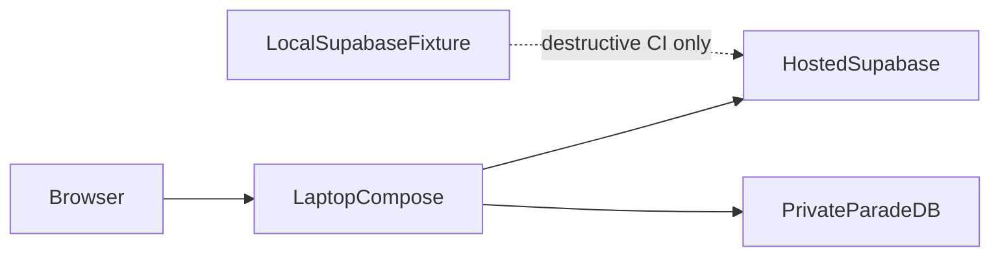

# Local setup

Daily laptop runtime uses hosted Supabase plus Compose sidecars. See
[ADR-hosted-runtime-local-test-fixture.md](../adr/ADR-hosted-runtime-local-test-fixture.md).

1. Install Docker Desktop (WSL2), uv, Node 20+, and pnpm 9.15+.
2. Run `uv sync --all-packages --group dev --python 3.11 --frozen`.
3. Run `pnpm install --frozen-lockfile`.
4. Put hosted session/transaction URLs in ignored `.env`, then run
   `uv run python scripts/ops/wire_hosted_ingest_env.py`. That writes
   `SUPABASE_URL`, `API_SUPABASE_DB_URL`, `WORKER_SUPABASE_DB_URL`,
   `LANGGRAPH_CHECKPOINT_URL`, and `LIGHTRAG_DB_URL` into `.env.compose`
   without printing secrets. Also set `NEXT_PUBLIC_SUPABASE_URL` and
   `NEXT_PUBLIC_SUPABASE_ANON_KEY` before building the frontend image.
5. Run `.\scripts\dev.ps1`. It starts Compose sidecars only and fails
   closed if hosted names are missing. Then run `.\scripts\verify-local.ps1`.
   Do not leave the local fixture `SUPABASE_URL=http://127.0.0.1:54321` in
   `.env` while Compose is running. That value wins interpolation over
   `.env.compose`, so Ask returns 401 `unauthorized` after a hosted sign-in.
   If Ask says `query_ready` is false while Valkey is healthy, a single
   limits timeout latched `rate_limit_degraded`. Restart the API to clear
   it immediately. After this change, `/health/ready` clears the latch
   when both Valkey probes are `ok`.
6. Destructive RLS/schema suites are opt-in against an explicit non-hosted
   `SUPABASE_DB_URL`. They refuse `*.supabase.co`.
7. To inspect the query graph in LangGraph Studio (unbound, no FastAPI
   admit), run `.\scripts\langgraph-studio.ps1` and open the printed Studio
   URL. Select `query_studio`. See [LANGGRAPH_STUDIO.md](./LANGGRAPH_STUDIO.md).

`dev.ps1` fails closed without hosted `.env.compose`. `stop.ps1` stops
Compose only.

See [CONFIGURATION.md](./CONFIGURATION.md), [TOOL_VERSIONS.md](./TOOL_VERSIONS.md),
[LANGGRAPH_STUDIO.md](./LANGGRAPH_STUDIO.md),
[demo-local-ingest-aws-ask.md](../runbooks/demo-local-ingest-aws-ask.md)
(hosted-Supabase laptop ingest uses [`.env.hosted-ingest.example`](../../.env.hosted-ingest.example)),
[docs index](../README.md).
