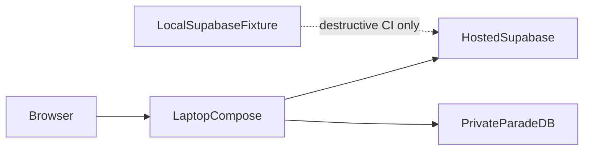

# Local setup

Daily laptop runtime uses hosted Supabase plus Compose sidecars. Local
Docker Supabase is a destructive-test fixture only. See
[ADR-hosted-runtime-local-test-fixture.md](../adr/ADR-hosted-runtime-local-test-fixture.md).

1. Install Docker Desktop (WSL2), uv, Node 20+, and pnpm 9.15+.
2. Run `uv sync --all-packages --group dev --python 3.11 --frozen`.
3. Run `pnpm install --frozen-lockfile`; this installs the workspace-pinned Supabase CLI for fixture/CI use.
4. Put hosted session/transaction URLs in ignored `.env`, then run
   `uv run python scripts/ops/wire_hosted_ingest_env.py`. That writes
   `SUPABASE_URL`, `API_SUPABASE_DB_URL`, `WORKER_SUPABASE_DB_URL`,
   `LANGGRAPH_CHECKPOINT_URL`, and `LIGHTRAG_DB_URL` into `.env.compose`
   without printing secrets. Also set `NEXT_PUBLIC_SUPABASE_URL` and
   `NEXT_PUBLIC_SUPABASE_ANON_KEY` before building the frontend image.
5. Run `.\scripts\dev.ps1`. It starts Compose sidecars only and fails
   closed if hosted names are missing. Then run `.\scripts\verify-local.ps1`.
6. For destructive reset/RLS/schema gates, start the fixture with
   `.\scripts\ci\start_local_supabase_fixture.ps1`. Those suites refuse
   `*.supabase.co`.
7. For the Phase 9 local release candidate, freeze, build, and seed with
   `uv run python scripts/phase09_candidate.py all`. Candidate identity is
   `docker-compose.yml` only; do not use `docker-compose.packet8.yml` for
   that proof. See [LOCAL_RELEASE_CANDIDATE.md](../deployment/LOCAL_RELEASE_CANDIDATE.md).
8. To inspect the query graph in LangGraph Studio (unbound, no FastAPI
   admit), run `.\scripts\langgraph-studio.ps1` and open the printed Studio
   URL. Select `query_studio`. See [LANGGRAPH_STUDIO.md](./LANGGRAPH_STUDIO.md).

`dev.ps1` fails closed without hosted `.env.compose`. `stop.ps1` stops
Compose only. `reset.ps1 -ConfirmReset` remains the explicit destructive
fixture route.

See [CONFIGURATION.md](./CONFIGURATION.md), [TOOL_VERSIONS.md](./TOOL_VERSIONS.md),
[LANGGRAPH_STUDIO.md](./LANGGRAPH_STUDIO.md),
[demo-local-ingest-aws-ask.md](../runbooks/demo-local-ingest-aws-ask.md)
(hosted-Supabase laptop ingest uses [`.env.hosted-ingest.example`](../../.env.hosted-ingest.example)),
[docs index](../README.md).
