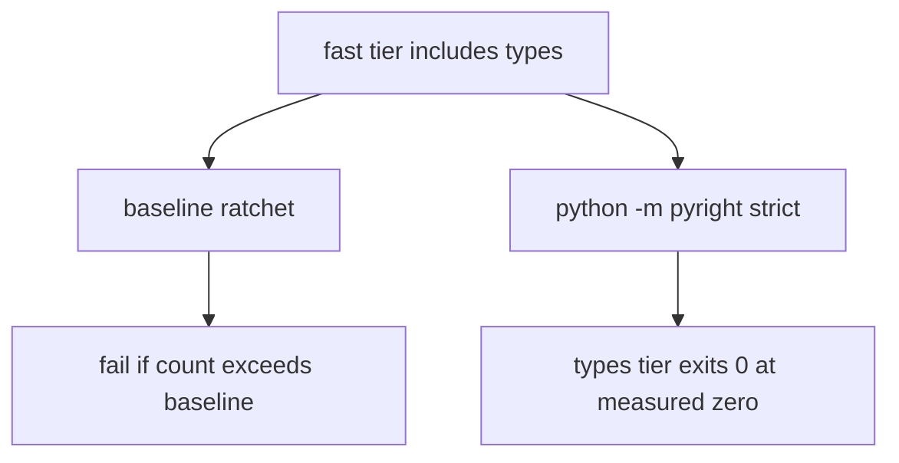

# Pyright types-tier baseline

Measured full-repo strict Pyright budget for review finding P1-7. This
snapshot is **0** errors. The types tier must stay a real
`python -m pyright` invocation inside `FAST_TIERS`. Recovery is complete
only at this measured zero; it is not a waiver, `|| true`, or an exclude of
`tests`.

Commands, include paths, and the hard-fail runner: [QUALITY_COMMANDS.md](./QUALITY_COMMANDS.md).
CI membership: [CI_TIERS.md](./CI_TIERS.md). Machine-readable copy:
[pyright_baseline.json](../../scripts/ci/pyright_baseline.json).



## Policy

- Do not remove `types` from `FAST_TIERS`.
- Do not add `|| true`, disable strict mode, or exclude `tests` to pass.
  Phase 1 included `tests` in `[tool.pyright]`; that remains required.
- Do not raise `error_count` in the JSON to hide new errors. The recorded
  count is **0**; any new diagnostic is a ratchet and types-tier failure.
- Prefer precise annotations over `# type: ignore`. Ignore comments are not
  a cleanup strategy.
- No dated waiver exists as of this writing. Remote GitHub Actions
  conclusion for the types tier is **unverified** here.

## Measured snapshot (2026-08-16)

| Field | Value |
| --- | --- |
| Command | `uv run pyright --outputjson` |
| Pyright | 1.1.411 (`typeCheckingMode = "strict"`, Python 3.11) |
| Host | local Windows workspace; not GitHub Actions |
| Exit code | 0 |
| Files analyzed | 417 |
| Errors | **0** |
| Warnings | 0 |
| Files with at least one error | 0 |

An earlier same-day freeze recorded **882** errors / 414 files while
recovery was incomplete. This re-measure is **0** errors / 417 files.
`generalDiagnostics` was empty. Do not treat 882 as the current budget.

### Errors by tree

Trees match `[tool.pyright].include` in `pyproject.toml`. Zero means the
tree is in scope and produced no diagnostics in this run.

| Tree | Errors | Files with errors |
| --- | --- | --- |
| `apps/agents/src` | 0 | 0 |
| `apps/backend/src` | 0 | 0 |
| `apps/worker/src` | 0 | 0 |
| `infra/crawl-proxy` | 0 | 0 |
| `packages/core/src` | 0 | 0 |
| `scripts` | 0 | 0 |
| `tests` | 0 | 0 |
| **Total** | **0** | **0** |

### Dominant rules

None. This snapshot has zero diagnostics.

### Hottest files (this snapshot)

None. This snapshot has zero diagnostics.

### Leftover diagnostics

None. Do not invent a zero: `summary.errorCount` was 0 and
`generalDiagnostics` was `[]`.

## Ratchet

`scripts/ci/check_pyright_baseline.py` invokes `python -m pyright --outputjson`
(or reads `--report-path`) and **fails if the error count increases** above
`scripts/ci/pyright_baseline.json`. The types tier still runs
`python -m pyright` afterward. With `error_count` at 0, both commands are
expected to exit 0.

When the count rises, do not raise the baseline. Fix the new diagnostics.
When it is 0, keep the direct Pyright invocation and keep `types` in
`FAST_TIERS`.

## Verification

```powershell
uv run python scripts/ci/check_pyright_baseline.py
uv run python scripts/check.py --tier types
uv run pyright --outputjson
```

Expected at this snapshot: ratchet exit `0` at 0 errors; types tier exit
`0` from both the ratchet and `python -m pyright`. A non-zero count must
fail both the ratchet (if above this baseline) and the direct Pyright run.

Review finding P1-7 close-out:
[2026-08-16-phases-01-05-closeout.md](../reviews/2026-08-16-phases-01-05-closeout.md).

[docs index](../README.md)
