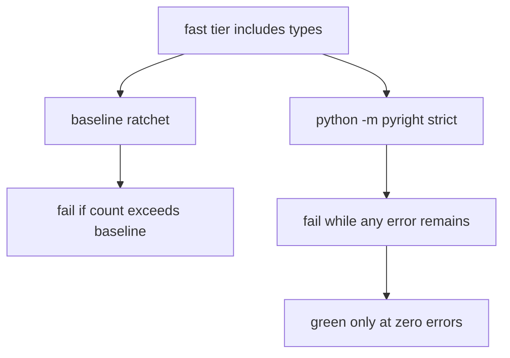

# Pyright types-tier baseline

Honest budget for review finding P1-7. Phase 1 closed `uv run pyright` at
**0** errors. This snapshot re-measured full-repo strict Pyright on
2026-08-16. The types tier must stay a real `python -m pyright` invocation
and must **fail** until the error count is driven to zero or a separately
dated waiver exists. Packet-scoped “zero new errors on files I touched” is
not a substitute.

Commands, include paths, and the hard-fail runner: [QUALITY_COMMANDS.md](./QUALITY_COMMANDS.md).
CI membership: [CI_TIERS.md](./CI_TIERS.md). Machine-readable copy:
[pyright_baseline.json](../../scripts/ci/pyright_baseline.json).



## Policy

- Do not remove `types` from `FAST_TIERS`.
- Do not add `|| true`, disable strict mode, or exclude `tests` to pass.
  Phase 1 included `tests` in `[tool.pyright]`; that remains required.
- Do not raise `error_count` in the JSON to hide new errors.
- A count at or below this baseline is **not** a types-tier pass. It only
  means recorded debt did not grow.
- Prefer precise annotations over `# type: ignore`. Ignore comments are not
  a cleanup strategy for this baseline.
- No dated waiver exists as of this writing. Remote GitHub Actions
  conclusion for the types tier is **unverified** here.

## Measured snapshot (2026-08-16)

| Field | Value |
| --- | --- |
| Command | `uv run pyright --outputjson` |
| Pyright | 1.1.411 (`typeCheckingMode = "strict"`, Python 3.11) |
| Host | local Windows workspace; not GitHub Actions |
| Exit code | 1 |
| Files analyzed | 414 |
| Errors | **882** |
| Warnings | 0 |
| Files with at least one error | 76 |

Phase 5 Packet 1 recorded “~612 pre-existing errors.” That figure was **not**
re-run from that commit in this measurement. Do not treat 612 as this snapshot.

The first complete probe in this run was also **882** errors (408 files).
While the baseline was being written, concurrent BM25 reconcile tests appeared
and transient probes read 884, 887, and 890. The freeze re-measure is **882**
errors / 414 files. New files from this packet have 0 Pyright errors. This
packet did not edit BM25 or graph-writer production code.

### Errors by tree

Trees match `[tool.pyright].include` in `pyproject.toml`. Zero means the
tree is in scope and produced no diagnostics in this run.

| Tree | Errors | Files with errors |
| --- | --- | --- |
| `tests` | 488 | 41 |
| `packages/core` | 348 | 27 |
| `apps/agents` | 19 | 5 |
| `apps/worker` | 16 | 2 |
| `infra` | 11 | 1 |
| `apps/backend` | 0 | 0 |
| `scripts` | 0 | 0 |
| **Total** | **882** | **76** |

`tests` split: `tests/unit` 348, `tests/contract` 110, `tests/fixtures` 30.

`packages/core` split (under `smart_rag_core/`): `ingestion` 149,
`retrieval` 116, `jobs` 47, `gateways` 23, `observability` 13.

### Dominant rules

| Rule | Count |
| --- | --- |
| `reportUnknownMemberType` | 200 |
| `reportArgumentType` | 171 |
| `reportUnknownVariableType` | 165 |
| `reportUnknownArgumentType` | 150 |
| `reportUnknownLambdaType` | 52 |
| `reportPrivateUsage` | 28 |
| `reportUnknownParameterType` | 26 |
| `reportGeneralTypeIssues` | 20 |

Most of the mass is untyped third-party / incomplete annotations, not a
handful of syntax errors. An 882-error cleanup in one change would be a
reckless rewrite.

### Hottest files (this snapshot)

| Errors | Path |
| --- | --- |
| 84 | `packages/core/src/smart_rag_core/retrieval/hybrid_run.py` |
| 69 | `tests/unit/test_graph_mapping.py` |
| 50 | `tests/unit/test_parser_adapters.py` |
| 40 | `packages/core/src/smart_rag_core/ingestion/tables/schema.py` |
| 33 | `tests/unit/test_graph_mapping_hybrid.py` |
| 32 | `tests/unit/test_graph_retriever.py` |
| 27 | `tests/fixtures/parser/__init__.py` |
| 25 | `packages/core/src/smart_rag_core/ingestion/tables/parquet_io.py` |
| 25 | `tests/unit/test_graph_inspect_openapi.py` |
| 24 | `tests/unit/test_ingestion_status_openapi.py` |

## Ratchet

`scripts/ci/check_pyright_baseline.py` invokes `python -m pyright --outputjson`
(or reads `--report-path`) and **fails if the error count increases** above
`scripts/ci/pyright_baseline.json`. The types tier still runs
`python -m pyright` afterward. The ratchet never makes a non-zero count
green.

When the count drops, lower `error_count` (and this document) in the same
change. When it reaches 0, set the baseline to 0 and keep the direct
Pyright invocation.

## Verification

```powershell
uv run python scripts/ci/check_pyright_baseline.py
uv run python scripts/check.py --tier types
uv run pyright --outputjson
```

Expected until the debt is paid: ratchet exit `0` when the count is `<= 882`
and did not grow; types tier exit `1` from Pyright while any error remains.

Review finding P1-7 close-out:
[2026-08-16-phases-01-05-closeout.md](../reviews/2026-08-16-phases-01-05-closeout.md).

[docs index](../README.md)
