# Hybrid PDF accuracy remediation

Additive overlay after Phase 3/4 engineering-complete. It does not uncheck
historical packets or open the synthetic holdout. Canonical packet contracts
live in the Phase 3/4 wrappers and in Phase 6 packets P06-10, P06-17,
P06-18, P06-19 through P06-26, and P06-27 through P06-36. This file is the
navigation index, honest baseline freeze, and rollback map.

Related: [ADR-hybrid-long-document-profile.md](../adr/ADR-hybrid-long-document-profile.md) ·
[ADR-detector-finding-reviews.md](../adr/ADR-detector-finding-reviews.md) ·
[ADR-local-pdf-evaluation-workspace.md](../adr/ADR-local-pdf-evaluation-workspace.md) ·
[ADR-hosted-webapp-evaluation-workspace.md](../adr/ADR-hosted-webapp-evaluation-workspace.md) ·
[PDF_EVAL_WORKSPACE.md](../evaluation/PDF_EVAL_WORKSPACE.md) ·
[PHASE4_RANKED_IDS.md](../evaluation/PHASE4_RANKED_IDS.md) ·
[PDF_HYBRID_EVALUATION.md](../evaluation/PDF_HYBRID_EVALUATION.md) ·
[COMPANY_DOCUMENTS_RAG_100.md](../evaluation/COMPANY_DOCUMENTS_RAG_100.md) ·
[DUAL_METRIC_SCORING.md](../evaluation/DUAL_METRIC_SCORING.md) ·
[OPENAI_DATA_GOVERNANCE.md](../security/OPENAI_DATA_GOVERNANCE.md) ·
[SUBPROCESSOR_GOVERNANCE.md](../security/SUBPROCESSOR_GOVERNANCE.md) ·
[docs index](../README.md)

## Scope

Qualify one privately held PDF on the production Hybrid path with Graph off.
The PDF is `real_company`. Never commit the file, extracted text, glossary
values, questions, answers, excerpts, or private labels.

```mermaid
flowchart LR
  governance["Provider and detector governance"] --> chunks["Chunking v2"]
  chunks --> glossary["Reviewed private glossary"]
  glossary --> ingest["Graph-disabled Hybrid ingest"]
  ingest --> labels["Human-sealed PDF labels"]
  labels --> core["Hybrid retrieval corrections"]
  core --> runtime["Production rerank and scope binding"]
  runtime --> tune["Development tune and qualification"]
  tune --> agentEval["Agent answer evaluation"]
  agentEval --> holdout["One immutable holdout run"]
```



## Packet map

| Overlay | Owner | Canonical contract | Operator gate |
| --- | --- | --- | --- |
| Gate 0 baseline | docs/plan | this file + wrappers | none |
| P1 provider matrices | Phase 3 Packet 9 | [03-phase-ingestion.md](../../.cursor/plans/hybrid-graph-rag/03-phase-ingestion.md) | named matrix approval |
| P2 detector findings | Phase 3 Packet 10 | same | none |
| P3 review lifecycle | Phase 3 Packet 11 | same | none |
| P4 worker graph off | Phase 3 Packet 12 | same | none |
| P5 chunking v2 | Phase 3 Packet 13 | same | 90% token-band or recorded parser stop |
| P6 glossary | Phase 4 Packet 10 | [04-phase-hybrid-rag.md](../../.cursor/plans/hybrid-graph-rag/04-phase-hybrid-rag.md) | human import approve |
| P7 one-file ingest | Phase 3 Packet 14 | Phase 3 wrapper | ClamAV/ParadeDB/OpenAI live + P1 |
| P8 private eval seal | Phase 4 Packet 11 | Phase 4 wrapper | human seal |
| P9 long-document profile | Phase 4 Packet 12 | Phase 4 wrapper | none (candidate not runtime-allow-listed) |
| P10 post-selection coverage | Phase 4 Packet 13 | Phase 4 wrapper | none |
| P11 BM25 variants | Phase 4 Packet 14 | Phase 4 wrapper | ParadeDB pin proof |
| P12 dense escalation | Phase 4 Packet 15 | Phase 4 wrapper | pgvector contract |
| P13 production rerank/scope | Phase 6 Packet 10 | [10-knowledge-scope-routing.md](../../.cursor/plans/hybrid-graph-rag/06-phase-agent-intelligence/packets/10-knowledge-scope-routing.md) | P06-09 accepted; overlay P06-19–P06-26 before Packet 10 coding |
| P13b local eval workspace | Phase 6 Packets 19–22 | [19-local-pdf-evaluation-overlay.md](../../.cursor/plans/hybrid-graph-rag/06-phase-agent-intelligence/packets/19-local-pdf-evaluation-overlay.md) | local `APP_ENV` only |
| P13c heading extraction | Phase 6 Packet 23 | [23-pdf-heading-extraction.md](../../.cursor/plans/hybrid-graph-rag/06-phase-agent-intelligence/packets/23-pdf-heading-extraction.md) | new ingest version |
| P13d channel diagnostics | Phase 6 Packet 24 | [24-pdf-eval-channel-diagnostics.md](../../.cursor/plans/hybrid-graph-rag/06-phase-agent-intelligence/packets/24-pdf-eval-channel-diagnostics.md) | human reseal |
| P13e measured retrieval repair | Phase 6 Packet 25 | [25-pdf-eval-retrieval-repair.md](../../.cursor/plans/hybrid-graph-rag/06-phase-agent-intelligence/packets/25-pdf-eval-retrieval-repair.md) | grounded labels |
| P13f cache and Combined/holdout record | Phase 6 Packet 26 | [26-retrieval-cache-and-holdout-gates.md](../../.cursor/plans/hybrid-graph-rag/06-phase-agent-intelligence/packets/26-retrieval-cache-and-holdout-gates.md) | holdout sealed |
| P14 freeze/qualify | Phase 4 Packet 16 | Phase 4 wrapper | live full Hybrid; holdout sealed |
| P15 PDF agent eval | Phase 6 Packet 17 | [17-pdf-agent-evaluation.md](../../.cursor/plans/hybrid-graph-rag/06-phase-agent-intelligence/packets/17-pdf-agent-evaluation.md) | P14 freeze + P1 |
| P16 holdout close | Phase 6 Packet 18 | [18-pdf-holdout-close.md](../../.cursor/plans/hybrid-graph-rag/06-phase-agent-intelligence/packets/18-pdf-holdout-close.md) | named SME open-once |

Phase 6 Packet 9 is accepted (2026-09-10). Overlay P06-19 through P06-26
run before Packet 10 coding. Overlay P13 requirements remain on Packet 10
for production rerank/scope. Do not edit `apps/agents/` in Phase 4 overlay
packets. Do not repurpose `eval_judge_v1.md`.

## Frozen baseline (2026-09-09, pre-change)

No source text is recorded here.

| Item | Value |
| --- | --- |
| PDF bytes SHA-256 | `72cdfc0f74bb1f60e0b61e950da06683e2db0aa04e90a59bdf271fcedfecf1f1` |
| PDF byte length | 12,990,407 |
| Content class | `real_company` (enum; not synthetic) |
| Parser policy | `parser_v1`; PDF `parser_v1_pdf_headings_v2` |
| Chunking policy | `chunking_v1` |
| Tokenizer | `cl100k_base_v1` |
| Dedup policy | `dedup_v1` |
| Embedding model pin | `text-embedding-3-large` / 1024 dims / `contextual_v1` |
| OpenAI SDK pin | `openai==2.26.0` |
| LangGraph pin | `langgraph==1.2.11` |
| LightRAG pin | `lightrag-hku==1.5.6` |
| pgvector pin | `pgvector==0.5.0` |
| Runtime Hybrid profile | `hybrid_default_v1` only |
| Frozen profile digest | `def45b691e64707d07d3c7ea47f45eb1b23b5d2d2546c37a19a514f316c5940c` |
| Default quotas | rerank pool 20; 5/doc pool; document quota 2; section quota 2; evidence 12 / 3500 tokens; MMR λ 0.7 Jaccard |
| Rerank prompt | `rerank_v1` SHA-256 `4767049107cfe6e8591c84d3b1d202393dfd2564383e6c5bfa0bd5fece8f1925` |
| Chat/rerank default model | `gpt-4o-mini` unless env pin overrides |
| Production reranker | **absent**: `ProcessHybridRetriever` constructs `HybridRetriever` without `rerank=` |
| Synthetic ranked-ID | development Recall@10 0.902; qualification 0.868; `rerank_call_count=0` identity ([PHASE4_RANKED_IDS.md](../evaluation/PHASE4_RANKED_IDS.md)) |
| Synthetic holdout | sealed; `holdout_opened=false` |
| Chunk-band counts for this PDF | **not measured** in Gate 0; Phase 3 Packet 13 analyzer owns count-only proof. Do not invent a 200–400 band percentage. |
| Graph for this version | must stay off (`WORKER_GRAPH_ENABLED=false` in Phase 3 Packet 12) |
| Provider matrices | org rows `unverified` as of 2026-08-13/26; live PDF calls remain prohibited until Phase 3 Packet 9 |

Production retrieve path inspected: `build_query_process_bindings` →
`ProcessHybridRetriever.retrieve` → `HybridRetriever(...)` with no
`rerank` argument → identity rerank. `HybridRetriever.retrieve` hard-codes
`want_full_summary = False` and `matched_terms=()`. BM25 jobs call
`query_text=query` only. Dense collect always uses the default HNSW profile.

## Overlay implementation status (2026-09-09)

| Overlay | Code | Operator / live gate |
| --- | --- | --- |
| P1 matrices | fail-closed then named/date overlay approval | **accepted 2026-09-09**; ZDR not claimed |
| P2 findings/reviews | migration + repository + ADR | unit/ACL tests |
| P3 review API | `POST /ingestion/detector-findings/reviews` | member/viewer 404 |
| P4 `WORKER_GRAPH_ENABLED` | default true; false skips LightRAG | unit tests |
| P5 `chunking_v2` | 401–600 splits toward 200–400 | this PDF ordinary 200–400 **0.7734**; parser heading follow-up |
| P6 glossary draft | hash-only CLI plus private import payload | owner/admin import |
| P7 ingest | `scripts/ops/ingest_private_pdf.py` | **live `graph_ineligible` 2026-09-09**; `real_company`; no graph |
| P8 private eval seal | schema + draft/seal CLIs | **locator-bound owner seal 2026-09-09**; grounding 2/24; `holdout_opened=false` |
| P9–P12 Hybrid | profile-driven quotas, post-selection coverage, BM25 key-field version scope, dense v2 | BM25 variants live; dense ANN ~2.5s on hosted 640-row slice |
| P13 production rerank/scope | `ProcessHybridRetriever` binds `rerank_v1`; unfrozen long-doc denied | live eligible rerank 7/24 on this PDF (18 timeout) |
| P14–P16 tune/qualify/holdout | two retrieve repairs; `gates_pass=false`; freeze denied | `holdout_opened=false` |

Successful ingest is not an accuracy pass. No full-Hybrid Recall@10 for this PDF is claimed.

## Operator observability

Host worker: `PYTHONUNBUFFERED=1`, `LANGSMITH_TRACING=true`,
`LANGSMITH_PROJECT=smart-rag-demo-3`, `LANGSMITH_EXPORT_IO=false`.
Visible `[hybrid] job=<uuid> stage=<token>` sequence: `scan` → `parse` →
`chunked` → `embed_batch` → `bm25` → `hybrid_ready`. Detector holds emit
`governance_review_required` without matched values. LangSmith must hide
inputs/outputs. Absence of graph work is correlated to the uploaded
version/job IDs.

## Rejected alternatives

Recorded in [ADR-hybrid-long-document-profile.md](../adr/ADR-hybrid-long-document-profile.md):
global quota enlargement, PDF-title/hash hardcoding, map-reduce/RAPTOR,
local rerankers, unsealed synthetic labels as gold.

## Rollback

| Overlay | Rollback |
| --- | --- |
| Gate 0 | restore wrappers/packets/ADR/index and previous integrity lock |
| P2–P3 | reverse additive migrations; keep historical packets complete |
| P5 | keep `chunking_v1` readable; new ingest uses v2 only after accept |
| P9–P12 | keep `hybrid_default_v1` bytes and `load_frozen_profile` allow-list |
| P13 | omit `rerank=` (identity) until signed |
| P14 | failed hash never edited; new candidate id |
| P16 | opened holdout never reused for tuning |

## Verification

```powershell
python .cursor/plans/hybrid-graph-rag/scripts/verify_plan_integrity.py
uv run python scripts/check.py --tier docs
```

Recorded 2026-09-10 (overlay Packet 16 development no_go after two retrieve repairs; ingest already accepted):

| Command | Exit |
| --- | --- |
| Overlay unit suite (`test_pdf_overlay_governance`, `test_private_pdf_eval`, `test_pdf_hybrid_overlay`, `test_chunking_service`, `test_ingest_trace`, `test_ingestion_status_openapi`, `test_query_profile_gateway`, `test_prompt_registry`, `test_hybrid_run`, `test_hybrid_rerank`, `test_hybrid_coverage`, `test_parser_governance`, `test_settings`, `test_hybrid_fusion`, `test_external_processing_governance`) | 0 |
| Packet-scoped Pyright on touched retrieval/review/eval paths | 0 |
| `uv run python scripts/eval_pdf_hybrid.py --probe-grounding` | 0; 2/24 scored grounded |
| `uv run python scripts/ci/check_openapi.py` | 0 |
| `uv run python scripts/check.py --tier docs --mermaid-puppeteer-config scripts/ci/puppeteer-no-sandbox.json` | 0 |
| PDF eval/draft CLIs without operator gates | 2; `holdout_opened=false` |
