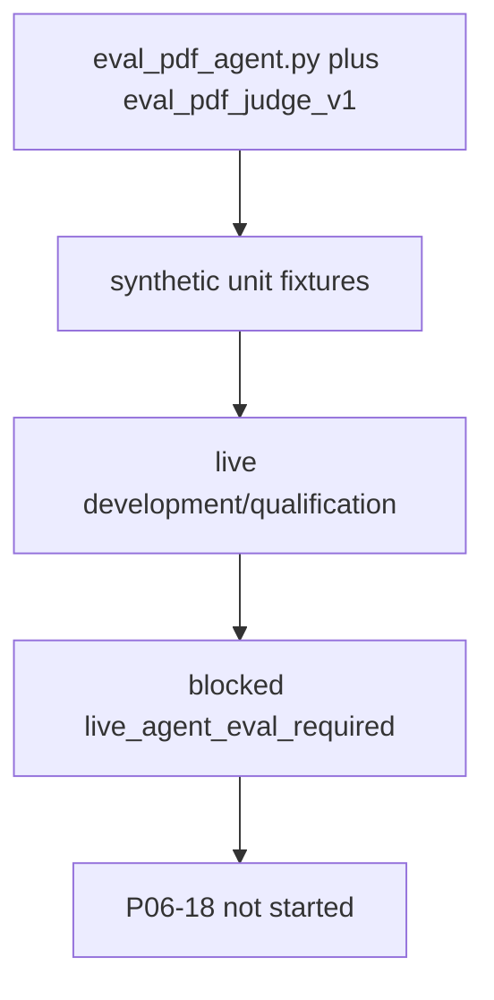

# P06-17 — PDF Hybrid agent evaluation (2026-09-13)

Related: [PDF_HYBRID_EVALUATION.md](../../evaluation/PDF_HYBRID_EVALUATION.md) ·
[overlay-pdf-hybrid-packets.md](./overlay-pdf-hybrid-packets.md) ·
[phase-06 index](../phase-06-agent-intelligence-evidence.md)

Requirement: qualify PDF Hybrid agent answers on development and
qualification without reusing `eval_judge_v1.md`, and without opening
holdout.

## Implementation present

- `scripts/eval_pdf_agent.py` refuses `eval_judge_v1` reuse.
- Prompt `eval_pdf_judge_v1.md` is registered separately.
- Unit fixtures: `tests/unit/test_private_pdf_eval.py`,
  `tests/unit/test_pdf_hybrid_overlay.py`.
- `holdout_opened` stays false on exam/report SQL and HTTP.

## 2026-09-13 commands

| Command | Exit | Notes |
| --- | --- | --- |
| `uv run pytest tests/unit/test_private_pdf_eval.py tests/unit/test_pdf_hybrid_overlay.py -q` | 0 | Deterministic fixtures only |

## Stop route

Live development/qualification numbers are **not** claimed. Overlay
2026-09-10 recorded `eval_pdf_agent.py --split development` exit 2
(`blocked=live_agent_eval_required`) and Hybrid `gates_pass=false`.
This close-out did not open holdout, did not freeze Hybrid pins, and did
not run a live judge against private pages.

Packet 17 remains **pending** until a live development then qualification
run meets signed citation/faithfulness/routing gates with
`holdout_opened=false`.

Handoff: P06-18 must not start. Hosted-eval ADR and user decision keep
holdout closed.
