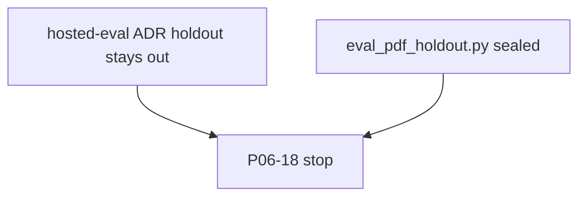

# P06-18 — Private-PDF holdout (blocked 2026-09-13)

Parent index: [phase-06-agent-intelligence-evidence.md](../phase-06-agent-intelligence-evidence.md).

Requirement: execute one immutable private-PDF holdout and close with
redacted evidence.

## Stop

This packet was not executed. User-approved 2026-09-10 hosted evaluation
decisions and
[ADR-hosted-webapp-evaluation-workspace.md](../../adr/ADR-hosted-webapp-evaluation-workspace.md)
keep holdout outside the database, API, UI, logs, reports, and import
paths. Overlay `eval_pdf_holdout.py` remains sealed
(`blocked=holdout_sealed`, `holdout_opened=false`).

Do not mark this packet complete. Do not open holdout to force a close.

Rollback: none. Holdout was never opened.
