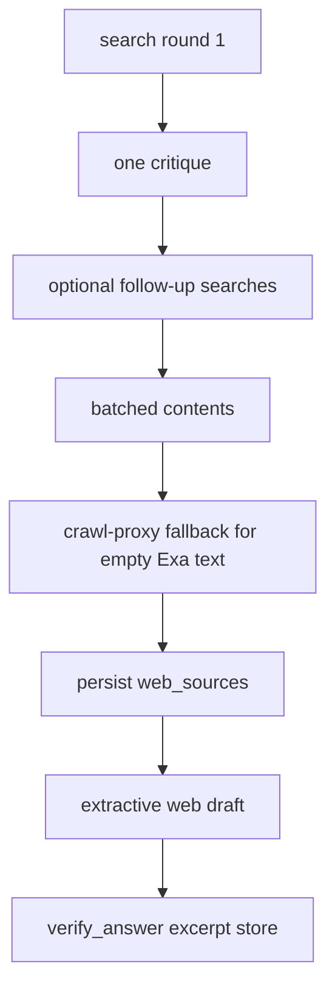

# P06-41 — Bounded iterative Web research graph (2026-09-15)

Parent index: [phase-06-agent-intelligence-evidence.md](../phase-06-agent-intelligence-evidence.md).

## Plan requirement

Quote: implement bounded iterative Web research graph, synthesis,
verification, and fail-closed routes.

Positive checks: two-round happy path persists ≤6 sources and ≤12
citations; third round is never attempted; disabled Web and
quota/auth/timeout map to typed codes; ambiguous operation does not
retry; verifier rejects invented source ids and non-contained spans;
company citation list on a Web answer is empty; cancellation closes the
HTTP client and does not leak the key.

Negative checks: prompt containing a company passage is never sent to
Exa; crawl-proxy is not called for a URL that was not an Exa candidate;
SSE custom payloads omit query, URL bodies, and excerpts.

## Graph

Caps: two rounds, three formulations, twelve candidates per round, six
sources, twelve citations, five external operations, 50s. Synthesis
persists sources first. Company and table citation lists stay empty.
`answer_origin=web`. Citations persist only after verification.

Hold-until-verify: `web_scope` is a draft node. `token_delta` is emitted
only from `verify_answer`. Mapper strips `web_sources`, `excerpt`,
`excerpts`, `body`, and `text`. Custom `node_start` stages are
`web_search` then `web_read`, then existing `verify_answer`. Extra
payload keys drop the custom event.

## Files

- [web_research/](../../../packages/core/src/smart_rag_core/web_research/)
- [web_scope.py](../../../apps/agents/src/smart_rag_agents/query/nodes/web_scope.py)
- [verify.py](../../../apps/agents/src/smart_rag_agents/query/nodes/verify.py)
- [web_critique_v1.md](../../../apps/agents/src/smart_rag_agents/prompts/web_critique_v1.md)
- [web_answer_v1.md](../../../apps/agents/src/smart_rag_agents/prompts/web_answer_v1.md)
- [test_web_research_graph.py](../../../tests/unit/test_web_research_graph.py)
- [QUERY_ROUTING.md](../../agent/QUERY_ROUTING.md)
- [ANSWER_VERIFICATION.md](../../agent/ANSWER_VERIFICATION.md)
- [SSE.md](../../api/SSE.md)

## Verification

| Command | Exit |
| --- | ---: |
| `uv run python -m pytest` P06-41 graph/SSE/prompt/verifier suites | 94 passed |
| `uv run python -m ruff check` on P06-41 Python | 0 |
| `uv run python -m pyright` on P06-41 modules | 0 |

Live Exa, crawl-proxy against public URLs, and hosted persist RPCs are
not exercised in this packet. `tests/contract/test_web_citation_persist.py`
remains the P06-39 SQL contract.

## Proven

- Two-round path caps sources at six and company citations at empty.
- A fourth formulation is never searched.
- Quota, auth, and timeout stay typed `web_search_*` codes.
- Ambiguous `sent` rows fail closed with one `mark_sent` and no Exa call.
- Invented `web_source_id` values and non-contained spans are dropped.
- Disabled/unconfigured Web at the node is `routing_rejected`, not a
  general draft.
- Empty Exa contents without fetch is `web_content_unavailable`.
- Cancel closes the injected client; `repr` omits keys.
- Progress keys are `web_search` / `web_read` only.
- SSE mapper holds `web_scope` drafts and drops excerpt extras.
- Model verifier is skipped on Web; fusion-based link checks cannot
  strip web citations.
- Optional-tool catalog still has no `web_search`.

## Unverified

- Live Exa search/contents against `api.exa.ai`.
- Crawl-proxy fetch of a real candidate URL.
- Hosted `insert_web_source` / `insert_web_citation` from a live graph
  run (`SUPABASE_DB_URL` unset here).
- Mermaid PNG render of the new ANSWER_VERIFICATION Web diagram.

## Rollback

Set `WEB_SEARCH_ENABLED=false`. Do not down-migrate Web tables.

## Handoff

Next packet is P06-42 Ask dropdown UX. Frontend contract:

- Labels: Searching… (`web_search`), Reading… (`web_read`),
  Verifying… (`verify_answer`).
- `answer_origin=web`. Citation preview IDs are `web_source_id` only.
- Company chips stay non-href. Web chips may `href` only after
  `isSafeHttpUrl` with `rel=noreferrer`.
- Unstaged leftover: `apps/frontend/src/lib/types/chat.ts` and
  `apps/frontend/src/lib/api/chat-run.ts`.
