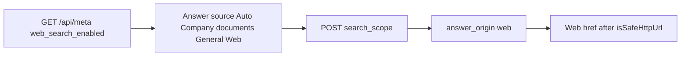

# P06-42 — Four-option Ask dropdown, Web origin, progress, citations (2026-09-15)

Parent index: [phase-06-agent-intelligence-evidence.md](../phase-06-agent-intelligence-evidence.md).

## Plan requirement

Quote: implement the exact four-option dropdown, Web origin/progress/citations,
and resume behavior.

Positive checks: new chat defaults Auto; forced Web send posts
`search_scope=web`; disabled Web is hidden; Web answers show origin and
URL chips; company answers stay non-clickable; resume restores
Auto/company/general/web without mixing.

Negative checks: unsafe or non-http URL is not an href; company
citation never becomes href; Web option hidden when
`web_search_enabled` is false.

## Surfaces

Labels are exactly Auto, Company documents, General, Web. Web is omitted
unless `/api/meta` `web_search_enabled` is true. Hidden chrome is not
authorization; FastAPI still 503s forced Web when disabled. Company
Storage URLs stay non-href. Web chips use `rel=noreferrer`. Progress
copy is Searching… / Reading… / Verifying…. Paced-reveal and
hold-until-verify are unchanged. No frontend Exa key and no client
fetch of result URLs.

## Files

- [chat-stage.tsx](../../../apps/frontend/src/components/chat/chat-stage.tsx)
- [use-chat-scope.ts](../../../apps/frontend/src/components/chat/hooks/use-chat-scope.ts)
- [citation-drawer.ts](../../../apps/frontend/src/lib/citation-drawer.ts)
- [ops.py](../../../apps/backend/src/smart_rag_api/routers/ops.py)
- [CORE_RAG_SURFACES.md](../../frontend/CORE_RAG_SURFACES.md)
- [workspace-screens.md](../../frontend/workspace-screens.md)
- [action-inventory.json](../../frontend/action-inventory.json)

## Verification

| Command | Exit |
| --- | ---: |
| `pnpm exec vitest run` P06-42 Ask/origin/citation/progress suites | 0 |
| `pnpm exec tsc --noEmit` | 0 |
| `pnpm exec eslint` on P06-42 frontend files | 0 |
| `uv run python -m ruff check` on meta/ops tests | 0 |
| `uv run python -m pyright` on meta schema and ops | 0 |
| `uv run python -m pytest` `test_api_meta_and_ready_never_claim_query_ready` | 0 |
| `uv run python scripts/ci/check_openapi.py` | 0 after snapshot |

Live Exa and Playwright against a signed-in member were not run in this
packet. Hosted `/api/meta` still publishes `web_search_enabled=false`.

## Proven

- New chat Answer source value is `auto`.
- Dropdown labels are Auto, Company documents, General; Web appears only
  when meta is true.
- Forced Web POST body includes `"search_scope":"web"`.
- `answer_origin=web` shows origin Web and a `rel=noreferrer` URL chip.
- Company citations with https provenance stay buttons.
- Resume restores `web` when enabled and clamps to Auto when hidden.
- `web_search` no longer maps to Retrieving….
- `/api/meta` publishes `web_search_enabled` and never includes keys.

## Unverified

- Playwright `core-rag-surfaces.spec.ts` against a live member session.
- Hosted Ask with `WEB_SEARCH_ENABLED=true` (rejected in staging/prod).

## Rollback

Leave `WEB_SEARCH_ENABLED` false. The Web option stays hidden.

## Handoff

Next packet is P06-43 integrated gates, then resume P06-17.
